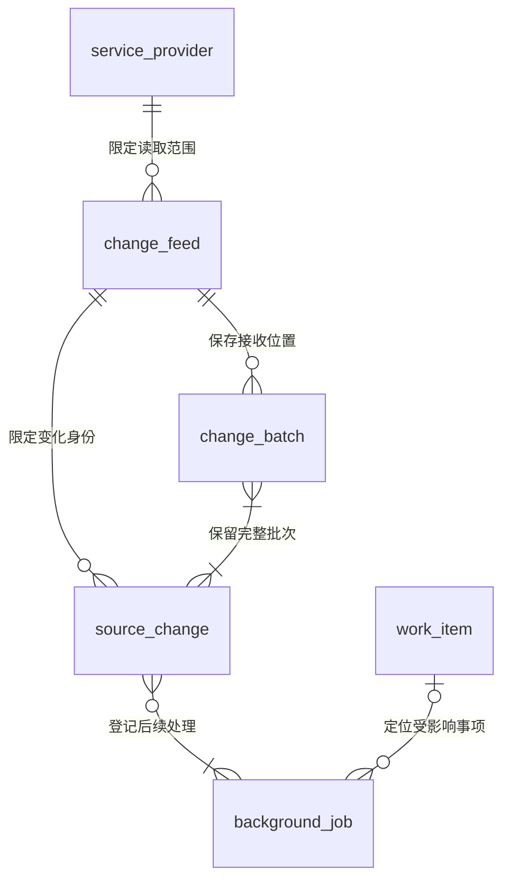
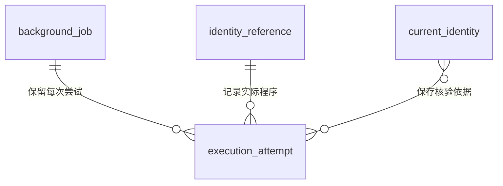
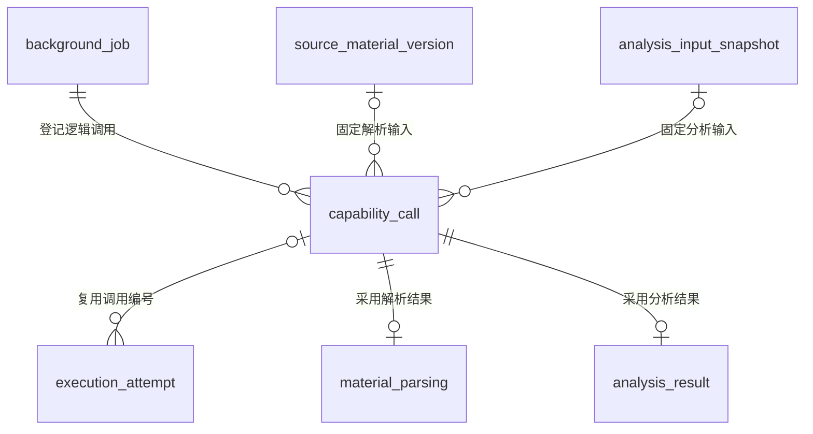
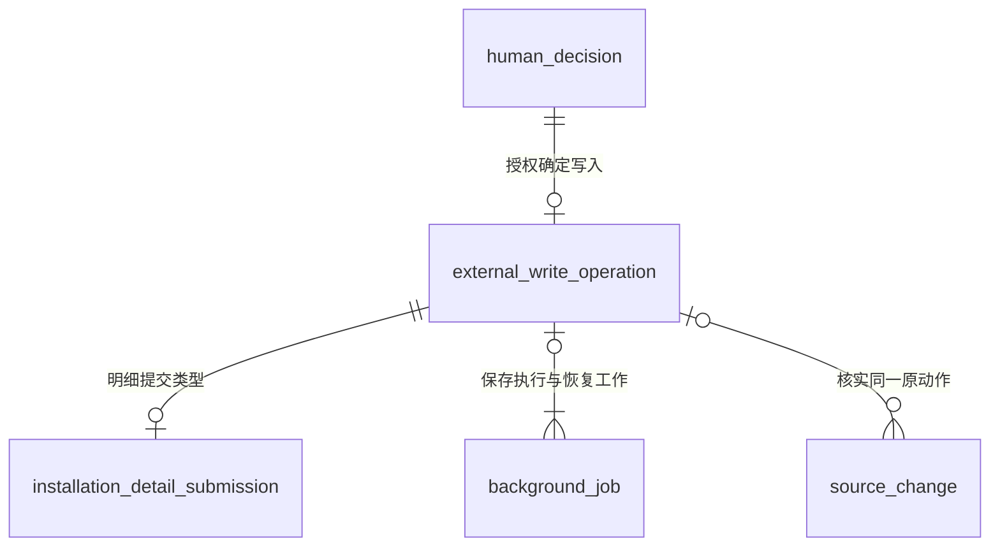

# 原记录变化接收与执行记录关系

> 版本：V1.0｜日期：2026-09-20｜状态：该域及全范围文档核对通过；真实实现待验证
> 图：[变化接收与后台执行](er-change-execution.html)
> 上游（我引用）：[术语表](../03-01-glossary/glossary.md) §1、§5、[原记录变化发现](../03-02-external-apis/source-record-changes-read.md) §1—5、[AI 推理与材料解析](../03-02-external-apis/ai-inference-material-parsing.md) §2—5、[正式安装明细提交](../03-02-external-apis/installation-detail-submit.md) §2—5、[核查决定与补充记录同步](../03-02-external-apis/review-supplement-sync.md) §2—5、[处理事项实体关系](er-work-item.md) §2—4、[材料与分析证据实体关系](er-evidence.md) §2—5、[安装资料实体关系](er-installation.md) §3—4、[身份与事项责任关系](er-identity-responsibility.md) §2—4、[当前身份与业务权限取得](../03-02-external-apis/current-identity-permissions-read.md) §3—5
> 下游（引用我）：[ER 范围与一致性总核对](coverage-review.md) §2—6、[材料与分析证据域表结构](../03-05-schema/evidence-schema.md) §1—7、[安装资料域表结构](../03-05-schema/installation-schema.md) §1—7、[变化接收与执行域表结构](../03-05-schema/execution-schema.md) §1—5

## 1. 范围与实体

变化到达、后台已执行、分析可用、人员已确认、原系统已成功分别保存。人员继续从原事项处理结果，后台接收、重试和回查不产生额外人工确认。逻辑实体不直接对应物理表，本域不选择队列产品或部署方式。

| 实体 | 命名 | 必须区分的内容 |
| --- | --- | --- |
| 服务商 | service_provider | 变化读取的授权业务范围，不据此推定共享原记录的唯一所有者 |
| 变化读取配置 | change_feed | feedId、来源、服务商、范围、取得方式及配置代次；分代保存接收位置和就绪情况 |
| 变化接收批次 | change_batch | 接收配置及代次、原 cursor、nextCursor、完整变化清单和覆盖信息 |
| 原记录变化 | source_change | feedId + changeId 的稳定提示及原始内容；原记录类型、编号、版本和关联完整性 |
| 后台任务 | background_job | 处理目的、目标范围、触发依据、进展与可恢复条件；区别于人员事项 |
| 处理事项 | work_item | 人员要处理的业务问题及责任；后台任务围绕原事项继续 |
| 执行尝试 | execution_attempt | 一次实际执行的起止、程序身份、核验依据、是否已发出调用及结果 |
| 身份引用 | identity_reference | 实际执行程序的稳定身份；原确认人另在人工决定中保存 |
| 当前身份 | current_identity | 此次执行取得的程序授权上下文，以及需要时重新核实的原确认人上下文 |
| 能力调用 | capability_call | runId、固定输入、操作类型、已解析的配置及实现版本；不随重试变化 |
| 原始材料版本 | source_material_version | 材料解析实际使用的确切文件版本及摘要 |
| 分析输入快照 | analysis_input_snapshot | Skill 分析实际使用的固定业务内容与配置版本 |
| 材料解析结果 | material_parsing | 一次解析所采用的输出，保留位置、完整性和缺项 |
| 分析结果 | analysis_result | 一次分析所采用的输出，保留证据与待核实问题；发布前仍检查是否过期 |
| 人工决定 | human_decision | 原人员对确定内容作出的业务确认；不因程序重试另造一次确认 |
| 外部业务写入 | external_write_operation | 一次确认后的稳定写操作、完整内容、目标和原系统结果 |
| 安装明细提交记录 | installation_detail_submission | 外部业务写入中的明细提交类型，沿用 submissionId 和原有资料关系 |

## 2. 变化接收与可恢复任务

| 关系 | 基数及约束 | 变更或恢复 |
| --- | --- | --- |
| 服务商 → 变化读取配置 | 一家服务商可有多个配置；每份配置只对应一家服务商和一份明确来源范围 | 范围或来源变化保留旧代次及位置；服务商改变须登记新配置标识，不能改属旧配置。新代次完成起点与覆盖核实后启用，不把原 cursor 直接搬过去 |
| 变化读取配置 → 变化接收批次 | 配置可有零至多批；每批绑定一个配置及确定代次 | 仅保存已可靠接收的非空批。空批不推进位置；失败请求另记诊断，不伪装已接收批次 |
| 变化读取配置 → 原记录变化 | 每条变化属于一个 feed；feed 内 changeId 唯一，提示内容固定 | 重放命中原变化，同号不同内容停止推进。配置换代不允许改写同一 feedId + changeId 的原内容 |
| 变化接收批次 ↔ 原记录变化 | 每个非空批至少一条变化，每条已接收变化至少属于一批；不同批可重叠包含同一变化 | 批清单保留原顺序和关联，不用重复收到的次数生成多个业务动作；批与变化的 feed 必须一致 |
| 原记录变化 ↔ 后台任务 | 每条已接收变化至少关联一项已持久保存的处理任务；一项任务可由零至多条变化触发 | 关联尚不完整时也有待核实任务；人工确认、失败恢复等任务可无来源变化。合并处理须保留全部触发依据和覆盖范围 |
| 处理事项 → 后台任务 | 一个事项可对应多项后台工作；每项任务关联零或一个事项 | 尚待解析范围的任务可无事项。发现多个受影响事项后分别保存对应任务；独立配置事项允许无安装工单 |

**完整批次、变化去重、后续任务与接收位置在同一事务中保存，按原 cursor 条件推进。** 任一部分失败保持原位置。并发接收只有条件匹配者成功；不同 pageSize 导致的重叠读取按变化身份去重，不能覆盖先前已接收批清单。已确认的位置推进后，下游失败从现有任务恢复。

批记录保留 retrievedAt、sourceCheckedAt、coverageThrough 和 hasMore 的原值。它们不互相替代：空批、hasMore=false 或接收成功均不能证明源系统已经全部同步。适配层的源端取得位置与本系统已接收位置分别记录，不用本地接收时间充当来源覆盖证明。

change_feed 的历史代次保留确切范围和起点；source_change 保留原 feed 范围依据，批次指向其接收时的代次。范围扩大后，即使再次遇到已知原记录，也须核实新增范围的处理覆盖，不能仅凭旧变化已完成就跳过新范围准备。游标失效或发现缺口时暂停正常推进，保留全部现有任务，经补查或完整起点重建后继续。

任务去重依据包括明确的处理目的、来源与业务范围、目标事项或待解析目标、所处理的确定版本；无法确定版本时保留未知，不将两个不明输入视为相同。单纯重复通知不另建人员待办。任务转交为后续工作时，先保存覆盖原范围的后续任务及触发关联，再结束当前阶段；当前阶段完成不等于整条分析链或业务已完成。

来源移除保留旧引用与人员决定，不自动删事项。关联列表为空且完整性未知时继续查关联；共享材料和条款的变化须覆盖所有已授权的受影响范围。仅能扫描到当前状态的来源不承诺捕获所有中间版本。

## 3. 实际执行与当次授权

| 关系 | 基数及约束 | 变更或恢复 |
| --- | --- | --- |
| 后台任务 → 执行尝试 | 每次尝试恰好属于一项任务；任务可未开始或已有多次尝试 | 重试新增尝试记录，保留原错误、调用情况和结果；不把旧失败覆盖为最后一次成功 |
| 身份引用 → 执行尝试 | 每次实际执行保存一个可靠的 SERVICE 程序身份；该程序可执行多次 | 不能把原确认人填成实际程序。无法建立可信执行身份时不放行任务执行，调度失败另留诊断 |
| 当前身份 ↔ 执行尝试 | 一次尝试可有零至多份实际取得的核验上下文，一份上下文可被零至多次尝试引用 | 未取得完整授权可以无上下文并停止调用；执行受保护操作前须取得适用的当前核验依据。保存历史上下文不允许跨请求长期放行 |

尝试与上下文的关联注明用途：执行程序核验，或外部新写出前对原确认人的重新核验，并保存实际匹配的动作与范围。前者须是该次 SERVICE 身份；后者须与原人工决定的 HUMAN 身份一致，不能拿另一名同角色人员的授权替代。

原确认人重新核实依赖提供方受控查询或委托验证能力；能力未确认时不开放相关异步新写入。原确认时的授权证据继续保留，执行时新取得的上下文不回填覆盖原决定。原系统账号映射与源端最终授权仍须成立。

任务领取及当前尝试采用条件保护，避免多个程序同时发布结果。进程失联或占用超时只说明本次执行状态不明，不能证明外部调用未发生；接手者须根据能力调用或业务写入的不同规则恢复。重试次数、等待时间和预算沿用相应接口，不在本域另造一套规则。

## 4. 能力调用、固定输入与结果

| 关系 | 基数及约束 | 变更或恢复 |
| --- | --- | --- |
| 后台任务 → 能力调用 | 每个调用归属一项任务；任务可有零至多个明确编号的调用 | 同一输入、相同配置的恢复复用 runId；确需更换输入或实现时登记新调用，不能覆盖旧调用 |
| 能力调用 → 执行尝试 | 一次调用可未开始或发生多次尝试；尝试关联零或一个能力调用 | 调用尝试与任务归属一致；取数、业务写入等尝试不必有关联的能力调用。一次实际调用尝试只执行一个已固定调用 |
| 原始材料版本 → 能力调用 | 同一材料版本可供多次调用；调用关联零或一个材料版本 | PARSE_MATERIAL 必须恰好一份确切材料版本，分析输入为空 |
| 分析输入快照 → 能力调用 | 同一快照可供多次调用；调用关联零或一份快照 | ANALYZE_SKILL 必须恰好一份快照，解析输入为空；两种输入互斥，不能同时缺失 |
| 能力调用 → 材料解析结果 | 每次调用最多采用一份解析；本图中新产生的解析结果恰好来自一次解析调用 | 解析完整性、失败单元和位置保留。已有解析供其他事项复用时引用原结果，不伪造另一次生成调用 |
| 能力调用 → 分析结果 | 每次调用最多采用一份分析；本图中新产生的分析结果恰好来自一次分析调用 | 结构或引用校验失败不形成可用分析；合法的缺项结果保留 NEEDS_INFORMATION。只返回该操作对应的一类结果 |

分析调用的快照所属事项必须与任务关联事项一致；纯材料解析任务可以尚无人员事项。任务的业务范围、材料授权与输入范围分别核实，不能只检查各编号存在。

runId 固定 operation、profileId、已解析的实现配置、确定输入、Skill 及输出结构版本。材料输入保留确切版本、完整字节与摘要；分析输入保留实际快照，不能用编号指向后来改过的内容。

AI 请求超时不套用业务写入禁止重发的规则。按能力契约限定次数和总预算重试，所有尝试归入原调用；提供方可能再次计费，不宣称外部原生幂等。多个有效响应只采用一份，晚到响应不得反复发布或替换已采用结果；其他尝试结果保留诊断及未采用原因。

调用采用结果与事项发布结果分别记录。已采用结果属于固定输入；更新事项当前结果前，仍核实输入、配置及事项当前版本，旧结果可保留但不得覆盖新输入。发布失败后先恢复本地接续，不为同一已采用结果重跑模型。相同解析内容的复用不扩大材料访问范围。

## 5. 人员确认与外部业务写入

| 关系 | 基数及约束 | 变更或恢复 |
| --- | --- | --- |
| 人工决定 → 外部业务写入 | 每笔本地发起的业务写入恰好关联一次人员确认，一次确认最多一笔稳定写入；本地确认、异常记录等可无外部写入 | 保存目标来源、服务商、工单、事项、完整确认内容和版本条件后才发出调用；重复确认请求复用已登记操作 |
| 外部业务写入 → 安装明细提交记录 | 每份明细提交记录对应一笔外部业务写入；仅明细提交类型恰好有一份，核查及补充同步类型为零份 | 两者描述同一次业务操作，submissionId、内容和状态只有一套权威记录；物理上可合存，不生成两个独立提交编号 |
| 外部业务写入 → 后台任务 | 已登记的写入至少有一项可靠保存的执行或恢复任务；一项任务关联零或一笔确定写入 | 同编号固定内容，写入、只读回查及本地接续分别明确任务目的；无写入的分析或变化解析任务可以不关联 |
| 外部业务写入 → 原记录变化 | 一笔写入可由多条变化提示验证关联；一条提示最多关联一笔已核实的本地写入，也可以没有 | 只有来源动作身份、确切结果及内容证据吻合时才建立关系。仅工单相同、状态相似或通知晚到不构成匹配依据 |

明细提交使用 submissionId；审核通过、退回和补充同步使用 operationId。去重包含来源、服务商、工单、接口类别与稳定编号，并核对事项、人工决定及全部内容。接口类别仅区分明细提交与核查补充同步；APPROVE、REQUEST_SUPPLEMENT、SUBMIT_SUPPLEMENT 共用 operationId 的同一范围，换 action 仍是同号改内容，必须拒绝。新增的统一逻辑实体用于复用恢复要求，不改变现有两份接口契约。

关联写入的任务必须针对同一事项、工单及服务商范围；同一任务的各次尝试不得改挂另一笔操作。

核查与补充同步的请求分支继续保留 action、replyToOperationId、分析和明细版本等原字段；回复关系指向同一事项仍有效的退回动作。正式明细提交分支保持完整草稿版本与项目列表，不能混用。配置启用、费用问答和本地异常关闭不被强行转成安装审核写入。

原系统成功回执保存完整可关联证据、确切记录与版本、verifiedAt 和原内容；它作为该写操作的结果结构，不额外制造一笔业务动作。SUCCEEDED 必须有匹配的权威终态证据，REJECTED 必须能证明没有生效。超时、部分成功或响应丢失保持 PENDING，区分 PROCESSING 与 RESULT_UNKNOWN。

**业务写入可能已发出而结果未知时，只按原编号回查，不换编号重发。** 能证明未发出的受理前失败才可按原编号恢复发出；原系统成功而本地接续失败，只恢复本地接续。领取超时、一般工单暂未查到新记录、人员撤权均不能把未知结果判成写入失败。

同一事项及同一安装工单的未决写保护覆盖明细、审核和补充入口；其实现后续在表结构及系统流程中落实。实际源端仍须具备条件写入、去重或等价能力和可关联回查，本地任务锁不能替代原系统保护。来源回执与变化通知最终接续同一业务事实，不重复创建核查事项或重新提交补充。

## 6. 恢复与角色走查

| 场景 | 正确接续与保留内容 | 人员操作 |
| --- | --- | --- |
| 接收批保存后程序中断 | 已推进位置对应的变化与任务仍在，从任务恢复 | 无需手动查原系统、搬运记录或启动 Skill |
| 位置尚未推进或同批重复到达 | 按原 cursor 重读、去重、条件推进，保留原触发关系 | 不增加重复人员待办 |
| 多工单、共享条款或关联不完整 | 保存待解析任务，分别覆盖确切事项；未知范围保持未完成 | 人员继续处理自己授权范围内的结果 |
| 配置资料没有工单 | 根据服务商和配置关系定位独立事项 | 不要求补造安装工单 |
| 服务商提交补充成功，分析失败 | 补充成功记录保持，恢复分析任务并接续原问题 | 服务商不重新提交同一回复，京东处理更新结果 |
| 旧通知或旧分析晚到 | 重读当前记录；旧输入结果不覆盖当前事项 | 不要求人员再次批准已完成的同一动作 |
| 已完成事项依据发生变化 | 原决定及当时版本保留，登记关联原事项的重新核实任务 | 只处理新变化，具体重新办理方式由业务流程明确 |
| 写入超时或返回部分成功 | 保留原操作与全部尝试，以有权后台查询其实际终态 | 不因超时要求改号重提或重复确认 |
| 人员撤权但旧写入结果未知 | 停止新的业务动作，有权程序继续回查旧操作；历史仍按当前权限访问 | 不将后台回查当成再次授权业务写入 |
| AI 重试或重复响应 | 按原 runId 和固定输入有限重试，只采用一个有效结果 | 不增加人工重跑或逐项选择模型 |

业务角色仍沿用原型：核查人员处理依据，资料人员确认或补充，业务对账人员与应收负责人核实差异，对接人员确认配置，履约人员处理阻碍。后台保存和恢复不增加这些角色的日常确认步骤。以上是关系与流程必要性走查，未实测点击数或真实处理效率。

## 7. 后续范围与证据边界

全部 ER 已完成范围、跨图关系、版本、确认衔接及双向引用核对。对应业务流程、候选表结构和接口契约已形成；正式运行能力按后续阶段接续。

真实来源覆盖、通知与补查、程序身份、原确认人重新验证、原系统条件写入及模型质量仍待后续联调。本图和文档检查不证明自动发现、持久化、并发保护或真实执行已经运行。
