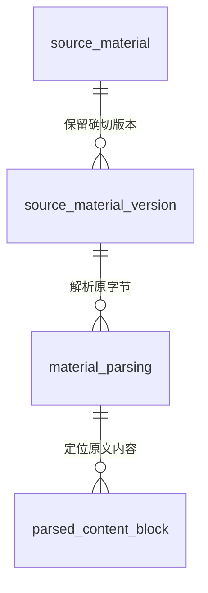
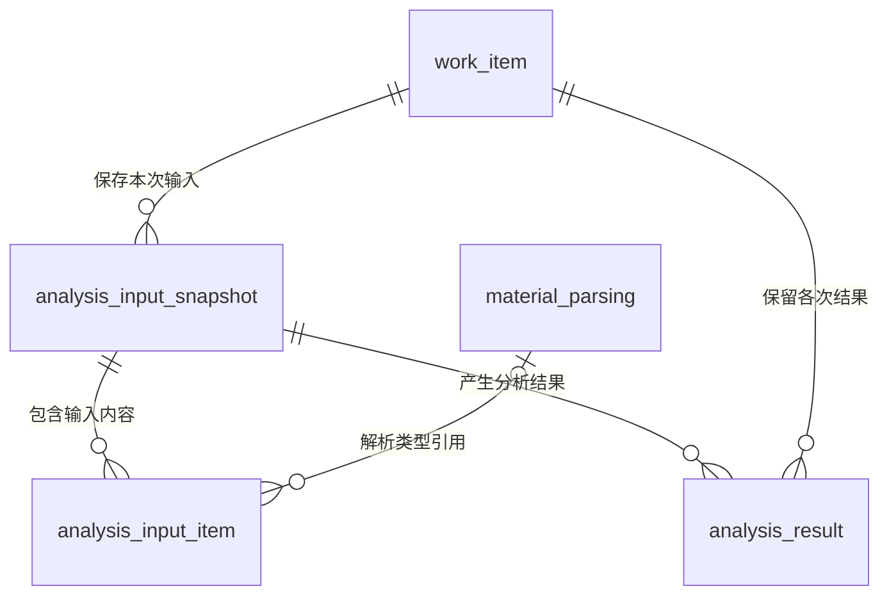
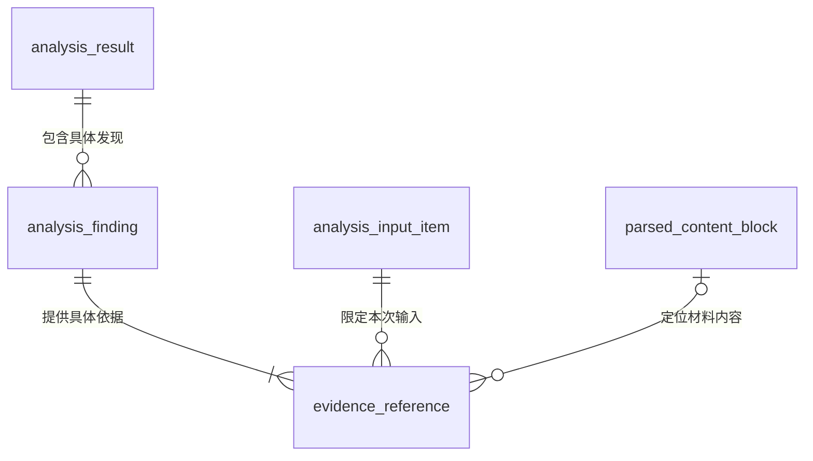

# 材料与分析证据实体关系

> 版本：V1.1｜日期：2026-09-20｜状态：该域及全范围文档核对通过；真实实现待验证
> 图：[材料、分析输入与证据引用](er-evidence.html)
> 上游（我引用）：[术语表](../03-01-glossary/glossary.md) §1、§5、[处理事项实体关系](er-work-item.md) §2、§4、[原始材料读取](../03-02-external-apis/source-material-read.md) §2—5、[AI 推理与材料解析](../03-02-external-apis/ai-inference-material-parsing.md) §2—3、[原记录变化发现](../03-02-external-apis/source-record-changes-read.md) §3、[原型交互说明](../../02-prototype/interaction-spec.md) §1—3
> 下游（引用我）：[安装资料实体关系](er-installation.md) §1、§3—4、[双方账单与对账依据实体关系](er-reconciliation.md) §1、§3—4、[接入配置实体关系](er-integration-config.md) §1—4、[变化接收与执行关系](er-change-execution.md) §4、[ER 范围与一致性总核对](coverage-review.md) §2—6、[安装核查与补充](../03-04-business-flows/flow-installation-review.md) §1—7、[材料与分析证据域表结构](../03-05-schema/evidence-schema.md) §1—7

## 1. 实体与范围

本图落实分析结果如何追溯到实际输入及确切原文。逻辑实体不要求逐个建表；材料存储、索引、执行任务及数据库约束留待相应阶段。

| 实体 | 命名 | 内容与边界 |
| --- | --- | --- |
| 原始材料 | source_material | 本图指原始材料中的文件类型，以来源系统及材料编号区分；业务记录内容走分析输入项，不强制导出文件 |
| 原始材料版本 | source_material_version | 同一文件的确定来源版本；可先有索引引用，取得成功后才有经核实的完整字节、类型及摘要 |
| 材料解析结果 | material_parsing | 对一份材料版本形成的解析内容，绑定文件摘要、解析实现版本及覆盖情况；接口对应 parseId |
| 解析内容块 | parsed_content_block | 解析内的具体文字、表格单元格或图片描述，绑定所属页面、图片或 sheet；blockId 在该解析内唯一 |
| 处理事项 | work_item | 当前需要办理的工作，定义同处理事项域 |
| 分析输入快照 | analysis_input_snapshot | 事项本次实际使用的输入与配置，包含缺失、不完整及版本未知状态；接口对应 inputSnapshotId |
| 分析输入项 | analysis_input_item | 快照内一份 RECORD 记录内容或一份 PARSED_MATERIAL 解析引用；不是来源系统新增记录 |
| 分析结果 | analysis_result | 该事项使用一份固定输入得出的经校验结果，定义同处理事项域 |
| 分析发现 | analysis_finding | 结果内的一条具体资料事实、证据判断、费用解释或可执行转换配置；findingId 在结果内唯一 |
| 证据引用 | evidence_reference | 某条分析发现对本快照内具体输入内容及位置的引用；实际支持程度仍由业务核实 |

解析中的页面、图片或 sheet 清单（units）作为材料解析结果内部结构完整保存；内容块通过 unitId 指向其中一项。本轮不将每个内部字段另画为实体。快照同样保存必要的 Skill、输出结构、接入配置等确切版本；这些配置的自身关系在对应分域展开。

## 2. 文件版本与解析

| 关系 | 基数与条件 | 变更、删除时的处理 |
| --- | --- | --- |
| 原始材料 → 原始材料版本 | 每份版本属于一个材料；材料可尚无可核实版本，或有多个确切版本。身份为来源、材料编号、来源版本的组合 | 来源缺版本时保留材料索引与缺失状态，不造一个“未知版本”冒充确定版本；来源删除不抹掉历史引用 |
| 原始材料版本 → 材料解析结果 | 每份解析只对应一个版本；版本可尚未读取、读取失败、未解析或保留多次解析 | 同来源版本出现不同字节摘要视为异常，禁止覆盖。更换解析实现产生新 parseId；原文件、旧解析及历史引用保持原样 |
| 材料解析结果 → 解析内容块 | 一个解析可有零至多个内容块；每块只属于一个解析 | 空白文件可无块；失败或未识别不能被当成空白。修正识别内容要形成新解析，不能原位改写已被引用的块 |

只有文件读取完整、版本一致、摘要核对通过后才允许解析。材料解析结果可为 INCOMPLETE，此时保留全部页面或 sheet 的覆盖状态及问题；调用失败没有可用解析结果时，记录执行失败，不伪造一个 COMPLETE 结果。

页码通过 unit.index、sheet 名通过 unit.name、单元格范围通过 block.cellRange 取得。公式和缓存值分别保留，不执行公式、不默认缓存仍准确。图片描述保留 IMAGE_DESCRIPTION 类型，引用时不显示为逐字原文。

## 3. 固定本次分析的实际输入

| 关系 | 基数与条件 | 变更、删除时的处理 |
| --- | --- | --- |
| 处理事项 → 分析输入快照 | 每份快照属于一个事项；事项可有零至多份输入快照 | 输入变化生成新快照，补充继续原事项；不能用旧编号装入新内容 |
| 分析输入快照 → 分析输入项 | 每个输入项属于一份快照；快照可有零至多个输入项 | 没有可用材料时可保存空输入及缺项，用于明确 NEEDS_INFORMATION；已固定的输入项不更新、不抽换 |
| 材料解析结果 → 分析输入项 | 每项关联零或一份解析；一份解析可被多份输入项引用。PARSED_MATERIAL 必须一份，RECORD 必须无解析 | 同一解析可在授权允许时复用，不因此复制或扩大权限。解析失效保留引用，新分析使用新快照 |
| 分析输入快照 → 分析结果 | 每个结果恰好引用一份快照；一份快照可无结果或有多份不同调用结果 | 失败调用不填充成功结果；同 runId 的重复响应只采用一份。换 Skill、配置或输入内容必须形成新的固定输入及调用 |
| 处理事项 → 分析结果 | 同处理事项域，一份结果只属于一个事项，事项可有多次结果 | 结果所属事项必须等于其快照所属事项；旧结果不能挂到另一个事项或覆盖当前新输入 |

输入项互斥规则：

- **RECORD**：保存 recordType、sourceSystem、sourceRecordId、原 sourceVersion（允许 null）、本次实际输入的 data 及取得时间。证据只能引用这份已保存 data，不在回看时重新查最新记录后替换。源版本未知不改写成已知版本；固定下来的内容也不等于已证明来源版本。
- **PARSED_MATERIAL**：关联确切 parseId，沿该解析追到材料版本；不接受无来源的自由文本冒充解析。材料块的定位限定在这份解析内。
- 快照内 records.inputId 与 parsedMaterials.parseId 共同唯一。对应到输入项的稳定标识按接口值保存；不能只凭 inputId 在全系统查到同号记录。相同解析重复加入同一快照应合并，跨快照引用仍各属其快照。

固定输入表示“这次实际用了哪些内容”，不表示多系统已提供同时点事务快照。缺少必需输入或解析不完整时只能形成明确缺项的结果；发布时仍须核对当前事项、来源记录及配置版本。源版本不透明，只判相等，不以字典序猜测新旧。

## 4. 从结论定位证据

| 关系 | 基数与条件 | 变更、删除时的处理 |
| --- | --- | --- |
| 分析结果 → 分析发现 | 每条发现属于一份结果；结果可有零至多条发现 | 无可靠依据时允许 findings=[] 并保留 openQuestions，不补造发现；结果保存后不独立改写发现 |
| 分析发现 → 证据引用 | 每个引用只服务一条发现，每条发现至少一个引用；同一原文可为多条发现分别提供依据 | 修正引用产生新的分析结果，不修改历史判断所引用的内容。引用存在不代表足以支持发现 |
| 分析输入项 → 证据引用 | 每个引用恰好指向一个输入项；一项可被零至多个引用使用 | 该输入项必须属于当前发现所在结果的输入快照，不可跨事项或跨快照借同号 inputId |
| 解析内容块 → 证据引用 | 每个引用指向零或一个块；一块可被多次引用。材料引用必须一块，记录引用必须无块 | 块必须属于该输入项指向的解析，不能将另一文件的相同 blockId 混入；材料旧版本不可得时明确不可取得，不跳到新版本 |

记录引用必须有能在该输入项 data 中解析的 jsonPointer，blockId=null；材料引用必须有有效 blockId，jsonPointer=null。引用范围按已登记 Skill 的证据规则检查，不凭模型自行声明接受任意字段。

quote 非空时须与对应内容一致；IMAGE_DESCRIPTION 的 quote 必须为 null 并明确显示为描述。原文预览由材料来源、编号、版本、解析位置共同确定。多个引用可以支持同一发现，也可能体现证据冲突；不能因为引用条数增加便自动升级为“支持充分”。

## 5. 必要性走查与访问边界

| 场景 | 关系如何支持 | 人员操作与限制 |
| --- | --- | --- |
| 核查人员查看春和庭变更依据 | 发现 → 引用 → 本快照输入项 → 解析块 → 解析 → 材料版本 | 一次“查看原文”定位当时材料；不要求手动搜文件或重选 Skill |
| 服务商补充新文件或原文件新版 | 新版本或新材料形成新解析、新快照、新结果，原决定引用旧结果 | 仍从原事项提交补充；无需另建同类待办，不能改写旧审核依据 |
| 对账人员查看条款记录 | 引用定位到本次保存的条款 data 字段；有附件时按文件路径取证 | 未取得批准记录或版本未知时提示待核实，不把“未读取到”说成“未批准” |
| 服务商确认资料或配置 | 安装事实、字段建议各自带发现与依据，人员确认相应业务含义 | 解析、固定输入与引用校验由系统承担；本图不新增人工检查页码或填写版本步骤 |
| 解析器改变、旧分析晚返回 | 新解析与快照各自保存；发布前检查当前输入及事项版本 | 用户只看到当前可用结果，旧结果供授权追溯，不覆盖新输入 |
| 共享条款或文件用于多个事项 | 原文件和解析可复用；每个事项独立保存输入项及结果 | 每次引用、预览与下载都检查当前权限；共享内容不等于跨服务商可见 |
| 权限撤销、源文件或旧版本删除 | 保留必要关联、可用性和失效信息，禁止自动级联删除历史决定 | 已存正文、片段、摘要、解析和分析中的敏感内容同样受权限限制；无权时不以缓存绕过 |

本期正常业务流程不对已被决定引用的输入与证据做物理级联删除。保留期限、合法删除、文件存储加密和具体脱敏方式在实施前确认；不能以历史追溯为由永久保存或无限制展示原文。

以上为设计走查，尚未实现文件读取、OCR、持久化或生产授权，也未测量实际操作次数改善。本轮关系不替代后续端到端验证。

## 6. 其他关系范围

安装方案、资料草稿与正式安装明细由安装资料域承担；双方账目、接入配置、身份与执行记录分别由对应域承担。各域共同作为业务流程与后续表结构的依据。
