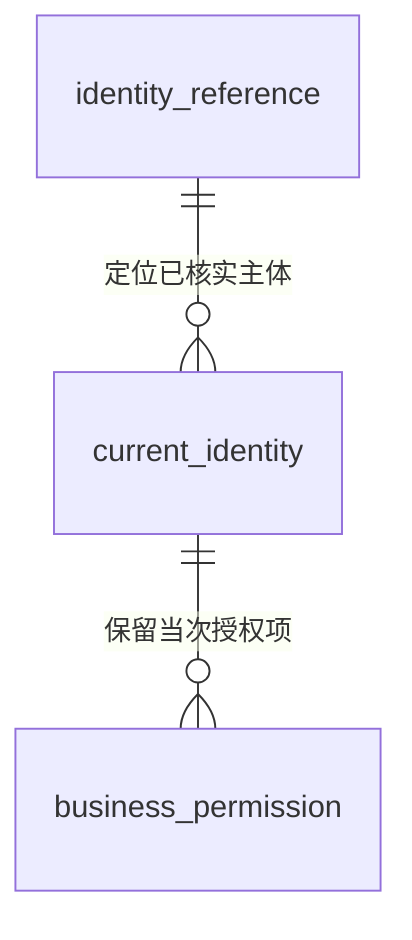
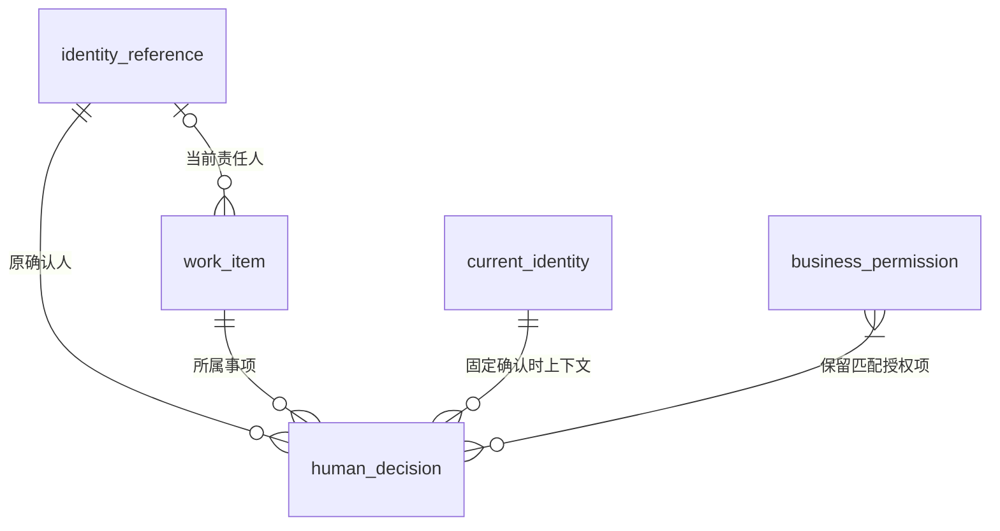

# 身份、权限与事项责任关系

> 版本：V1.0｜日期：2026-09-20｜状态：该域及全范围文档核对通过；真实实现待验证
> 图：[身份授权与人员责任](er-identity-responsibility.html)
> 上游（我引用）：[术语表](../03-01-glossary/glossary.md) §1、§3、§5、[当前身份与业务权限取得](../03-02-external-apis/current-identity-permissions-read.md) §2—5、[处理事项实体关系](er-work-item.md) §1—4、[安装资料实体关系](er-installation.md) §3—5、[接入配置实体关系](er-integration-config.md) §3、§5、[原型交互说明](../../02-prototype/interaction-spec.md) §1—3
> 下游（引用我）：[变化接收与执行关系](er-change-execution.md) §3、§5、[ER 范围与一致性总核对](coverage-review.md) §2—6、[业务主流程与角色交接](../03-04-business-flows/flow-business-main.md) §1—7、[履约协同与共用异常](../03-04-business-flows/flow-coordination-exceptions.md) §1—7、[处理事项域表结构](../03-05-schema/work-item-schema.md) §1—9、[身份、权限与责任域表结构](../03-05-schema/identity-schema.md) §1—4

## 1. 范围与实体清单

本域明确“哪一个人或程序”“这次核实到什么权限”“事项此刻由谁负责”“当时由谁确认”的关系。工作台引用已有身份与业务职责；账号注册、人员组织管理及权限发放不在本期范围。

| 实体 | 命名 | 保存的事实 |
| --- | --- | --- |
| 身份引用 | identity_reference | 可靠的 identitySource + subjectId 及 HUMAN / SERVICE 类型；标识稳定主体 |
| 当前身份 | current_identity | 某次成功核实的完整上下文：主体、验证时间、有效上限、授权版本、原账号映射及授权项 |
| 业务权限 | business_permission | 该上下文内一项 grant，将角色、允许动作与明确范围绑定；grantId 只在该上下文内唯一 |
| 处理事项 | work_item | 原业务范围、当前办理进展及零或一个具体责任人引用 |
| 人工决定 | human_decision | 人员实际确认的内容、事项及依据版本、原操作者与当时授权依据 |

共五类既有或新增实体；两个图重复展示必要关联。当前责任人 `assignee` 是处理事项与人员身份引用的关系，不另建“责任人账号”。原账号映射、业务角色、动作与数据范围保留为上下文或授权项内结构，不将每个属性各画一张表。

当前身份是每次核实得到的上下文。同一稳定主体可以形成多次上下文；被人工决定引用的那次内容须固定保存。历史内容用于解释当时为何允许操作，后续请求仍核实当前权限。具体存储方式在表结构阶段确定，不要求将每次只读请求都保存为永久业务记录。

## 2. 身份与当次授权

| 关系 | 基数与条件 | 变更、失效与历史 |
| --- | --- | --- |
| 身份引用 → 当前身份 | 一个主体可以尚无本地保存的上下文，也可有多次；每个成功上下文只属于一个主体，来源、编号和类型须一致 | 主体停用后停止新的受保护操作，保留必要历史引用；不能因同名或账号复用把旧决定移给另一人 |
| 当前身份 → 业务权限 | 一次完整核实可以确认无授权项，或有多项；每项只属于这一次上下文 | 已确认无权限与查询失败分别处理；旧授权项不更新为最新内容。跨次相同 grantId 不视为同一授权证据 |

### 2.1 上下文内的必要结构

| 内容 | 本域约束 |
| --- | --- |
| identitySource + subjectId | 联合定位主体；displayName 只用于展示。角色、服务商名称和工单责任人姓名均不能替代编号 |
| verifiedAt / validUntil | 保留核实时间和来源给出的使用上限。validUntil=null 只供本次请求使用，不跨请求缓存放行；有效上限内发生撤权也须立即停止沿用 |
| authorizationVersion | 保留来源的真实授权版本；未知为 null，不用核实时间冒充版本 |
| sourceIdentities | 保存经核实的 sourceSystem + sourceUserId 映射；HUMAN 可以无映射，SERVICE 必须为空。映射随本次上下文固定，历史不随账号变更漂移 |
| businessRole / actions / scope | 一项授权内保持完整对应；人类角色限已有六类职责，后台角色为 null。角色名称不自动生成动作 |
| scope | 保留 scopeType、sourceSystem、recordType、resourceIds；来源、类型和编号共同定位原记录，其余范围按已确认的命名范围解析 |

原系统人员映射用于对外办理时核实原操作者，不能单独授予写入权。同一人可以在不同系统有不同编号；映射缺失时，涉及该来源的写入保持待核实，其他不依赖它且已授权的操作不受无关阻断。凭据、密码和令牌不写入上述记录。

### 2.2 范围与动作共同核实

服务商、安装工单、原记录和变化配置四种范围沿用身份接口契约。授权项中的资源清单必须明确，不能用空清单或通配符表示全部；未知归属与无法完整解释的来源限制不能改为全服务商权限。

**一个动作必须在同一授权项内同时满足动作与目标范围。** 不能把服务商甲的办理动作与服务商乙的可见范围组合使用。若一次确认涉及多个必须核实的动作，逐个检查完整的“动作与范围”，所使用的授权项均来自同一份成功核实的上下文。

查看事项不自动包含附件、账单或办理权。多工单账单按整张记录范围核实；共同材料的解析可以复用，但文件查看、历史内容和下载仍逐次核实来源权限。SERVICE 仅能获得契约允许的只读与后台动作，不生成“人员已确认”。

## 3. 当前责任与本地人工决定

本图的人工决定限定为**经本工作台核实身份并接受的人员确认**，包括后续外部执行失败或结果未知的确认。原系统导入的既有决定另按真实来源保留，见 §4；不要求为它们补造本地上下文。

| 关系 | 基数与条件 | 变更与历史 |
| --- | --- | --- |
| 身份引用 → 处理事项：当前责任人 | 一个人可负责零至多个事项；一个事项零或一个当前责任人，必须为 HUMAN。尚未取得可靠人员时明确待分配 | 责任来自已核实的原业务分工或办理交接。缺具体人员时不向同角色所有人员开放决定，也不新建额外审批来补关系 |
| 身份引用 → 人工决定：原确认人 | 每份本地确认恰好一个实际人员，一个人可有多份决定；程序身份不能占据该关系 | 责任转交、姓名修改或人员停用不改写历史确认人；展示可以保留当时姓名，但身份比对只按稳定标识 |
| 处理事项 → 人工决定 | 每份决定恰好属于一个事项；一个事项可有多轮决定 | 确认时保存事项及责任版本。补充后仍接续原事项，不能把原决定挂到另一个服务商或问题 |
| 当前身份 → 人工决定 | 每份本地确认对应一份当次有效且固定的 HUMAN 上下文；该上下文可被零至多份决定引用 | 只有满足使用时效和重新核实要求时才能复用，逻辑基数不允许跳过接口要求。新的人员业务动作须重新核验，不因同一登录会话而长期沿用 |
| 业务权限 → 人工决定 | 每份本地确认保留一至多项实际匹配的授权项；一项授权可被零至多份决定引用 | 所有匹配项必须属于决定关联的同一上下文，并保存用于此次动作与目标的匹配依据，不能只留脱离上下文的 grantId |

确认时须同时满足：上下文主体与原确认人一致、该人员是事项当前责任人、所需动作与目标范围匹配、事项状态与已确认内容版本仍允许此动作。责任人匹配不代替权限，拥有权限也不代替当前办理责任。

上述检查与保存决定应针对同一有效的事项及责任版本。人员打开页面后如果责任已转交，旧页面提交不得继续接受；具体并发实现留到表结构、接口及系统流程。授权不足或身份未核实的请求不生成一份“已接受人工决定”；失败尝试另由运行记录保存。

责任未明确不妨碍已获准的后台分析准备。人员看到的是已准备好的结果与责任状态，无需手动选择 Skill；收到可靠责任关系后即可按既有业务流程继续。

## 4. 外部执行、来源导入与保留范围

| 情况 | 关系处理 |
| --- | --- |
| 人员确认后后台异步写入 | 决定继续保留原人员及确认时上下文；执行前另核实原人员当前权限、原账号映射与源端授权，并单独记录实际程序身份。执行记录由变化接收与执行关系承接 |
| 缺少可重新核实原人员的提供方能力 | 保持相关异步新写入待核实，不给当前身份 GET 增加任意 subjectId 参数，不用后台权限代替人员权限 |
| 已发出的写入结果未知，随后人员撤权 | 停止新增业务动作；由有权的后台回查已有操作。未知结果不等于失败，不重发，也不改写原决定的身份 |
| 原系统既有决定被导入 | 保留来源、原动作编号、原操作者引用及已知事实；操作者未知或尚不能映射时保留未知。只有可靠依据才能关联身份引用，不造一次本地确认或成功授权上下文 |
| 历史授权失效或人员已停用 | 保留必要决定和当时授权证据；访问历史内容仍按当前权限检查。历史内容不能被当作当前授权凭据 |
| 原系统记录或人员映射变化 | 保留原决定的确切内容及当时映射；新的办理按当前事实核实，不把历史记录批量改成新账号 |

本域不定义登录页面、角色配置后台或自动代办规则。真实身份提供方、责任分配的权威来源、原账号映射及受控重新验证能力仍待接入验证；不能把当前原型的角色选择器视为这些能力已经实现。身份和授权历史只保留业务追溯所需内容，受限访问及保存期限在实施前明确。

## 5. 必要性走查

| 角色或场景 | 完整业务操作与关系核对 | 操作负担 |
| --- | --- | --- |
| 京东安装资料核查人员 | 打开授权事项，核实证据并通过或退回；决定绑定本人、当前事项版本及当时授权项 | 身份核实由后台完成，不增加选角色、手动启动分析或重复确认 |
| 服务商资料人员 | 接收已退回的原事项，补充并提交；系统核实本方范围、原问题和当前具体责任人 | 保持原事项接续，不要求复制材料到另一待办 |
| 京东业务对账人员 | 打开已授权的双方账单，核实差异并提出问题；不能用一个可见工单放行整张多工单账单 | 获得完整授权时按原页面办理，缺权限时明确无法读取 |
| 服务商应收负责人 | 按本方事项回复核实，必要时按原系统权限维护应收 | 不增加京东代改账目或工作台财务审批 |
| 服务商对接人员 | 核实配置含义与适用范围，查看试转换并确认启用；需为当前责任人且具有 ENABLE_INTEGRATION_CONFIG | 不新增第二轮启用审批 |
| 京东物流履约协同人员 | 打开当前负责的问题，记录实际协调结果 | 不因身份域设计强制增加 AI 核查或资料审核 |
| 同人跨服务商、同角色不同人员 | 每次办理核实明确动作及范围；角色相同但不是当前责任人时不接受决定 | 权限检查自动完成，不要求人员拼接权限或解释账号 |
| 责任转交、撤权或来源失败 | 旧页面不得继续办理；原已发出动作由有权程序恢复结果，历史决定不变 | 不重复提交未知结果，也不增加重复人员确认 |
| 后台准备分析 | 程序按已授权范围取数与分析，不取得人员决定关系 | 人员打开工作台即可处理结果 |

以上为文档关系和角色操作走查，未实现生产鉴权、责任分配、并发提交或撤权传播；未测量旧系统与新系统的真实操作次数。

## 6. 后续关系范围

原记录变化、接收位置、待执行工作、实际尝试与外部结果由变化接收及执行记录域承担，分别关联原人员确认与实际程序身份。全部 ER 范围与一致性核对已完成，对应业务流程及技术契约已形成。
