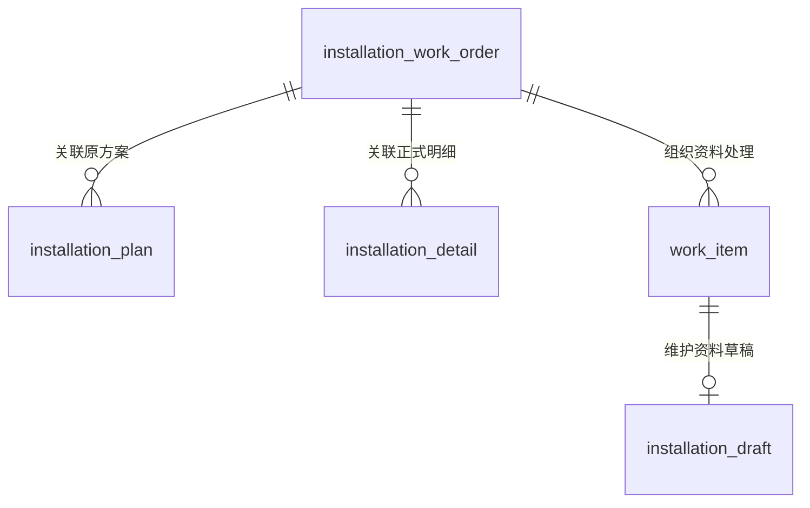
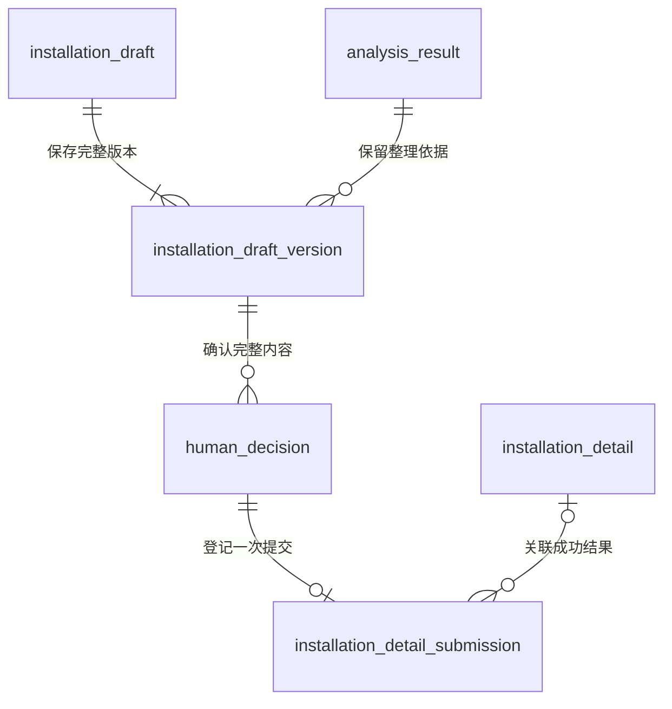

# 安装资料实体关系

> 版本：V1.0｜日期：2026-09-20｜状态：该域及全范围文档核对通过；真实实现待验证
> 图：[安装资料归属与提交确认](er-installation.html)
> 上游（我引用）：[术语表](../03-01-glossary/glossary.md) §1—2、§5、[处理事项实体关系](er-work-item.md) §2—4、[材料与分析证据实体关系](er-evidence.md) §2—5、[安装工单上下文读取](../03-02-external-apis/installation-work-order-context.md) §3、[正式安装明细提交](../03-02-external-apis/installation-detail-submit.md) §2—5、[核查决定与补充记录同步](../03-02-external-apis/review-supplement-sync.md) §2—4、[原型交互说明](../../02-prototype/interaction-spec.md) §1—3
> 下游（引用我）：[身份与事项责任关系](er-identity-responsibility.md) §4—5、[变化接收与执行关系](er-change-execution.md) §5、[ER 范围与一致性总核对](coverage-review.md) §2—6、[业务主流程与角色交接](../03-04-business-flows/flow-business-main.md) §1—7、[安装资料整理与提交](../03-04-business-flows/flow-installation-submission.md) §1—8、[安装资料域表结构](../03-05-schema/installation-schema.md) §1—7

## 1. 范围与实体

本图覆盖原方案、安装事实整理、人员确认提交和正式明细的衔接。原系统继续维护方案与正式明细；工作台维护草稿、确认依据、提交结果及事项关联。逻辑实体不直接等同 SQL 表。

| 实体 | 命名 | 归属与含义 |
| --- | --- | --- |
| 安装工单 | installation_work_order | 原系统组织一次安装履约的记录，保存可靠来源引用 |
| 安装方案 | installation_plan | 原系统中用于安排及核查安装的方案记录，包含其独立版本和方案项目 |
| 正式安装明细 | installation_detail | 原系统接受的实际安装记录，保留来源编号、独立版本及正式项目内容 |
| 处理事项 | work_item | 本图只展示安装资料整理事项，核查事项的统一关系见处理事项域 |
| 安装资料草稿 | installation_draft | 某个资料整理事项中持续供人员核实的草稿，尚未成为正式安装明细 |
| 安装资料草稿版本 | installation_draft_version | 草稿一次保存或确认的完整内容、原分析依据、使用的材料版本与上下文版本 |
| 分析结果 | analysis_result | 对应事项的安装资料整理 Skill 结果，提供候选安装事实及证据 |
| 人工决定 | human_decision | 本图只展示人员确认提交资料的决定，保存实际操作者、确认内容和依据 |
| 安装明细提交记录 | installation_detail_submission | 用稳定 submissionId 保存一次确认后的完整请求、执行状态及原系统回执 |

方案和正式明细是原业务对象。已有记录的新版本不算一个新业务对象；不同来源编号是否为替换记录须由原系统关系证明，不凭名称相同合并。本图不假定一个工单终身只有一个方案编号或明细编号；当前上下文按已核实的原系统状态选取当前有效记录。若源系统同时返回多个无法判明有效性的记录，应保留冲突并暂停相关确认，不能随便选取一份。

方案和明细历史按当次固定来源读取内容保留，材料按确切版本保留；分析实际使用的字段另按证据域固定输入保存。图中连接业务记录；确认与结果回执必须进一步指向具体版本，不能仅保存业务记录编号。

## 2. 工单与资料归属

| 关系 | 基数与适用条件 | 失效、删除时的处理 |
| --- | --- | --- |
| 安装工单 → 安装方案 | 一份方案属于一个工单；一个工单可尚未取得方案，或保留多份历史关联方案。当前有效方案最多一份，以原系统为准 | 方案撤销、替换或改版后保留原引用；未取得当前方案不能拿旧方案补齐后提交 |
| 安装工单 → 正式安装明细 | 一份正式明细属于一个工单；工单可无正式明细或保留历史关联明细。当前上下文最多一份当前明细 | 正式记录更新保留旧版本及当时依据；读取不到明细不直接推断“未提交”，须区分 NOT_SUBMITTED、SUBMITTED 和 UNKNOWN |
| 安装工单 → 处理事项 | 本图中的每个资料整理事项必须关联一个工单；同一工单可有不同业务阶段或经核实的新处理范围 | 一条变化通知或一次补充不新建相同事项。工单关闭不删除既有确认、草稿版本或提交历史 |
| 处理事项 → 安装资料草稿 | 一个资料整理事项至多一份持续编辑的草稿；尚无可用整理结果时可无草稿。每份草稿只属于该事项 | 补充和重新整理更新同一草稿的版本，不追加同类待办。后续另一个业务处理范围须有明确依据，不能靠生成新草稿编号绕过原提交 |

草稿的工单与服务商范围由其所属事项确定；分析结果、人工决定及提交记录必须属于同一事项和同一工单，不允许只检查编号分别存在。

方案项目保存 plannedQuantity，草稿与正式明细保存 installedQuantity。项目还需分别核实 unit、materialSupplier、serviceScope；同名项目不自动一一对应，数量相同也不证明服务范围相同。原项目没有稳定行标识时，不自造来源行号；本地版本内定位不能冒充原系统项目身份。

购买订单、安装权益及材料可作为整理或核查的固定输入；不由本图复制成另一份交易或权益账本。权益数量上限、计费数量和领料数均不能填入实际安装数量。

## 3. 草稿版本、人员确认与提交结果

本图的人工决定仅指“确认提交安装资料”。其他动作与草稿版本的关联不能直接套用本图必填关系。

| 关系 | 基数与适用条件 | 失效、删除时的处理 |
| --- | --- | --- |
| 安装资料草稿 → 安装资料草稿版本 | 每个版本属于一份草稿；草稿建立时至少一份版本，后续保存或确认形成新版本 | 不要求每次键盘输入都产生版本；已被确认或提交引用的版本不可修改。丢弃未保存的页面编辑不删除历史版本 |
| 分析结果 → 安装资料草稿版本 | 本期 AI 整理草稿的每个版本引用一份作为整理起点的分析；一份分析可支持零至多个人员编辑版本 | 人员修改后的内容与原分析分开保存，不篡改模型原输出。重新分析后形成新版本供核实，不覆盖尚在编辑的内容或已确认内容 |
| 安装资料草稿版本 → 人工决定 | 每份提交确认恰好绑定一个完整草稿版本；同一版本可尚未确认或经历不同有效确认 | 内容修改、依据失效后旧确认不能授权新提交。原始确认和失败结果继续保留，不改成后来的成功记录 |
| 人工决定 → 安装明细提交记录 | 每笔提交恰好引用一个人员确认；一次确认至多一笔稳定提交记录。受理前条件不满足时可尚无提交记录 | 同一确认重复请求复用原编号及状态；不能因超时新建确认或编号。真正重新确认前，原未决提交必须已明确终态 |
| 正式安装明细 → 安装明细提交记录 | 一份明细可有零至多笔本工作台成功提交关联，兼容原系统已有记录和后续修订。每笔提交当前可关联零或一份已核实成功明细 | 仅 SUCCEEDED 关联正式明细的确切版本；PENDING、REJECTED 不把猜测记录当成功结果。原明细后续更新不能替换本次回执版本 |

完整草稿版本指保存本次全部项目及缺项状态，不表示安装事实已全部核实。

同一草稿的不同版本均保留实际项目、材料引用及编辑责任。人员对提取内容作出的改正记录为人工修改，不能继续把它显示成 AI 原文摘录；重新整理后需明确变化部分，保留已填意见，禁止静默覆盖。

一份确认绑定的内容至少包括 installationDraftId、confirmedDraftVersion、完整 items、sourceMaterials、expectedWorkOrderVersion、expectedPlanVersion 和 expectedDetailVersion。首次提交的 expectedDetailVersion=null 只在已证实原系统尚无正式明细时使用，不能代表“没有读到版本”。

提交记录固定上述内容、原确认操作者、目标来源、服务商及工单。同一 submissionId 内容不得变化；同工单未决提交与审核、补充写动作共用保护。原系统还须支持条件写入及可关联回查，不能仅凭工作台版本检查推定外部并发安全。

## 4. 业务约束与衔接

1. **草稿允许待核实，正式提交不允许未知值冒充完整。** AI 候选数量、单位、供料方或范围可以缺失；提交项目必须按既有契约核实完整。未知不填零，方案数不当实际数；提交完整项目列表，不把部分修改隐式拼成正式明细。
2. **分析与人工确认保持对应。** 草稿版本的分析属于同一资料整理事项，且为安装资料整理能力的结果。人工决定关联该版本的整理依据并保存实际确认内容；旧分析作为历史起点保留，新的写入仍检查当前工单、方案、明细及材料是否改变。
3. **成功需有对应的原系统证据。** 人员确认只授权该次提交。SUCCEEDED 必须取得能关联本次请求的正式明细编号与版本，并核对全部确认内容；PENDING/RESULT_UNKNOWN 等待回查，HTTP 正常返回不等于提交成功。
4. **重复不重复办理。** 同一请求重放复用原记录。原系统成功、本地交接失败时恢复本地交接，不再写明细；核查事项按提交编号或对应正式明细版本去重衔接，不要求服务商再次确认同一内容。
5. **资料提交与京东核查各有结果。** 服务商资料事项在成功提交后完成本环节，京东核查事项对正式明细及其版本继续处理。允许修订时，保留此前核查决定并按新明细更新相应核查事项，不抹掉旧结果；已审核内容不能绕过原系统状态直接覆盖。
6. **原系统记录不要求本地前置历史。** 已存在的正式明细可以没有本工作台草稿和提交记录，照常按授权取得并核查；不得为补齐关联伪造历史确认。外部直接修订后保留其真实来源并重新分析，不伪装为本工作台提交。
7. **关闭不级联删除。** 方案、草稿及正式明细失效时保留必要历史与失效原因。已被决定引用的版本、确认和结果不在正常业务流程中物理级联删除；历史访问仍核验当前权限，保存期限在实施阶段统一确认。

## 5. 必要性走查

| 场景 | 人员实际操作及系统接续 | 关系检查 |
| --- | --- | --- |
| 服务商确认桂语庭安装事实 | 核实实际用量、供料方与服务范围并提交；系统固定本次确认并写回原系统 | 人员编辑版本与 AI 原分析分开；提交绑定完整内容，未增加一轮人工审批 |
| 方案在确认后发生变化 | 系统停止新的写入，保留草稿与意见，提示核实变化部分 | 旧确认不能套用新版方案；不能用工作台本地锁替代原系统条件写入 |
| 提交超时但源系统实际成功 | 页面显示结果确认中；后台按原编号回查，成功后继续京东核查 | 保留一笔提交及回执，服务商无需重新填写或改号重发 |
| 修订被源系统明确拒绝 | 原提交保存拒绝原因；符合原业务状态后才允许重新核实并提交 | 旧版本、旧决定和拒绝结果不覆盖；新内容需要新版本、新确认和新编号 |
| AI 重新整理时人员已在编辑 | 保留人员编辑，展示新分析带来的差异，再保存或确认新版本 | 不静默覆盖，不将人工修正伪装为模型提取 |
| 京东核查原系统已有资料 | 直接对当前正式明细与依据进行核查 | 正式明细允许没有本地提交历史，不要求服务商把旧流程再走一遍 |
| 两份相同成功通知先后到达 | 系统识别同一提交或明细版本，接续既有核查事项 | 不多建事项，不重复要求京东审核 |

这是依据现有原型与开发契约的关系走查，尚未验证真实写入、并发控制、回查或操作次数改善。本轮不增加页面，不修改原型交互。

## 6. 其他关系范围

双方账单、账单分项与费用依据由对账域承担；接入配置、身份权限及执行记录分别由对应域承担。各域共同作为业务流程与后续表结构的依据。
