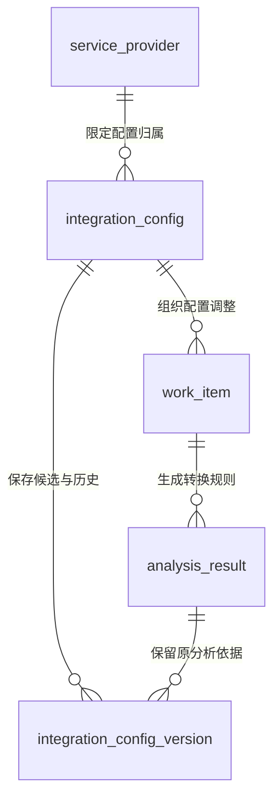
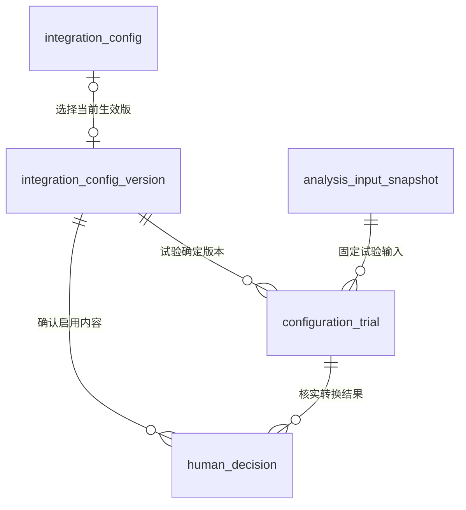

# 接入配置实体关系

> 版本：V1.1｜日期：2026-09-20｜状态：该域及全范围文档核对通过；真实实现待验证
> 图：[配置版本、试转换与生效关系](er-integration-config.html)
> 上游（我引用）：[术语表](../03-01-glossary/glossary.md) §1、§4—5、[处理事项实体关系](er-work-item.md) §1—2、§4、[材料与分析证据实体关系](er-evidence.md) §2—5、[服务商资料与格式说明读取](../03-02-external-apis/provider-documents-format-read.md) §2—5、[AI 推理与材料解析](../03-02-external-apis/ai-inference-material-parsing.md) §2—3、[当前身份与业务权限取得](../03-02-external-apis/current-identity-permissions-read.md) §2—3、[原型交互说明](../../02-prototype/interaction-spec.md) §1—3
> 下游（引用我）：[身份与事项责任关系](er-identity-responsibility.md) §3、§5、[ER 范围与一致性总核对](coverage-review.md) §2—6、[业务主流程与角色交接](../03-04-business-flows/flow-business-main.md) §1—7、[配置确认](../03-04-business-flows/flow-configuration.md) §1—7、[接入配置域表结构](../03-05-schema/integration-config-schema.md) §1—7

## 1. 范围与实体

本图覆盖已有接入配置场景的建议、确认、试转换和启用。配置资料可独立于安装工单；配置生效只允许适用资料按确认关系处理，不提交安装事实、不批准费用。

| 实体 | 命名 | 含义与归属 |
| --- | --- | --- |
| 服务商 | service_provider | 配置所属业务组织；一方的配置不默认用于其他服务商 |
| 接入配置 | integration_config | 工作台维护的一份明确来源、用途和业务范围的字段及费用项目对应配置 |
| 接入配置版本 | integration_config_version | 固定的含义确认内容、受控转换规则及适用条件；候选与生效使用同一版本身份 |
| 处理事项 | work_item | 围绕某份配置的新建或调整工作；本图中的事项不关联安装工单 |
| 分析结果 | analysis_result | 接入配置 Skill 对原字段、说明和证据形成的建议与待确认问题 |
| 分析输入快照 | analysis_input_snapshot | 某次建议或试转换实际使用的固定资料及必要配置版本，定义延续证据域 |
| 试转换记录 | configuration_trial | 确定配置版本在固定输入上的输出、缺项、校验结果和执行实现版本 |
| 人工决定 | human_decision | 本图仅指确认并启用指定配置版本的实际人员动作及结果 |

原服务商资料、原格式说明保留在输入快照及其原记录引用中，不复制成另一份可被工作台改写的原说明。格式说明版本、材料版本、Skill 版本、转换实现版本与接入配置版本分别保存。

## 2. 配置归属与建议版本

| 关系 | 基数与条件 | 变化与删除时的处理 |
| --- | --- | --- |
| 服务商 → 接入配置 | 每份配置属于一家服务商；服务商可有零至多份不同来源或业务范围的配置 | 停用服务商不删除已使用配置与历史依据；访问及新启用均按当前授权核实 |
| 接入配置 → 接入配置版本 | 每个版本只属于一份配置；配置可尚在取得资料而无候选，或保留多个版本 | 保存后内容固定，修改生成新版本；新候选不替换仍有效的当前版本，不覆盖历史规则 |
| 接入配置 → 处理事项 | 本图每个配置事项关联一份配置；配置可以历经多个有明确调整原因的事项 | 相同变化与补充继续当前事项，不逐条资料生成新配置任务；不能把配置编号当安装工单号 |
| 处理事项 → 分析结果 | 每份接入配置分析属于一个配置事项；事项可有零至多个结果 | 分析失败不伪造完成结果；材料或格式变化后新分析接续原事项，旧结果保留 |
| 分析结果 → 接入配置版本 | 本期 AI 辅助配置的每个候选版本引用一份整理起点分析；分析可形成零至多个经人员修正的候选版本 | 人员修正与 AI 原建议分别保存，不改写原分析。版本所属配置必须等于分析所在事项的目标配置 |

配置规则作为版本内部结构保存，包含原字段完整位置、目标业务字段、已确认含义、允许的转换方式及成立条件。不同工作表同名列不能合并。目标字段与转换操作使用服务端登记清单；模型返回的 interpretation、原文件内容和自由文本说明均不能直接成为可执行脚本。

版本中的规则须保留业务区别：电缆各段需明确为不重叠的实际安装量才可相加；同一段桥架的供料与安装记录不能重复累计施工长度；费用项目对应不等于数量口径相同。具体操作参数和校验细节在 PRD 定义，本图不把任意自然语言作为程序规则。

## 3. 试转换、人员确认与当前版本

| 关系 | 基数与条件 | 变化与删除时的处理 |
| --- | --- | --- |
| 接入配置版本 → 试转换记录 | 一次试转换恰好使用一个候选版本；版本可尚未试转换或有多次记录 | 规则或含义改变后新版本须重新验证，旧成功记录不能转挂新版本 |
| 分析输入快照 → 试转换记录 | 一次试转换使用一份固定输入；一份输入可参与多次有明确执行标识的试转换 | 输入保留实际资料、版本、缺失情况及候选配置标识；试转换不修改原资料，重复响应不反复生成业务确认 |
| 试转换记录 → 人工决定 | 本图每次启用确认引用一次当时核实的试转换；一份记录可尚未被确认或关联多次有实际原因的确认尝试 | 仅同版本、同适用范围且满足校验要求的结果支持启用；内容变化或失败不能复用旧确认 |
| 接入配置版本 → 人工决定 | 每次启用确认恰好绑定一个完整配置版本；版本可有零至多次人员动作记录 | 确认内容、选定试转换及版本必须一致；保留操作者与执行结果，不能用“人员已点击”证明已生效 |
| 接入配置 ↔ 当前生效版本 | 每份配置最多选定一个当前生效版本；某版本至多被其所属配置选中 | 引用必须指向本配置版本，不能借用其他配置或服务商版本；切换成功后保留原版与历史使用关系，不能物理删除旧版 |

同一启用动作中，事项、配置、候选版本、原分析、试转换输入及人员确认必须具有关联一致性。试转换输入快照属于当前配置事项，记录实际使用的候选版本；原建议分析保留自己的输入快照，不把试转换后的内容回填为原分析输入。确认人与当前责任人一致，且当前具备 ENABLE_INTEGRATION_CONFIG 及目标范围权限；试转换成功不授予人员权限。

试转换应保存实际输入、转换结果、规则执行情况、输出字段校验、缺项与冲突。界面预览是这份记录的呈现；仅打开预览或输出非空不构成通过。系统可自动准备对应版本的试转换，“查看结果”供核实或重试，不增加另一轮人工审批。

启用只在当前资料和格式条件仍成立、必要含义已核实、受控规则可执行且试转换满足要求时完成。当前生效引用、启用结果及事项状态应保持一致；重复确认同一内容返回已保存结果，不重复切换。并发版本改变时停止旧确认，保留未提交意见和候选，具体条件更新在表结构与本系统接口阶段落实。

## 4. 适用范围与持续复用

| 范围条件 | 保存及使用规则 |
| --- | --- |
| 服务商与来源 | 限定已确认的服务商及登记来源，不能用公司名、文件名或任意 URL 替代身份 |
| 用途与业务范围 | 区分安装资料整理、费用项目对应等用途，保存已核实的业务范围；不能将配置适用性当成数据读取授权 |
| 原格式及版本 | 来源提供时保留其确切标识、版本与关联证据；不匹配则停止依赖该配置的自动转换，不用旧说明强行解释新资料 |
| 未提供原格式说明 | NOT_PROVIDED 可继续由人员核实含义，但不伪造原格式编号或版本。只在有依据的授权资料约定与已核实范围内使用；无法证明后续资料同样适用时保持待核实 |
| 条件未知或多份配置同时命中 | 保留冲突及原资料，不以“最新创建”挑一份，不把多个配置叠加执行后重复计算 |

每次实际转换仍核实输入在生效配置的适用范围内。相同条件的资料直接复用确认关系，无需人员逐单选 Skill 或重做含义确认。输入不适用时只处理受影响配置与资料，不能让所有角色重新审批全部业务。

实际资料整理、对账及其输入快照必须记录所用配置版本，不能只指向会变化的“当前版本”。配置改版不改写已提交正式明细、原账或历史人工决定；需要重新核实的受影响事项保留与原事项的关联，具体重分析流程在业务流程阶段定义。

单份资料试转换通过只证明该输入上的结果，不能证明声明范围内所有未来资料均适用。启用前仍须验证规则所需的字段、单位、业务关系和缺项处理；范围不明时不能扩大自动使用。

## 5. 必要性走查

| 场景 | 关系检查与人员工作 |
| --- | --- |
| 服务商对接人员确认分段与桥架含义 | 原事项直接展示建议及原文，人员核实含义、查看对应试转换并启用；系统保存版本与结果，不增加独立审批角色 |
| 人员改了一个转换条件 | 形成新候选版本，保留旧试转换供回看；系统准备新版本结果，不要求人员重新录入全部原资料 |
| 来源格式变化 | 原数据、说明与旧配置保留，当前不适用部分停止自动转换；仅把新差异交给对应责任人核实 |
| 原说明未提供 | 保留 NOT_PROVIDED 和原资料，人员确认有依据的含义与范围，不编造来源说明或自动全量启用 |
| 同服务商多种资料或同名列 | 按来源、用途、位置和适用条件分别核实，不能因同名直接复用 |
| 撤权或版本并发变化 | 服务端停止旧确认，保留候选与意见，不能靠前端按钮或历史权限启用 |
| 后续资料满足已确认条件 | 系统直接执行生效版本，业务人员聚焦新的事实或差异，无需逐单确认配置 |
| 回看旧分析与旧业务决定 | 展示当时配置版本和证据；当前配置更新不会改变当时判断所依据的含义 |

本轮只完成关系设计。当前原型的试转换与启用为固定场景模拟，不能证明生产校验、权限、并发与适用范围匹配已实现；未执行真实转换，也未测量操作次数改善。

## 6. 其他关系范围

身份引用、业务权限与事项责任由身份与责任域承担，沿用已有身份机制。变化接收及执行记录由对应域承担，之后做 ER 全范围核对。
