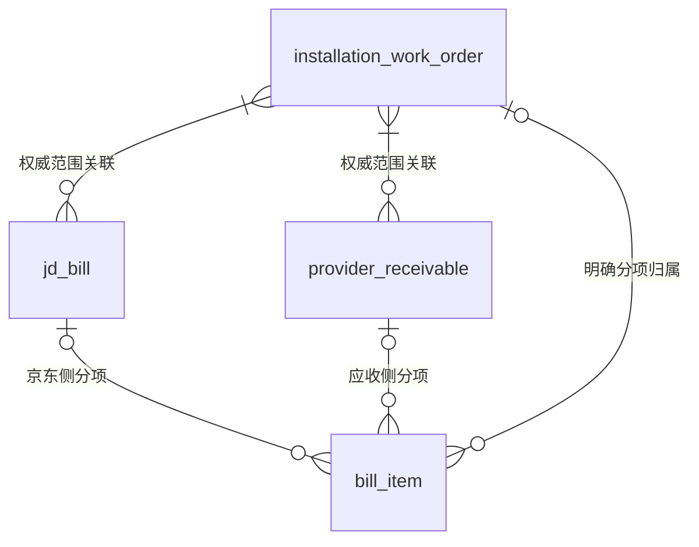
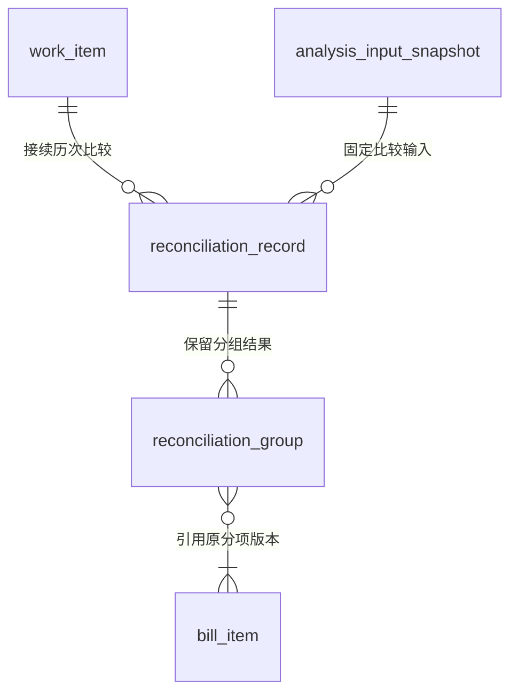
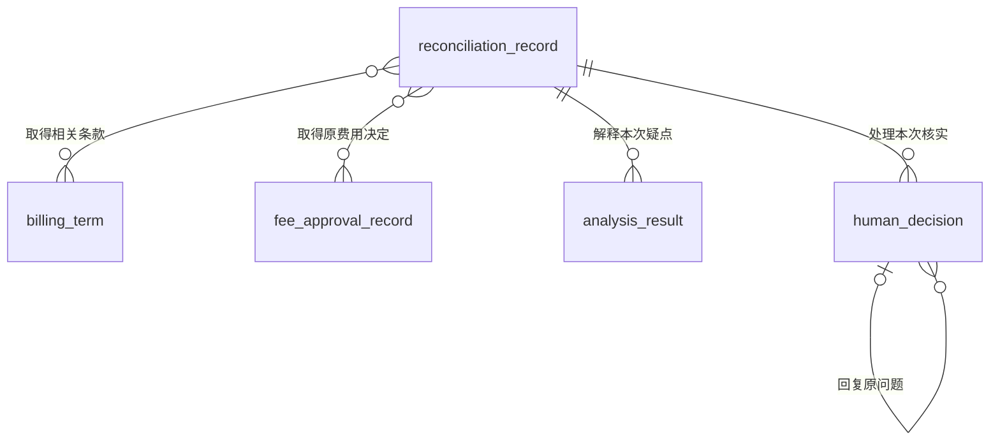

# 双方账单与对账依据实体关系

> 版本：V1.0｜日期：2026-09-20｜状态：该域及全范围文档核对通过；真实实现待验证
> 图：[独立账单、本次比较与核实依据](er-reconciliation.html)
> 上游（我引用）：[术语表](../03-01-glossary/glossary.md) §1、§5、[处理事项实体关系](er-work-item.md) §2、§4—5、[材料与分析证据实体关系](er-evidence.md) §3—5、[京东账单读取](../03-02-external-apis/jd-bill-read.md) §2—5、[服务商应收读取](../03-02-external-apis/provider-receivable-read.md) §2—5、[计费条款与批准记录读取](../03-02-external-apis/billing-terms-approval-records-read.md) §2—3、[原型交互说明](../../02-prototype/interaction-spec.md) §1—3
> 下游（引用我）：[ER 范围与一致性总核对](coverage-review.md) §2—6、[业务主流程与角色交接](../03-04-business-flows/flow-business-main.md) §1—7、[业务对账](../03-04-business-flows/flow-reconciliation.md) §1—7、[双方账单与对账依据域表结构](../03-05-schema/reconciliation-schema.md) §1—7

## 1. 范围与实体

本图明确原账归属、本次实际比较的范围，以及费用核实如何引用当时依据。原账与工作台对账记录分别保存，不新增付款、费用审批或代改服务商应收入口。逻辑实体不直接等同数据库表。

| 实体 | 命名 | 内容与归属 |
| --- | --- | --- |
| 安装工单 | installation_work_order | 本次对账的安装履约范围；一份对账事项关联一个工单及一家服务商 |
| 京东账单 | jd_bill | 京东原系统独立形成的账单，保留来源、编号、原总额和版本 |
| 服务商应收 | provider_receivable | 服务商原系统独立维护的应收，按来源、服务商、编号定位 |
| 账单分项 | bill_item | 某一方原账内的稳定分项，保留原名称、范围、计费数量和金额；不得同时属于双方 |
| 处理事项 | work_item | 原对账工作及其当前办理责任，修订取得后继续本事项 |
| 分析输入快照 | analysis_input_snapshot | 本次比较及差异解释使用的固定原记录内容、缺失状态和适用配置版本；延续证据域定义 |
| 对账记录 | reconciliation_record | 程序按固定输入与范围生成的一次比较记录，保留分项结果、总分核对和未解决问题 |
| 对账分组 | reconciliation_group | 本次比较中的双方分项集合，保存对应依据与比较结果；单边无对应项目也保留 |
| 分析结果 | analysis_result | AI 对本次疑点形成的解释与证据，不替代确定性金额计算 |
| 计费条款 | billing_term | 原合同或计费约定，可能覆盖多个工单或费用范围 |
| 费用批准记录 | fee_approval_record | 原费用流程中的真实决定，仅适用于其明确范围 |
| 人工决定 | human_decision | 本图指提出费用核实问题、答复及业务处置的实际人员动作；不等同原费用审批 |

“版本”沿既有证据域保留在固定原内容与关联中。图中账单与分项是业务身份，比较时必须进一步固定其所属账单版本，不能只保存一个可随最新账目变化的分项编号。

## 2. 双方账目与工单范围

| 关系 | 基数与条件 | 变更、删除时的处理 |
| --- | --- | --- |
| 工单 ↔ 京东账单 | 每张已核实关联的账单覆盖一个或多个工单；工单可关联零至多张账单 | 保留完整权威关联范围；替换、作废与改版分别记录，不默认读取最近一张或累加所有历史账单 |
| 工单 ↔ 服务商应收 | 每张已核实关联的应收覆盖一个或多个工单；工单可关联零至多张应收 | 修订在服务商原系统完成；新编号替换旧编号需源系统依据，不按小区名称或总额猜配 |
| 京东账单 → 账单分项 | 京东侧分项恰好属于一张京东账单；应收侧分项在此关系上为零。账单可有零至多项 | 账单内稳定 billItemId 与来源、账单身份共同定位；换版保留旧内容，不用可变行号充当源身份 |
| 服务商应收 → 账单分项 | 应收侧分项恰好属于一张应收；京东侧分项在此关系上为零。应收可有零至多项 | 与上一关系互斥且必选其一；同名或同 billItemId 不跨来源合并，不改成京东侧计费结构 |
| 工单 → 账单分项 | 每项明确归属零或一个工单；共同费用、归属未知时无直接工单关联，一个工单可有多项 | 不能以整单覆盖范围或平均分配补造分项归属；关联已知不等于可任意分摊 |

本图只把已核实的账单范围画为关系；发现编号但关联未核实的记录保留待核实信息，不拼接为有效比较输入。工单对整单的多对多关联与分项最多归属一个工单是不同事实，不能互相推导。

读取整单须具备完整访问权限。不得截去他方工单行后声称整单完整；若真实来源另提供授权工单视图，须保留其独立范围与总额含义。多工单总额没有明确分配依据时，目标工单金额保持未知，不用整单总额替代。

## 3. 固定本次比较与分项对应

| 关系 | 基数与条件 | 变更、删除时的处理 |
| --- | --- | --- |
| 处理事项 → 对账记录 | 每份对账记录恰好属于一个事项；事项可尚无记录或保留历次比较 | 新版取得、范围或适用关系变化形成新记录，仍属原事项；同一输入重放不重复生成待办 |
| 分析输入快照 → 对账记录 | 每次比较恰好固定一份输入快照；快照可无比较结果或被多次有明确执行标识的比较使用 | 快照所属事项必须与对账记录一致；读取失败也保留实际缺失状态。配置、原账或范围变化不得用旧快照编号替换内容 |
| 对账记录 → 对账分组 | 每组只属于一次比较；记录可有零至多组 | 没有可比较分项时保留缺项，零组不代表金额为零或核对一致；新比较不覆盖旧组 |
| 对账分组 ↔ 账单分项 | 每组至少引用一个原分项，可为一对多、多对多或仅单边有项目；一个源分项可出现在不同历史比较的多组中 | 组成员同时保存输入项、原账身份、账单版本和 billItemId；必须属于本次快照，不能读最新分项替换。一个分项在同一次比较最多计入一组，禁止重复累计 |

固定输入快照在 AI 调用前已保存，程序可先完成确定性比较；没有 AI 输出仍可保留程序比较结果与缺项。AI 解释若使用该快照，必须接收其已登记的实际输入，不得同编号换成另一套内容。程序算出的金额不交给模型重新猜测。

每份对账记录明确本次工单、服务商、所选有效账单集合、币种、含税口径、比较范围和配置版本。输入保留双方独立原总额、目标工单金额、原分项，以及完整性和当前性信息。允许分别展示已知内容，但未知币种、税口径、有效性、归属或版本不支持“可直接比较”的结论。

分组引用已确认且当前适用的项目对应关系，保留对应依据和版本；单有相同名称不成立。没有可靠对应关系的项目保留为单边待核实，不强行匹配。跨组部分分摊须有源系统明确范围与可核实金额，本期未定义这样的拆分时保持待核实，不自动拆行。

金额计算按十进制及原正负方向处理。总额、分项和目标工单金额分别核对，不以计算结果回填原总额，不以计费数量推定实际施工量。仅在整单与比较范围可核实一致时检验对应合计；共同费用或分配未知时不能把可见行合计称为工单应付。计算公式、精度及展示状态在后续业务流程和 PRD 细化。

## 4. 费用依据、AI 解释与人员核实

| 关系 | 基数与条件 | 变更、删除时的处理 |
| --- | --- | --- |
| 对账记录 ↔ 计费条款 | 两侧均可关联零至多份；关联表示本次取得的相关原记录，不直接表示适用于每个分组 | 关系固定原条款版本及适用依据；失效或替代不抹掉历史。按费用发生时的适用范围核实，不仅看取数当天状态 |
| 对账记录 ↔ 费用批准记录 | 两侧均可关联零至多份；工单适用性仍需进一步落实到具体费用范围 | 保留批准、驳回、待处理、撤销或未知原状态；没有查到不能直接记成未批准，施工签字不能替代费用决定 |
| 对账记录 → 分析结果 | 本图中的每份对账差异解释属于一次固定比较；一份比较可尚无解释或保留多次解释 | 分析与对账记录必须同事项、同输入快照；差额、条款或配置变化后形成新比较及分析，旧结果不覆盖新版本 |
| 对账记录 → 人工决定 | 本图每个费用核实动作引用一份当时对账记录；记录可有零至多次人员动作 | 提问、答复及实际处置分别保存。人员动作不改双方原金额，不将“已修改”的答复记成已取得新版 |
| 人工决定 → 人工决定：回复原问题 | 一个核实问题可有零至多次实际回复；回复必须指向同事项中的一个问题，非回复动作在此关系上为空 | 关联两条不同记录，禁止自指或循环；已关闭问题不能接收新的业务回复。后续轮次指向新问题，不覆盖原问答 |

条款和费用决定须存在于本次固定输入中；具体结论使用证据域的“分析发现—证据引用”定位原字段或确切文件版本。关联为空时同时保留查询范围及列表是否完整，不能把未查全、无权取得、查全但未发现记录混为一类。

费用问题由当前京东业务对账人员提出，应收负责人按职责回复或在原系统修订。回复引用原问题与自己实际看到的对账记录；若双方看到不同轮次，记录各自版本并继续原事项，不将旧问题改挂新版。人工决定如引用 AI 分析，该分析必须属于其当时对账记录。费用问答不复用安装审核的 REQUEST_SUPPLEMENT / SUBMIT_SUPPLEMENT 接口，不凭本图新增收费审批。

## 5. 必要性走查与完成条件

| 场景 | 关系与处理检查 | 人员工作变化 |
| --- | --- | --- |
| 双方项目拆分不同 | 原分项不改名，按已确认范围组织比较组；未匹配项单独保留 | 系统准备比较与疑点，人员核实业务含义，无需手动重抄两份账 |
| 应收负责人修订本方记录 | 重新取得可靠新版，形成新输入及对账记录，原事项继续 | 不要求京东代改应收，也不要求重复建事项；京东账单保持独立 |
| 回复已修改但尚未取得新版 | 回复留在对应问题下，原账版本未变时保持待取得修订记录 | 页面不能提前显示核对一致；系统负责继续取得记录 |
| 总额相同但分项范围或税口径未明 | 分组、适用依据与缺项分别保留 | 人员只处理尚需核实的问题，不能因总额相同自动结束 |
| 多工单共同费用无法归属 | 保留原记录与范围缺失，停止依赖分摊的结论 | 不新增人工平均分摊步骤，不以猜测金额补齐 |
| 找到费用批准但范围不符 | 保留原决定，核实具体项目、时间及金额限制 | 不把施工验收或工单级相关性当作费用批准 |
| 原账作废、替换或旧分析晚到 | 保存历史并核实当前输入，不覆盖新结果或旧人员决定 | 不要求人员搬运旧回复；新的必要核实继续关联原事项 |

形成“核对一致”须同时满足有效且可核实的双方记录、工单范围、币种与税口径、总分检查、适用项目对应及必要依据；仍有未知或冲突则继续核实。核对一致只表达业务核对状态，不表示已结算、已付款或所有费用获批。

关闭事项不级联删除原账引用、比较、问答或证据。历史内容仍受当前访问权限约束；共享合同、共享账单不自动开放其他服务商数据。留存期限与合法删除在实施前统一确认。

以上为关系与角色设计走查，未实现真实算账、原系统读取、问答同步或权限控制，未测量实际操作次数改善。本轮不添加具体费用数据，不修改 BRD 或原型业务行为。

## 6. 其他关系范围

接入配置及其版本、身份权限、变化接收与执行记录分别由对应域承担。各域共同作为业务流程与后续表结构的依据。
