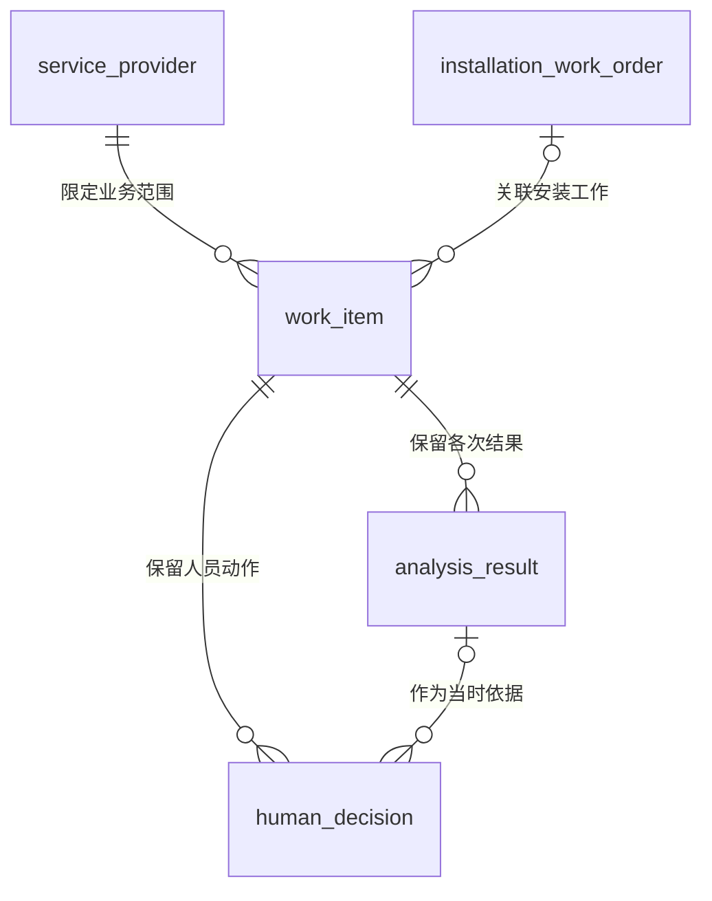
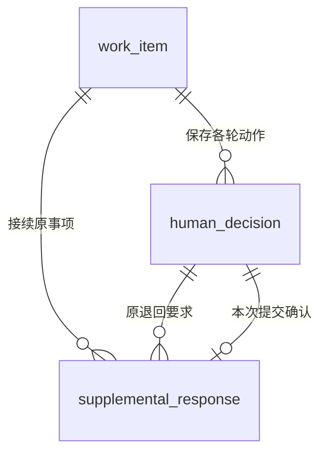

# 处理事项实体关系

> 版本：V1.1｜日期：2026-09-20｜状态：该域及全范围文档核对通过；真实实现待验证
> 图：[处理事项与补充轮次](er-work-item.html)
> 上游（我引用）：[术语表](../03-01-glossary/glossary.md) §1、§3、§5、[原型交互说明](../../02-prototype/interaction-spec.md) §1—3、[安装工单上下文读取](../03-02-external-apis/installation-work-order-context.md) §3、[核查决定与补充记录同步](../03-02-external-apis/review-supplement-sync.md) §1—5、[原记录变化发现](../03-02-external-apis/source-record-changes-read.md) §3、[AI 推理与材料解析](../03-02-external-apis/ai-inference-material-parsing.md) §2—3
> 下游（引用我）：[材料与分析证据实体关系](er-evidence.md) §3、§5、[安装资料实体关系](er-installation.md) §2—5、[双方账单与对账依据实体关系](er-reconciliation.md) §3—5、[接入配置实体关系](er-integration-config.md) §1—3、[身份与事项责任关系](er-identity-responsibility.md) §1、§3—5、[变化接收与执行关系](er-change-execution.md) §2、§5—6、[ER 范围与一致性总核对](coverage-review.md) §2—6、[业务主流程与角色交接](../03-04-business-flows/flow-business-main.md) §1—7、[安装资料整理与提交](../03-04-business-flows/flow-installation-submission.md) §1—8、[安装核查与补充](../03-04-business-flows/flow-installation-review.md) §1—7、[履约协同与共用异常](../03-04-business-flows/flow-coordination-exceptions.md) §1—7、[处理事项域表结构](../03-05-schema/work-item-schema.md) §1—9

## 1. 范围与实体清单

本图定义工作台如何组织人员要处理的工作，以及补充后如何继续原事项。逻辑实体不等于数据库表；存储拆分、字段类型、索引及完整状态转换在后续文档定义。

| 实体 | 命名 | 定义与归属 |
| --- | --- | --- |
| 服务商 | service_provider | 原业务系统登记的安装服务组织；工作台引用其可靠标识，不因生成事项另建同名组织 |
| 安装工单 | installation_work_order | 原系统组织一次安装履约的记录；在本图作为工单引用，保留来源和独立版本 |
| 处理事项 | work_item | 工作台组织的一项资料确认、核查、费用核实、配置确认或履约协同工作，保存当前进展及办理责任 |
| 分析结果 | analysis_result | 某事项某次固定输入下形成、通过结构校验的分析内容；多次结果分别保留，不能覆盖历史版本 |
| 人工决定 | human_decision | 责任人实际确认的一次业务动作及当时的依据；人员确认与外部执行结果分别记录 |
| 补充回复 | supplemental_response | 针对某轮退回要求确认提交的回复内容及材料引用；保存回复不代表原系统已接收成功 |

“当前责任人”在本图是事项的人员引用，保存可靠身份来源与人员标识，不能只存角色或姓名。权限与当前身份由既有机制核实；本轮不新建账号体系。交接尚未确定具体人员时应明确待分配，不向该角色全部人员默认授予处理权。

“处理记录”是页面按时间展示的业务过程：引用人工决定、补充回复、分析完成及执行结果等实际记录。它不替代这些事实，也不要求为了记日志让人员再做一次操作。其系统事件存储在后续表结构与系统流程中定义。

## 2. 主关系

| 关系 | 基数与理由 | 删除或失效时的处理 |
| --- | --- | --- |
| 服务商 → 处理事项 | 一家服务商可有零至多个事项；每个事项限定一家服务商的业务范围。京东人员可处理多个服务商的事项，不能因此把事项合并成跨服务商记录 | 服务商停用后保留既有事项及历史；可见和可办范围按当前授权重新核实 |
| 安装工单 → 处理事项 | 一个工单可有零至多个不同业务阶段或问题的事项；一个事项关联零或一个工单。安装资料、核查、对账和履约协同事项必须关联一个工单；接入配置事项不关联工单 | 源工单撤销或移除时保留来源引用、分析和决定，不级联删除，不自动视为事项完成 |
| 处理事项 → 分析结果 | 每份结果只属于一个事项；事项可尚无结果，或保留多次结果。当前可用结果最多一份，且必须属于本事项并对应当前输入 | 旧结果停止作为当前依据，但保留供历史决定追溯；不把失败调用记成一份分析成功结果 |
| 处理事项 → 人工决定 | 每份决定只属于一个事项；一个事项可以尚无决定，也可经历多轮退回、回复和确认 | 关闭事项只结束当前办理；既有决定及其执行情况继续保留，不能覆盖成最后一条意见 |
| 分析结果 → 人工决定 | 每份决定引用零或一份当时分析；同一分析可被不同的人员动作引用。本工作台发起的审核通过及退回等依赖分析的动作必须引用一份有效分析；补充提交、履约协调等可无分析 | 引用固定版本，禁止改为“当前最新结果”；结果随后失效不抹掉当时决定，也不能继续用旧结果作新批准 |

来源编号以来源系统及业务类型区分，不把不同系统的相同编号当成同一记录。事项的服务商与工单当前业务关联须核实一致；来源发生重新分配时暂停不适用的办理并重新核实责任与可见范围，不能静默把旧决定迁给新服务商。

每份人工决定和所引用分析必须属于同一事项。工单与事项各自拥有版本；原记录版本、事项版本和分析版本分别保留，不互相替代。已完成事项的依据变化仍须保存重新核实的任务及与原事项的关联，历史决定保持原样；具体重新办理方式在业务流程中定义。

## 3. 补充轮次

图中人工决定到补充回复的两条关系含义不同：一条指出“回复哪个退回问题”，另一条指出“谁确认提交了这次回复”。两份决定是同一实体类型中的不同记录，不能互相替代。

| 关系 | 基数与条件 | 删除或失效时的处理 |
| --- | --- | --- |
| 处理事项 → 补充回复 | 一个事项可有零至多份回复；每份回复只属于一个原事项，不另外创建同类待办 | 回复内容、材料版本和原问题关联保留；不能删除回复来撤销已成功同步的动作 |
| 人工决定 → 补充回复：原退回要求 | 每份回复恰好指向一次已成功生效的退回决定。该决定可对应多次不同提交尝试的回复记录，但同一轮至多一份成功生效的回复 | 失败尝试保留结果；原问题关闭后不能继续以它为新回复目标。新一轮退回必须生成新的决定 |
| 人工决定 → 补充回复：本次提交确认 | 每份回复恰好对应一次确认提交的决定；一份决定最多对应一份回复，SUBMIT_SUPPLEMENT 决定必须对应一份，其他动作不产生此关系 | 决定与确认提交的内容绑定；重新提交不同内容需要新的决定与动作编号。原动作结果未知时先回查，不能换编号重发 |

三方事项必须一致：回复、退回决定、提交决定均属于同一事项，并且服务商范围一致。补充提交决定不要求先有新分析；系统在原系统确认接收成功后更新分析，再交回京东人员核查。

本节的补充轮次约束对应安装核查的 REQUEST_SUPPLEMENT / SUBMIT_SUPPLEMENT。对账的发起核实与应收回复在对账域单独定义，不把核查接口套用于账单动作。

## 4. 关联与历史约束

1. **同一业务变化接续同一事项。** 以可靠的工单、业务阶段或具体问题、服务商范围识别事项；独立配置事项按服务商与配置适用范围识别。标题、小区名和变化通知编号均不能作为唯一业务身份。精确唯一约束在各域与表结构阶段落定。
2. **人员确认和外部成功分开。** 人工决定先保存确认内容；需要同步的动作关联稳定 operationId 或 submissionId 及外部回执。结果未知时展示等待核实；仅在成功被证实时推进相应业务状态。失败不能伪装成审核通过，恢复也不能再次要求人员确认同一内容。
3. **历史引用不能跟着最新内容漂移。** 分析结果关联固定输入快照、Skill 与实现版本；人工决定绑定看到的事项版本和分析版本。具体材料位置与记录版本关系在材料与分析证据域 ER 中展开，不以自由文本代替这些引用。
4. **重复消息不重复产生事实。** 同一动作的重放复用原决定、回复及回执；来自变化发现的相同原动作与主动同步的成功回执也应关联到同一事实。原系统直接发生的动作须按真实原记录导入并标明来源，不能伪造本地人员确认或本地 AI 分析；原操作者或原分析依据未知时保留未知。
5. **业务关闭与数据删除分开。** 本期正常流程不提供对既有决定、分析依据或成功回复的物理级联删除；来源失效保留必要历史与失效标记。权限撤回后历史也受访问限制，不能因“保留追溯”继续展示无权读取的材料。保存期限与合法删除要求在实施前另行确认。

## 5. 必要性走查

| 角色或场景 | 按现有原型走完的工作 | 关系是否支持、是否增加操作 |
| --- | --- | --- |
| 京东安装资料核查人员 | 打开春和庭事项，查看分析与依据，通过或提出补充问题 | 决定指向当时分析，退回留在原事项；不增加另建待办或手动启动 Skill |
| 服务商资料人员 | 打开原退回事项，填写回复与必要材料并提交；后续如需再补，回应新的退回问题 | 每份回复绑定具体退回和提交决定；不会误答上一轮，重复点击不多建记录 |
| 服务商资料人员确认安装草稿 | 核实整理结果并提交正式资料，随后京东开展核查 | 同一工单允许不同阶段事项；本图不把资料提交完成等同京东核查通过，草稿和正式明细在安装域展开 |
| 京东业务对账与服务商应收人员 | 京东发起核实，服务商维护本方应收，系统接续原对账事项 | 多版分析保留，双方账单不混为同一对象；账单与费用关系留在对账域，不增加京东代改应收的步骤 |
| 服务商对接人员 | 确认配置含义并启用 | 事项可以无安装工单，无需人为造一个工单；配置版本在配置域展开 |
| 京东物流履约协同人员 | 查看阻碍，填写实际协调结果 | 人工决定可无 AI 分析，不为关闭协同强制运行一个 Skill |
| 旧分析晚到、完成后依据变化 | 系统检查当前版本并保留需要重新核实的工作 | 旧分析不覆盖新输入；已完成决定不抹除。后台检查不增加人工搬运资料的动作 |

以上是关系与既有操作的设计走查，未测量真实业务点击数或效率提升。当前不具备旧系统逐角色实测数据，不能宣称已证明操作次数下降。

## 6. 后续关系范围

原始材料、输入快照与证据引用、安装资料、双方账单与计费依据、接入配置、身份与事项责任分别由对应关系域承担。变化接收及执行记录由对应域承担。全部 ER 范围核对后再推进业务流程和表结构。
