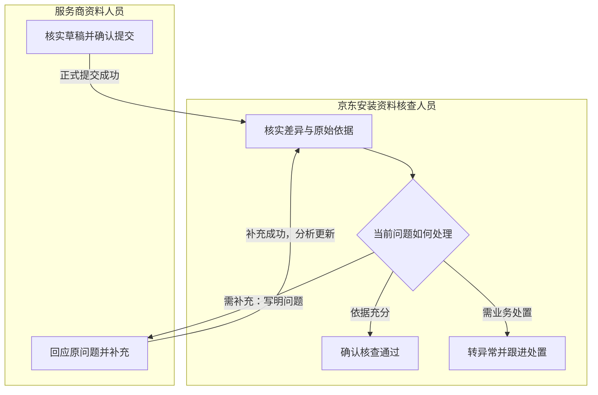
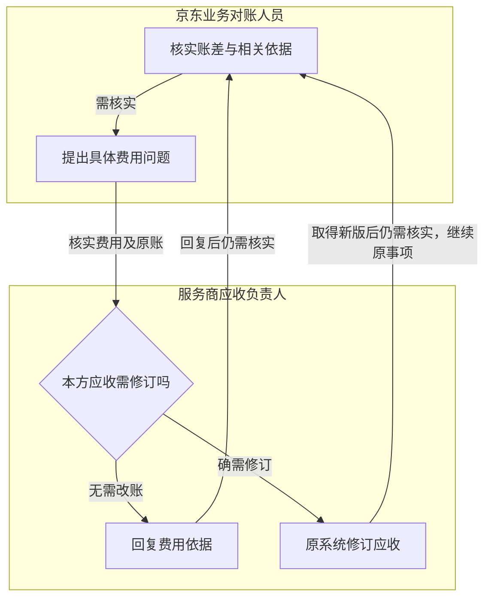

# 业务主流程与角色交接

> 版本：V1.0｜日期：2026-09-20｜状态：主流程及详细流程覆盖核对通过；真实实现待验证
> 图：[业务主流程与角色交接](flow-business-main.html)
> 上游（我引用）：[BRD](../../01-brd/BRD-jd-charging.md) §2—4、[原型交互说明](../../02-prototype/interaction-spec.md) §1—3、[原型页面清单](../../02-prototype/page-list.md) §1—2、[术语表](../03-01-glossary/glossary.md) §1—5、[ER 总核对](../03-03-er/coverage-review.md) §2—6、[处理事项关系](../03-03-er/er-work-item.md) §2—5、[安装资料关系](../03-03-er/er-installation.md) §3—5、[对账关系](../03-03-er/er-reconciliation.md) §3—5、[接入配置关系](../03-03-er/er-integration-config.md) §3—5、[身份与责任关系](../03-03-er/er-identity-responsibility.md) §3—5
> 下游（引用我）：[安装资料整理与提交](flow-installation-submission.md) §1—8、[安装核查与补充](flow-installation-review.md) §1—7、[业务对账](flow-reconciliation.md) §1—7、[配置确认](flow-configuration.md) §1—7、[履约协同与共用异常](flow-coordination-exceptions.md) §1—7、[业务流程覆盖与一致性总核对](coverage-review.md) §2—8、[01-subprd-workbench-items.md](../../05-prd/01-subprd-workbench-items.md) §3

## 1. 范围与入口

**业务信息到达后，工作台准备分析结果及相关依据；人员从自己的待处理事项进入，直接核实、确认或处理例外。**

本流程承接六类职责及四类 Skill。安装资料提交后进入京东核查；费用核实在双方账单具备相应业务条件时开展。接入配置与履约协同按需发生，不串成每张工单的固定审批链。

| 入口 | 已准备的信息 | 当前需要办理的人 |
| --- | --- | --- |
| 安装资料整理 | 安装资料整理 Skill 给出草稿、原文、缺项及冲突 | 服务商资料人员 |
| 安装资料核查 | 安装资料核查 Skill 给出实际与方案差异、关联依据和待核实问题 | 京东安装资料核查人员 |
| 费用差异核实 | 程序按适用关系比较双方账单，对账差异解释 Skill 整理疑点及相关费用依据 | 京东业务对账人员；收到问题后由服务商应收负责人回复 |
| 接入配置确认 | 接入配置 Skill 给出字段含义建议、对应关系及待确认问题 | 服务商对接人员 |
| 履约协同 | 安装安排或入场阻碍、已有沟通信息 | 京东物流履约协同人员 |

当前责任人是有权办理的具体人员。尚未确定人员时保持待分配，按既有业务分工落实，不默认让同角色所有人都能提交决定。读取、分析和提交的失败状态须可见；结果未准备好时不把空白界面当作“没有问题”。

工单查询与历史回看路径：在授权范围内查找工单 → 查看工单详情 → 打开相关原文、当时分析与处理记录 → 返回当前事项继续办理。查看本身不产生业务决定；历史记录保持当时内容，材料和账单仍按当前权限访问。

## 2. 安装资料与核查交接

| 环节 | 人员动作与交接内容 | 完成或返回条件 |
| --- | --- | --- |
| 核实草稿并确认提交 | 服务商资料人员核实实际数量、供料方、服务范围与依据，补齐缺项后确认完整内容 | 正式资料提交成功后，资料整理环节完成，京东进入关联工单的核查事项；人员点击提交但结果未知时继续等待核实 |
| 核实差异与原始依据 | 京东安装资料核查人员查看差异、引用位置及完整原文，判断证据与当前工单、问题是否相符 | 已取得的正式明细可直接进入该环节，不要求服务商重新走一次草稿提交 |
| 确认核查通过 | 当前核查人对有效资料及充分依据作出正式决定 | 审核成功后完成核查环节，保留当时资料与决定；不表示额外费用获批或已付款 |
| 提出补充要求 | 核查人说明具体缺项、矛盾或待核实问题 | 退回成功后交给对应服务商资料人员；京东侧显示等待补充 |
| 回应原问题并补充 | 服务商资料人员在同一核查事项回复当前问题、附必要材料并提交 | 补充成功后原事项更新分析，再交回核查人；提交回复不代表审核通过 |
| 转异常并跟进处置 | 当前核查人说明异常原因，按原业务职责协调处理并记录实际结果 | 仍缺事实或处理结果时继续待处理；实际处置完成才关闭异常，完成原因为异常处理，不能改记审核通过 |

**资料提交与京东核查分别记录阶段结果；退回、补充和复核接续同一个核查事项。** 新一轮补充指向新提出的问题，历史回复与当时结论保留。

## 3. 费用核实交接

| 环节 | 人员动作与交接内容 | 完成或返回条件 |
| --- | --- | --- |
| 查看账差与依据 | 京东业务对账人员查看双方独立原账、对应分项、差异及条款 | 范围、版本、币种、含税口径或对应关系不明时保持待核实，不凭总额相同结束 |
| 提出具体费用问题 | 对账人员说明待核实费用及业务问题 | 问题交给对应服务商应收负责人，双方看到原问题及进展 |
| 核实费用与本方原账 | 应收负责人核实费用事实、原账及批准依据 | 无需改账时回复依据；确需修订本方应收时在服务商原系统办理 |
| 回复依据或修订原应收 | 回复保留原问题关联；修订保留原账历史，工作台取得真实新版后重新比较 | 回复“已经修改”不等于已取得新版；京东账单保持独立，不随服务商报送金额改写 |
| 接续结果 | 仍有差异或依据不充分时，原事项继续交由京东业务对账人员核实；必要时提出新的具体问题 | 仅在有效范围、对应关系、分项比较及未决问题均满足条件时记录核对一致，无需为无差异结果再增加人工批准 |

图中展示仍需核实的回路。取得回复或新版后，如果符合核对一致条件，可结束当前对账环节，不再进入人工回路。初次比较已一致的事项同样记录结果，不要求先制造一个费用问题。

发现京东侧原账疑点时，由京东业务对账人员按原账维护职责协调核实，工作台等待可靠原记录；不新增代改京东账单或费用审批入口。仍有争议的费用保持未解决，不以回复完成替代差异解决。

**核对一致只表示当前范围的业务对账完成。结算批准与付款继续按原流程办理。**

## 4. 配置与履约的独立路径

| 路径 | 触发与人员工作 | 结果如何复用或交接 |
| --- | --- | --- |
| 接入配置 | 服务商资料含义或适用关系需新建、调整时，对接人员核实建议、确认范围，查看对应版本的试转换及校验结果，再确认启用 | 试转换满足要求且启用成功后，同类且仍适用的资料自动复用；无需每单重新选择 Skill 或确认含义 |
| 配置暂不能启用 | 含义、单位、范围仍未知，试转换未通过或条件已变化 | 保留待核实项，由原对接人员继续核实；修订候选后使用匹配的新结果，不拿旧预览确认新内容 |
| 履约协同 | 存在入场、安装安排等阻碍时，物流履约协同人员查看问题、联系相关方并记录实际协调结果 | 阻碍已解决才完成本环节；需要其他角色继续办理时保留原工单与相关事项关联，不代替资料审核或费用核实 |

配置调整只影响适用范围内的资料与事项。历史正式明细、原账与人员决定不随配置变更而被改写。履约协同可直接依据业务事实办理，不强制增加 AI 分析或新增审核角色。

## 5. 共用返回与完成约束

| 情况 | 当前人员看到什么 | 谁处理、回到哪里 |
| --- | --- | --- |
| 资料未齐或分析失败 | 明确缺失、失败原因及已成功提交内容，暂不提供依赖无效结果的批准动作 | 人员只补真实缺失内容；后台恢复已有处理，得到有效结果后回原事项，不重复提交已成功的补充 |
| 提交结果尚未确定 | 已确认内容与“结果待核实”，不显示成功完成 | 工作台核实原动作结果；已成功则继续原交接，尚未知不要求换内容或重复确认 |
| 办理时资料或责任变化 | 说明当前结果已不适用，保留未提交意见及可追溯历史 | 更新结果或按既有职责确认办理人后继续原事项；无权人员不继续办理 |
| 补充后仍不足 | 新结果与未解决问题、上一轮回复 | 原核查人或对账人员明确本轮问题，继续交给对应人员，不覆盖上一轮问答 |
| 完成后依据变化 | 既有完成原因保留，并显示与原事项关联的待重新核实工作 | 只处理受影响变化；不得自动撤销原决定或重新发出同一已成功动作。重新办理条件在各详细流程明确 |
| 源工单撤销、移除或关联失效 | 暂停依赖旧关联的办理，保留原记录与失效事实 | 按原业务职责核实当前安排，不能以记录不可读当作审核或对账完成 |

“本环节完成”须展示具体含义：资料提交成功、审核通过、核对一致、配置启用、履约阻碍处理完成或异常处置完成。不同含义不能归并为整个安装业务完成。

## 6. 角色走查与操作必要性

计数按一次成功路径中的**业务提交或决定**计算，不计阅读、输入、搜索、按钮弹窗和自动分析。以下是流程结构计数，未测量真实点击数或处理时间；旧流程工作内容来自当前 BRD 的交互对比，尚无逐角色实测基线。

| 角色与路径 | 工作台 2.0 的完整办理动作 | 一次路径的业务决定数 | 相比旧流程减少的准备工作 |
| --- | --- | --- | --- |
| 服务商资料人员：首次资料提交 | 打开整理结果 → 核实或修正事实 → 确认提交 → 查看成功或待核实结果 | 1 次资料提交 | 减少跨材料整理和重复填写；原事实确认继续保留 |
| 京东安装资料核查人员：通过 | 打开分析结果 → 核实原文及差异 → 作出审核决定 → 查看结果 | 1 次审核决定 | 减少先对照再找证据的准备工作，不增加独立 AI 审批 |
| 京东核查与服务商资料人员：一轮补充后通过 | 京东提出具体问题 → 服务商在原事项回复 → 京东核实更新结果并决定 | 京东 2 次决定，服务商 1 次补充提交 | 原问题、回复与证据集中呈现，省去重新串联材料；每增加一轮补充会增加相应决定，不宣称零沟通 |
| 京东业务对账人员：发起一次核实 | 打开账差与依据 → 核实 → 提出问题 → 查看回复或新版比较结果 | 1 次发起核实；仍有问题时继续办理 | 减少逐项对应、计算和查找原因；无问题的比较结果不增设批准 |
| 服务商应收负责人：回复或修订 | 查看原问题 → 核实费用 → 回复依据，或在原系统修订 → 查看接续结果 | 回复路径 1 次回复；修订路径 1 次原账修订 | 避免手工重制对账表或重复上传相同修订；具体原系统操作与接入效果待验证 |
| 服务商对接人员 | 打开建议 → 核实含义与范围 → 核实试转换 → 确认启用 | 1 次启用决定 | 建立可复用关系，同类适用资料无需逐单重做配置；试转换失败仍须继续核实 |
| 京东物流履约协同人员 | 查看阻碍 → 按原职责协调 → 记录实际结果 | 1 次结果提交 | 沿用协调职责，不为完成协同新增资料审核或 AI 确认 |

本图中每个动作均有明确业务角色；读取、解析、定时检查、写入恢复不计作人员步骤。新的分析准备环节不增加人工审批，但实际是否减少总操作次数仍需用旧系统与新工作台的同类业务完整路径验证。

必要性走查结论：四类 Skill 均能对应人员直接处理的结果，六类职责均有完整入口及结果；补充接续、原账独立、配置复用与原责任人决定得到保留。详细流程已明确不可办理条件和完成后重新办理规则，覆盖结论见本目录总核对文档；真实操作效果仍待验证。

## 7. 后续分步范围

安装资料整理与提交、安装核查与补充、业务对账、配置确认、履约协同与共用异常已形成独立流程。全范围覆盖核对已完成；对应表结构、本系统接口与系统流程已形成。

本文件只规定主流程及角色交接，不作为完整状态机、接口契约或生产验收结果。真实提供方、外部状态映射、原账维护入口及权限能力仍按待核实事项推进。
