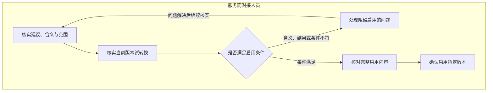

# 配置确认

> 版本：V1.0｜日期：2026-09-20｜状态：图文与角色走查通过；真实实现待验证
> 图：[配置确认](flow-configuration.html)
> 上游（我引用）：[业务主流程](flow-business-main.md) §1、§4—7、[接入配置关系](../03-03-er/er-integration-config.md) §1—5、[服务商资料与格式说明读取](../03-02-external-apis/provider-documents-format-read.md) §1—5、[当前身份与业务权限取得](../03-02-external-apis/current-identity-permissions-read.md) §2—3、[AI 推理与材料解析](../03-02-external-apis/ai-inference-material-parsing.md) §2—3、[原型交互说明](../../02-prototype/interaction-spec.md) §1—3
> 下游（引用我）：[履约协同与共用异常](flow-coordination-exceptions.md) §1—7、[业务流程覆盖与一致性总核对](coverage-review.md) §2—8、[接入配置域表结构](../03-05-schema/integration-config-schema.md) §1—7、[服务商接入配置接口](../03-06-provided-apis/configuration-apis.md) §1—3、[03-subprd-provider-config.md](../../05-prd/03-subprd-provider-config.md) §3

## 1. 范围与办理条件

**接入配置 Skill 生成完整可执行转换规则及必要对照表，后台实际试转换；服务商对接人员核实含义、适用范围和转换结果后一次确认启用。**

本流程覆盖本工作台维护的字段及费用项目对应配置。配置可独立于安装工单，不要求为了办理配置造一张安装工单。启用不提交安装事实、不改原账、不批准费用，也不改变人员的数据访问权限。

| 进入情况 | 本轮需要处理的工作 |
| --- | --- |
| 服务商首次接入，缺少适用配置 | 取得授权资料及已有说明，形成候选建议；对接人员只核实尚未确认的含义和使用条件 |
| 来源资料或业务含义变化 | 在相应配置事项呈现变化与受影响规则；同一调整尚未完成时接续当前事项 |
| 已有生效配置且新资料仍满足适用条件 | 直接复用，无需再产生一笔人工配置确认 |
| 原格式说明明确未提供 | 保留未提供事实，可按可靠原资料和业务确认确定受限范围；不伪造格式编号或版本 |
| 是否有说明未知、说明读取失败或与资料不匹配 | 明确问题并恢复读取或关联核实；不能当作“本来没有说明”跳过 |
| 必要原资料缺失、版本未知或业务含义不清 | 保留已知内容，暂不能启用依赖该缺口的配置 |
| 当前对接责任人未确定或无目标范围启用权限 | 保持待分配或待核实；查看资料、试转换成功均不授予启用权限 |

原资料、格式说明、AI 建议、人员更正、候选配置和生效配置分别保留。读取完整只说明取得内容齐备，不代表字段含义正确、试转换通过或配置可以启用。

## 2. 核实、试转换与一次启用

| 人员步骤 | 核实对象 | 系统支持及返回规则 |
| --- | --- | --- |
| 核实建议、含义与范围 | 原字段完整位置、业务含义、目标字段、使用范围及仍有疑问的地方 | 原文与建议并列；保留人工更正，不能把更正写回原格式说明或冒充 AI 原输出 |
| 核实当前版本试转换 | 实际使用的原始输入、转换结果、规则执行及缺项冲突 | 自动准备匹配版本的试转换；查看供核实，失败可恢复，不要求先选择 Skill |
| 判断是否满足启用条件 | 必要含义已明确、规则受控且可执行、当前试转换满足校验、资料范围与权限仍适用 | 含义、试转换或当前条件不符时显示具体原因，不能只因预览非空放行 |
| 处理阻碍启用的问题 | 补齐依据、纠正含义或候选条件；权限或来源故障按实际原因恢复 | 不重录全部资料；更改已保存候选形成新版本，重新准备匹配试转换，旧结果保留供回看 |
| 核对完整启用内容 | 本次配置版本、全部规则、适用范围、匹配试转换和与原生效版的差异 | 人员只重点复核变化，最终确认仍覆盖整份启用内容；不能偷偷扩大范围 |
| 确认启用指定版本 | 当前有权对接责任人作一次业务决定 | 系统确认生效结果后，本轮配置事项完成；单纯点击按钮不代表已生效 |

确认展示与最终按钮属于一次启用决定。含义核实、查看试转换和启用由当前业务责任人连续完成，不增加独立 AI 审批或第二名配置审批人。

AI 重新分析时不能静默覆盖人员正在修改的内容。若原资料未变，只修正含义或规则，可继续保留起点分析，形成新的候选及试转换；若原资料、说明或适用依据变化，先准备反映当前输入的建议，再继续核实。

## 3. 含义、范围与试转换检查

| 核实内容 | 可启用的要求 | 常见错误及处理 |
| --- | --- | --- |
| 字段位置 | 按来源、原结构及工作表等完整位置区分 | 不同工作表的同名列不能合并；只凭列名匹配时保留待核实 |
| 实际量与其他数量 | 明确是实际安装量、计费量、权益或其他业务数量 | 不能把费用表中的计费量自动转换成施工量 |
| 电缆分段 | 只有已确认各段代表不重叠的实际施工，且单位一致时才合计 | 重叠、单位不明或存在缺项时不能通过简单求和消除问题 |
| 桥架供料与安装 | 核实两条记录是否描述同一段施工，各自表示什么 | 同段供料与人工不能重复累计施工长度；数值相同本身不足以证明同段 |
| 费用项目对应 | 对应的费用范围、拆分和计费含义已经明确 | 费用合并关系不等于安装数量也可相加，不改双方原分项 |
| 原值及缺项 | 原值保持，输出明确区分未知、真实零值和不适用 | 未知不填默认零；缺失的必要量不能靠“转换成功”消失 |
| 服务商、来源、用途与范围 | 用已核实身份和业务约定限定，不能跨服务商默认复用 | 文件名相同、格式相似或公司名近似均不证明适用 |
| 规则可执行性 | 目标字段及转换方式在系统支持范围内，参数与成立条件明确 | 自由文本解释、原文件内容或模型生成脚本不直接执行；不支持的操作保持待处理 |

一次试转换保存其实际输入、候选版本、执行实现、输出和校验结果。界面上的预览对应这份记录，不能用上次成功截图证明当前规则可用。

| 试转换情况 | 启用与返回 |
| --- | --- |
| 尚未执行、执行失败或没有可靠结果 | 不能启用，恢复当前候选的试转换；保留已经核实的含义 |
| 输出存在，但缺必要字段、单位或关系冲突 | 显示具体问题，修正后重新验证；非空输出不等于通过 |
| 结果属于另一候选、另一输入或其他适用范围 | 不作为本次依据，准备对应版本的结果 |
| 输入不包含某条必需规则涉及的字段 | 明确该规则未验证；补充适用输入或收窄有依据的范围，不能把“未执行”记为“通过” |
| 同版本、同范围结果通过，当前条件未变 | 对接人员核实后可一次确认启用 |
| 样例结果通过，但后续资料适用性无法证明 | 只支持已经核实的范围；不因此允许全部未来资料自动套用 |

系统负责保存版本和检查关联。人员不需要输入版本号、记录编号或复制转换回执。验证不足时补的是确实缺少的业务依据与输入，不增设无意义的确认框。

## 4. 启用结果、冲突与恢复

| 当前情况 | 页面反馈及后续工作 | 保留的事实 |
| --- | --- | --- |
| 条件校验未通过，尚未启用 | 展示具体缺项、权限或版本变化，回到原候选处理 | 原候选、试转换和人员意见保留 |
| 已确认但结果尚未取得 | 显示正在确认本次启用结果，核实原动作；不能换内容盲目重发 | 固定本次确认的完整版本与范围 |
| 启用成功 | 明确当前生效版、适用范围和本次决定，结束本轮事项 | 原版本、试转换、操作者及历史使用关系继续保留 |
| 启用成功，但显示、通知或后续资料处理失败 | 保留已生效事实，只恢复失败环节 | 不重新启用、不要求人员重复确认 |
| 明确未生效，且仅临时故障 | 条件未变时恢复原确认；内容改变须重新核实并确认 | 不把恢复同一动作记成新的业务决定 |
| 其他人员已启用新版本或当前责任发生变化 | 停止旧确认，提示变化，由当前有权责任人核实差异 | 不覆盖他人已生效版本；旧候选与意见可追溯 |
| 权限撤回或范围缩小 | 停止新的越权启用，按当前访问范围展示 | 历史决定保持原操作者，不用缓存绕过权限 |
| 同一内容重复点击或成功结果重放 | 返回原动作结果，不重复切换版本或新增事项 | 同一次决定保持唯一记录 |

本工作台保存配置启用结果，不把它伪装成原安装系统的审核动作。是否生效应能通过已保存的配置状态及本次决定核实；生效版本、启用结果和事项进展必须一致。具体保存与并发保护在表结构、本系统接口和系统流程阶段落实。

新候选尚未启用时，不替换仍然适用的原生效版。确认新版本并切换成功后，同一份配置只有一个当前生效版本；其他版本继续供历史追溯。结果未明确前，不以“没收到成功提示”认定没有生效，也不无条件恢复旧版覆盖可能已经成功的新版本。

## 5. 持续复用与变化后的处理

**适用条件相同的资料自动复用已确认配置，只有受影响的变化才重新交给对接人员。**

| 后续情况 | 自动使用与人员处理边界 |
| --- | --- |
| 服务商、来源、用途、格式及业务条件仍满足 | 使用当前生效版处理，记录本次实际所用版本；资料人员继续核实安装事实，对账人员继续核实费用疑点，不逐单确认配置 |
| 同一份配置出现新的未确认候选 | 原版仍适用的资料继续按原版处理；候选不参与生产转换 |
| 格式、字段关系或单位变化，旧配置不再适用 | 停止受影响资料按旧规则自动转换，保留原资料和已处理历史；形成或更新对应调整事项 |
| 格式说明未提供，但已有可靠业务约定 | 仅在已核实条件内复用；无法证明新资料仍符合时保持待核实，不靠文件名猜测 |
| 多份配置同时命中同一用途与范围 | 保留冲突，暂停有冲突的转换；不选择最新创建者，也不叠加执行 |
| 只有个别资料不符合已确认条件 | 处理该资料及相关规则，不暂停未受影响的其他来源或用途，不要求全员重审 |
| 相同变化或同版资料重复到达 | 接续尚未完成的调整工作，不逐条通知新建待办或重复确认 |
| 已完成配置事项后发生新的实质变化 | 保留原启用决定，在同一配置下建立有明确原因的后续调整；后续工作未完成时持续接续其中 |

配置新版本启用后，重新检查受影响且尚未完成的资料整理、安装核查或对账事项，准备对应的新结果并呈现差异。原有人工编辑保留；不能把新结果静默覆盖到正在填写的表单或用旧确认提交新内容。

已提交安装明细、双方原账和历史决定不会随配置更新改写。若历史使用的旧规则存在错误，并影响已完成业务结论，应保留原依据和结果，关联后续核实工作；只处理有依据的影响范围，不把所有历史业务一律重办。影响范围暂时不能确定时保留待核实工作，不能宣称已全部处理。

发现已启用配置不适用时，先阻止它继续用于不适用资料。若拟重新使用历史规则，也需确认其对当前条件有效并具备匹配验证，按一次明确的新启用办理；不能因某版曾经成功就自动回退。历史版本的原内容和当时决定不变。

## 6. 角色操作与必要性走查

以下计数是业务决定数，未测量旧系统点击数或处理时间。试转换执行、查看结果和确认弹窗不另算审批。

| 路径 | 服务商对接人员 | 资料、核查或对账人员 | 重复操作检查 |
| --- | --- | --- | --- |
| 建议准确且试转换满足要求 | 核实含义、范围和结果，确认启用：1 次决定 | 按各自原业务职责处理结果 | 无第二轮 AI 审批，无新增审批人 |
| 人员修正一条含义 | 更正后核实新候选试转换，再确认启用 | 无需重录未变资料 | 保留旧内容，系统自动准备新结果 |
| 试转换失败 | 核实业务缺项或等待执行恢复，条件成立后继续 | 不收到假成功结果 | 不重复确认未变化内容，不因失败多启用一次 |
| 后续资料条件不变 | 无逐单配置决定 | 查看整理或比较结果，处理业务事实 | 配置确认可持续复用 |
| 格式变化或范围冲突 | 只核实受影响条件，必要时确认新版 | 当前受影响事项等待适用结果，其他工作继续 | 不让全部角色重做全部流程 |
| 启用结果未知或提醒失败 | 查看原动作实际进展 | 不重复提交已经成功的业务内容 | 状态恢复不增加人工决定 |
| 历史配置影响已完成业务 | 核实规则及影响范围，按当前条件修正 | 原责任人只核实受影响结论 | 不自动改旧明细、原账或历史决定 |

旧流程需要解释服务商字段并整理交接含义；新流程提前提供建议和原始依据，将已确认关系用于相同条件的后续资料。提效来自减少重复解释与配置，并不省略安装事实确认、资料审核或费用核实。

必要性结论：图中每步都由当前对接责任人完成，试转换和版本保护由系统承担。含义在配置启用前核实，具体安装事实与费用仍在各自环节判断，配置启用不能替代这些业务决定。

## 7. 原型差距与后续范围

| 能力 | 当前原型覆盖 | 正式实现要求 |
| --- | --- | --- |
| 查看字段说明、选择含义并展示试转换 | 固定场景可操作 | 使用真实输入、完整字段位置与受控规则，保留版本及执行结果 |
| 确认启用 | V1.1 已校验当前候选的模拟试转换记录，修改含义使旧记录失效 | 服务端检查当前候选、试转换、范围、权限和人员确认，缺少有效试转换不能启用 |
| 规则更改后重新验证、结果未知与并发 | 固定模拟未覆盖生产行为 | 明确失效提示、重试及原动作结果恢复 |
| 多配置冲突、持续复用与影响范围 | 原型没有完整执行机制 | 逐次匹配适用条件，记录实际使用版本，只重新处理受影响工作 |

V1.0 曾可在未形成试转换记录时模拟启用；原型 V1.1 已补齐前端限制并验证修改后的重新试转换。真实输入、范围与生产权限仍须按本节正式实现要求验收。

真实资料方式、格式版本证明、目标字段和转换方式支持范围、权限及启用结果保存仍须实现和验证。本文件是业务流程依据，不宣称已完成转换引擎或生产接入。

履约协同与共用异常已形成独立流程，全范围覆盖核对已完成；对应表结构、本系统接口与系统流程已形成。
