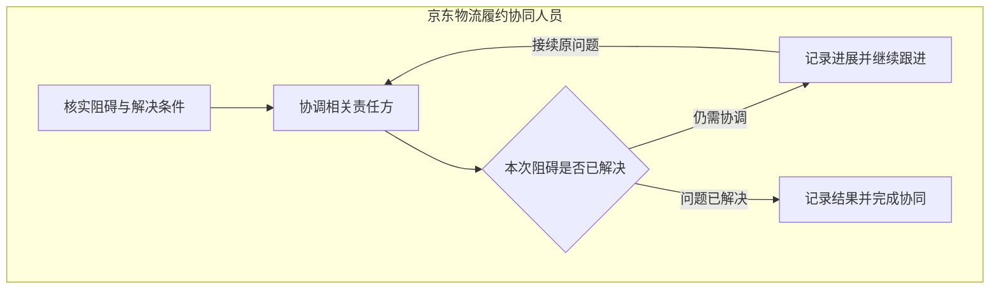
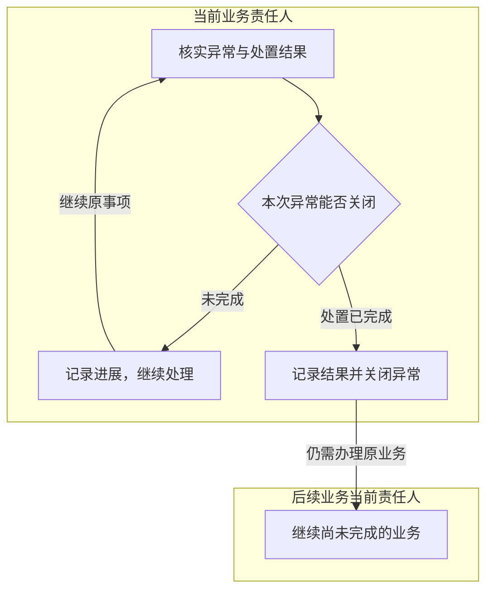

# 履约协同与共用异常

> 版本：V1.0｜日期：2026-09-20｜状态：图文与角色走查通过；真实实现待验证
> 图：[履约协同与共用异常](flow-coordination-exceptions.html)
> 上游（我引用）：[业务主流程](flow-business-main.md) §1—2、§4—7、[处理事项关系](../03-03-er/er-work-item.md) §1—5、[身份与事项责任关系](../03-03-er/er-identity-responsibility.md) §1—5、[当前身份与业务权限取得](../03-02-external-apis/current-identity-permissions-read.md) §2—3、[安装核查与补充](flow-installation-review.md) §2—5、[业务对账](flow-reconciliation.md) §2—6、[配置确认](flow-configuration.md) §4—6、[原型交互说明](../../02-prototype/interaction-spec.md) §1—3
> 下游（引用我）：[履约协同与共用异常核验](../../../../../02-任务/01-current/PHASE-14-foundation逐项建设/验收证据/履约协同与共用异常核验.md) §1—4、[业务流程覆盖与一致性总核对](coverage-review.md) §2—8、[处理事项域表结构](../03-05-schema/work-item-schema.md) §1—9、[履约协同与共用异常接口](../03-06-provided-apis/coordination-apis.md) §1—4、[07-subprd-coordination.md](../../05-prd/07-subprd-coordination.md) §3

## 1. 范围与责任

**履约协同由京东物流履约协同人员解决具体安装阻碍；业务异常由原事项当前有权责任人跟进，实际处置完成后记录结果。**

本流程不新增统一异常审批部门，不改变各角色的业务职责。联系物业、服务商或原系统维护人员按既有协作方式进行，不要求这些协作方注册工作台账号或再批准一次相同结果。

| 进入情况 | 办理方式 | 当前责任 |
| --- | --- | --- |
| 入场条件、安装安排等问题需要协调 | 保留具体阻碍、关联工单和已知进展，进入履约协同 | 京东物流履约协同人员 |
| 资料或费用问题超出普通补充可解决范围 | 说明业务异常和需要处理的内容，在原事项跟进 | 原业务当前责任人；合法转交后按新责任关系办理 |
| 普通资料缺项或费用事实待回复 | 按原核查补充或费用核实流程办理 | 原核查人、对账人员及对应服务商责任人 |
| 配置含义不明、试转换失败或范围不适用 | 返回配置确认的相应处理位置 | 服务商对接人员，不默认转给物流人员 |
| 材料读取、分析或提交执行失败 | 保留实际执行状态并恢复原处理；只补确实缺少的业务内容 | 原事项责任保持；不为技术故障增加一次业务异常审批 |
| 外部写入结果未知 | 先核实原动作，不能并行转异常或关闭来绕过 | 有权后台恢复结果，人员查看真实进展 |

每个事项只保留一个当前具体责任人。需要其他方协助，不等于已转移办理责任；尚未落实具体办理人时明确待分配，不能向同角色所有人员开放关闭权限。责任人身份、办理动作和目标范围均按当前授权核实。

同一工单可以有资料、核查、对账和履约等不同阶段事项。履约协同不要求每张工单必经，也不能把所有业务异常汇总后统一交给物流人员处理。

## 2. 履约协调与完成

| 环节 | 人员实际工作 | 完成或继续条件 |
| --- | --- | --- |
| 核实当前阻碍与解决条件 | 阅读工单、具体问题、现有回复及安排，明确本次需要解决什么 | 问题范围不清时先核实，不把整个安装生命周期都设为本事项目标 |
| 协调相关责任方 | 按原职责联系相关方，核实可执行安排或需要解决的条件 | 保留真实沟通结果，不虚构对方同意或承诺 |
| 问题仍未解决 | 保存本次进展、尚未解决的内容与后续跟进安排 | 继续原事项；记录进展不显示为已完成，不要求重复新建待办 |
| 问题已解决 | 当前有权责任人明确确认结果，记录解决事实及必要依据 | 保存成功后，完成原因为本次履约阻碍处理完成；不等于安装已经完成 |
| 原安排取消或工单撤销 | 核实真实原记录与对本事项的影响 | 经核实确实无需继续本次协调时，按实际停止原因结束；不能写成阻碍已解决，也不能在此代取消工单 |

解决条件取决于原问题。若原问题是“物业入场时间待确认”，相关方已经确认可执行的入场安排即可完成这次协调；无需等施工、核查或付款全部完成。若仍存在无法入场的条件，仅记录“已联系”或拟定一个时间不能证明阻碍解决。

结果应说明解决了哪个问题、实际确认的安排或事实、仍有哪些不属于本次协调范围的待办。已有业务记录或材料可直接关联；没有必要附件时不为满足表单而上传无关文件。

履约协同可以直接依据业务事实完成，不强制先产生 AI 分析。系统准备已有问题和进展，人员负责实际协调与事实确认。

## 3. 业务异常跟进与关闭

转异常时保留原事项、原问题和已有依据，记录具体原因及未解决内容。不得通过转异常修改正式安装明细、双方账单、费用批准或原系统审核状态。

图中“当前业务责任人”指下表中的既有人员职责；“后续业务当前责任人”仍按原业务确定，可与当前人员相同，不新增角色。

| 问题所属业务 | 原责任及处理边界 |
| --- | --- |
| 安装资料整理 | 服务商资料人员核实实际事实与缺项；关闭异常不表示正式资料已提交 |
| 安装资料核查 | 京东核查人员核实依据并协调；关闭异常不表示原系统审核通过 |
| 业务对账 | 京东对账人员跟进其负责问题，服务商应收负责人按本方责任回复或维护应收；双方不能代改对方原账 |
| 配置确认 | 服务商对接人员核实含义和适用条件；异常关闭不启用配置 |
| 履约协同 | 京东物流履约协同人员解决当前阻碍；不代替资料审核或费用决定 |

普通补充、配置修订及履约沟通本就能处理的问题，直接走原流程。共用异常仅统一实际处置、记录和返回要求，不要求上述每类事项都增加一个“转异常”步骤。

| 当前处置情况 | 人员动作 | 事项结果 |
| --- | --- | --- |
| 正在联系、等待事实或尚无明确处置 | 记录实际进展和仍需处理的问题 | 保持异常处理中；不能用备注长度或“已联系”替代处置完成 |
| 已处理部分问题 | 记录已解决部分、未解决部分及后续责任 | 原异常继续；不能丢弃未决问题后整项关闭 |
| 本次异常处置已完成，原业务无须继续 | 说明事实、依据及实际结束原因，确认关闭 | 保存异常处理完成，不改成审核通过、核对一致或其他正常完成结果 |
| 本次异常处置已完成，原业务仍需办理 | 记录处置结果和仍需办理的业务，确认关闭并接续相应工作 | 原异常完成原因保留，未完成业务按 §4 继续，不隐藏为整个工单完成 |
| 只是决定“以后再处理”或简单转告其他人 | 保留进展，继续落实责任与处置 | 尚不满足关闭条件；转告不等于可靠交接或问题解决 |

关闭前由当前有权责任人确认本次异常已实际处置，系统核实当前状态、未决动作及需要继续的业务是否已保留。系统不根据自由文本字数或 AI 对语气的判断自动批准关闭，也不要求第二人重复审批。

## 4. 关闭后的原业务如何继续

**异常结束与原业务成功分别记录。** 需要继续办理时，工作台保留原工单、服务商、问题和处置依据，接续已有对应未完成事项；没有对应工作时，建立与原异常关联的后续业务事项。

| 异常处理后仍需做的工作 | 接续规则 |
| --- | --- |
| 正式安装资料尚未提交 | 在原资料范围继续核实草稿，满足提交条件后再由服务商提交；不把关闭异常当成提交回执 |
| 正式明细待核查 | 准备当前资料和分析，交当前有权核查人按通过、补充等条件办理；不能调用关闭异常替代审核通过 |
| 费用问题已协调，但原账或比较仍待更新 | 取得可靠原账、依据及必要回复后重新比较；满足全部一致条件才记录核对一致 |
| 配置问题已澄清，但尚未启用 | 准备匹配的候选及试转换，由有权对接人员确认；异常记录不授权系统直接启用 |
| 只解决了某项履约阻碍 | 保留其他已存在的安装或履约工作；无需为“协同已结束”重复创建已有工单 |
| 原工单或原业务已按真实来源停止 | 保留原取消或停止记录及其影响，明确哪些本地事项无须继续 | 

同一原问题只保留必要的未完成工作。查找已有事项时须核实业务范围、原问题及尚需办理的动作；仅属于同一工单、同一业务类型，不足以证明是本次应接续的工作。自动交接失败时，异常处置结果保持，明确显示“后续工作衔接中”及待落实责任，恢复原交接即可；不能为了恢复再让人员关闭一次异常。交接尚未确定具体人员时保持待分配，不交给整个角色默认办理。

原业务需要实际批准或提交的，由原有权责任人按其流程决定。这是尚未完成的业务动作，不能省略；工作台负责传递已有事实，人员无需复制整段异常记录或重新上传已经可用的材料。

异常关闭属于本工作台处理记录。当前外部开发契约没有通用的“关闭异常”写入；不得拿安装审核通过、补充提交或任意备注充当外部状态同步。若某来源确需同步协调或异常结果，须核实其真实业务含义、接口与权限后补充契约；未验证前只呈现本工作台已保存状态。

## 5. 结果、责任变化与共同返回规则

| 场景 | 保留与返回 |
| --- | --- |
| 保存进展或关闭结果尚未明确 | 保留原确认内容，核实同一次保存结果；暂不显示完成，不换编号重发 |
| 明确没有保存，内容与条件未变 | 恢复原确认或进展保存，不增加一次业务决定；内容改变则重新核实 |
| 保存成功，但提醒、页面更新或后续分析失败 | 只恢复失败环节，不重复关闭、不抹掉实际处理结果 |
| 页面打开后责任转交或权限撤销 | 阻止旧页面继续办理，交当前有权具体人员；历史操作者保持 |
| 处理中原问题、工单或依据变化 | 提示变化并保留未提交内容，重新核实受影响事实；不能用旧安排确认新问题已经解决 |
| 新回复或材料到达 | 继续原事项，更新问题进展；收到回复不自动关闭，材料到达不自动批准 |
| 外部提交、审核或修订仍处于结果未知 | 继续核实原动作，不通过本地异常关闭覆盖或隐藏未决执行 |
| 原来源无法读取或记录暂时消失 | 明确失败或失效，核实当前业务安排；不能推断已取消、已解决或已经付款 |
| 多人重复点击、相同通知重复到达 | 同一次决定和问题继续原记录；不重复完成、增加待办或重复发通知要求确认 |
| 事项已完成后出现影响结论的新事实 | 保留旧完成原因与当时依据，关联后续核实；重复通知不重开同一工作，未结束的后续事项继续更新 |

人员只处理实际业务事实，后台恢复不增加人工审批。安装提交、核查补充、对账和配置的详细版本条件，继续按各自流程执行，不因通用异常规则而放宽。

共同关闭条件包括：当前有权责任人、当前事项及问题版本、明确且实际的处置结果、原未决动作已核实，以及尚未完成的业务有可追溯接续。这里定义业务约束，具体字段、保存一致性和状态转换由表结构、本系统接口及系统流程落实。

## 6. 角色走查与操作必要性

计数按一次业务决定，保存进展不等同关闭。以下为设计路径，未测量同类旧系统的实际点击数、耗时或沟通次数。

| 路径 | 人员工作与决定 | 减少的重复操作及保留责任 |
| --- | --- | --- |
| 入场安排已协商确认 | 物流人员核实事实，记录结果并完成本次协同：1 次完成决定 | 不等施工全过程结束，不新增 AI 分析或资料审核 |
| 入场条件仍未满足 | 记录进展、继续联系相关方，不点击完成 | 不为每次沟通新建事项，不制造假完成结果 |
| 核查异常已实际处置 | 当前核查人说明异常、跟进并记录关闭：转异常与关闭各 1 次决定 | 两次对应进入处置和实际结果；不加第二人重复批准 |
| 异常关闭后资料审核仍未完成 | 系统传递处置依据，当前有权核查人继续真正的审核决定 | 原审核责任保留，人员不搬运历史资料；不能把异常关闭算审核通过 |
| 对账争议处理后仍缺可靠新版 | 当前对账人员保留需要取得新版及核实的工作 | 只恢复取数与比较，不要求服务商重复改账 |
| 配置或资料问题已解决 | 对接或资料责任人继续其原确认、提交流程 | 异常关闭不代替启用或正式提交，不重填未变化内容 |
| 责任变化或技术失败 | 原确认保留，按当前责任恢复工作或结果 | 无权限人员不能继续关闭，系统恢复不要求同一内容再次确认 |

必要性结论：协同围绕原问题解决条件结束，异常围绕真实处置结果结束。原业务的未完成动作继续保留，其他角色不为恢复技术失败增加审批。

## 7. 原型差距与后续范围

| 能力 | 当前原型 | 正式实现要求 |
| --- | --- | --- |
| 履约填写结果并完成 | V1.1 可保存进展继续跟进，或记录结果完成 | 区分保存进展与确认问题解决，核实当前问题、权限及完成原因 |
| 异常说明原因、填写结果并关闭 | V1.1 区分保存进展和关闭操作，人员确认实际结果 | 提供“继续处理”与“处置完成”的明确选择，保留未解决问题及后续办理；不能以字数通过证明问题已解决 |
| 关闭后的业务接续 | V1.1 保存异常完成原因，复用已有未完成事项或创建关联事项，并提供继续办理入口 | 保留异常完成原因，可靠接续未完成业务，避免漏办或重复事项 |
| 接续对象匹配及无需继续的业务 | 原型按工单、服务商和类型简化匹配；关闭后总会保留后续事项，未覆盖真实停止后无需继续的路径 | 核实原问题及所需动作，避免关联同一工单的其他问题；确认原业务已停止时保留依据，不生成无须办理的事项 |
| 未决保存、并发、转交及外部状态 | 尚无生产行为验证 | 按当前责任、版本和真实执行结果恢复，不伪造外部关闭回执 |

系统应检查明确的处理结果选择、当前已知未决事项和保存条件；人员负责所确认事实的真实性，不要求 AI 从一段文字推断是否可以关闭。

原型 V1.1 已补齐保存进展及关闭后接续原业务的前端交互，并验证异常关闭不会替代原审核。真实结果保存、权限、协作来源、业务终止及必要外部同步仍待实现和验证。

详细业务流程及全范围覆盖核对已完成；对应表结构、本系统接口与系统流程已形成，正式实现按后续 PRD 推进。
