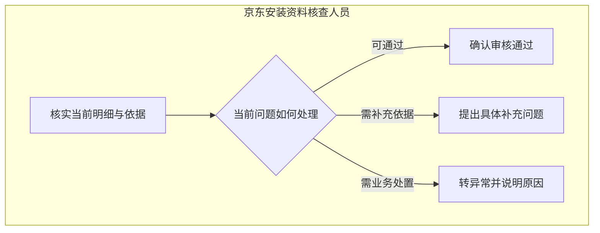
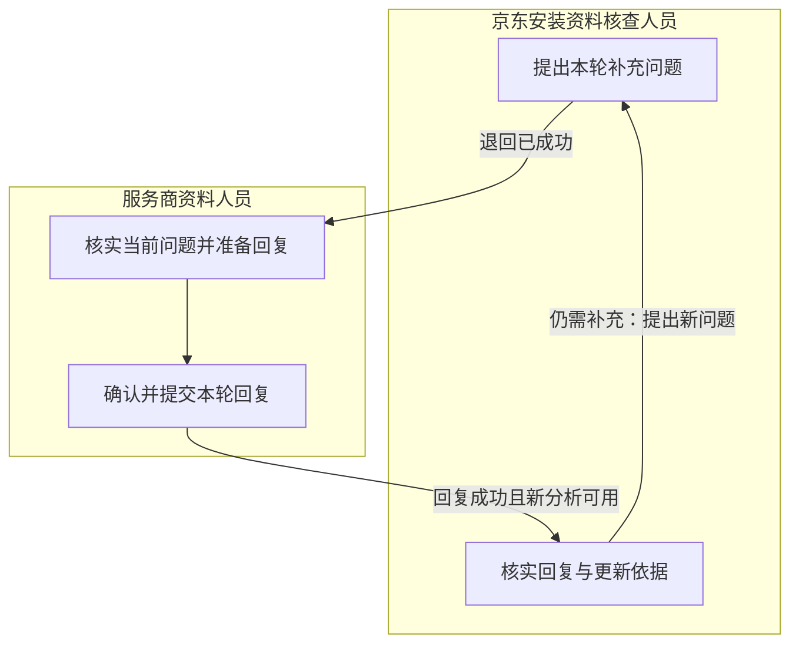

# 安装核查与补充

> 版本：V1.0｜日期：2026-09-20｜状态：图文与角色走查通过；真实实现待验证
> 图：[安装核查与补充](flow-installation-review.html)
> 上游（我引用）：[业务主流程](flow-business-main.md) §1—2、§5—7、[安装资料整理与提交](flow-installation-submission.md) §1、§4—8、[处理事项关系](../03-03-er/er-work-item.md) §1—5、[材料与分析证据关系](../03-03-er/er-evidence.md) §3—5、[核查决定与补充同步](../03-02-external-apis/review-supplement-sync.md) §1—5、[原型交互说明](../../02-prototype/interaction-spec.md) §1—3
> 下游（引用我）：[履约协同与共用异常](flow-coordination-exceptions.md) §1—7、[业务流程覆盖与一致性总核对](coverage-review.md) §2—8、[处理事项域表结构](../03-05-schema/work-item-schema.md) §1—9、[材料与分析证据域表结构](../03-05-schema/evidence-schema.md) §1—7、[安装资料与核查接口](../03-06-provided-apis/installation-apis.md) §1—4、[05-subprd-installation-review.md](../../05-prd/05-subprd-installation-review.md) §3

## 1. 范围与进入条件

**京东安装资料核查人员直接核实已整理的差异与依据，作出审核决定；服务商围绕当前具体问题补充，系统更新原事项的分析。**

本流程承接正式安装明细，覆盖核查、退回、回复、继续核查和本环节结束。费用核实、原账修订和付款不在此流程中。

| 当前情况 | 办理方式 |
| --- | --- |
| 正式明细已确认提交成功，分析可用 | 当前有权核查人直接进入差异与依据，不要求服务商重新提交资料 |
| 原系统已有正式明细或历史审核记录 | 按真实来源和当前业务状态接续；保留历史操作者及依据，未知信息保持未知，不补造本地提交或 AI 判断 |
| 正式提交结果仍未知 | 显示提交进展，暂不能批准或退回这笔尚未确认的明细 |
| 明细存在，但分析未完成或必要材料读取失败 | 保留已有资料，展示准备或失败状态；恢复后继续原事项，不能将空结果当作没有差异 |
| 已有有效分析，但明确提示缺项或冲突 | 核查人员针对具体问题提出补充或按职责处理异常；不能按“已经有分析”直接通过 |
| 当前责任人未确定、无办理权限或服务商归属变化 | 保留待分配或待核实状态，按原职责确认办理人；有查看权限不等于有决定权限 |
| 已退回且仍待回复 | 服务商只回应当前轮次；京东可查看进展，不在未解决的补充要求下直接通过 |

当前分析可用表示对应当前正式明细、适用方案和本次取得的依据，且其输出通过有效性检查。它可以明确说明证据不足。读取失败造成没有可用分析，与有效分析中识别出业务缺项，须分别展示。

## 2. 核实依据与作出决定

| 核实内容 | 核查人员判断什么 | 工作台提前提供什么 |
| --- | --- | --- |
| 当前工单与明细 | 是否为本次安装，项目、单位、实际量、供料方和服务范围是否对应 | 正式明细、适用方案及逐项差异，保留各自含义 |
| 材料关联与内容 | 文件是否属于本工单，相关段落与完整原文是否一致，适用范围和版本是否有效 | 可直接打开的原始依据及引用位置；不能只展示无法核实的 AI 摘要 |
| 差异解释 | 证据是否足以说明实际变化，是否还存在矛盾或缺项 | 已找到的支持、冲突或不足之处，及仍待核实的问题 |
| 既有补充 | 回复是否回应本轮问题，新的依据是否解决具体缺口 | 本轮问题、回复、新旧结果差异和此前记录 |
| 当前办理条件 | 资料、责任人与原系统审核状态是否仍允许这次决定 | 变化提示和不可办理原因；人员不手填版本或搬运系统回执 |

**找到相关文件仅表示可以核实依据，审核结论仍由有权核查人作出。** 材料数量、AI 表述肯定程度和数值一致，均不能替代事实与适用范围核实。

施工验收签字证明其实际覆盖的施工事实。当前问题若涉及额外费用是否获批，仅有施工验收签字仍不能消除这个疑点；应补充适用依据或转业务异常处理。此要求只针对存在该问题的事项，不要求每笔安装都补一份费用批准记录，也不授予安装核查人费用批准权。

| 决定 | 人员动作 | 生效及结束条件 |
| --- | --- | --- |
| 确认审核通过 | 核实当前资料与必要依据，确认没有未解决的补充要求；通过意见可不填 | 原系统确认本次审核动作成功后，本环节以审核通过结束。保留当时输入、判断和实际操作者 |
| 提出具体补充问题 | 说明哪个项目、哪处依据存在何种缺项或矛盾，以及需要核实什么 | 原系统确认退回成功后，才交给本服务商当前资料责任人；同一事项接续 |
| 转异常并说明原因 | 写明无法通过或普通补充无法解决的原因，按原职责协调 | 进入异常处理中，由当前责任人跟进；实际处置完成并记录结果后才能关闭，完成原因保留为异常处置 |

转异常为工作台的业务处置记录，不调用安装审核通过或退回接口来伪造外部状态。不能将“异常已关闭”显示为“原系统审核已通过”。外部状态映射及异常关闭后的业务安排，在共用异常流程继续细化。

## 3. 提出问题、补充与继续核查

| 步骤 | 当前责任人的工作 | 交接内容与限制 |
| --- | --- | --- |
| 京东提出本轮问题 | 说明需要补充的具体事实与依据 | 保存原问题与当时核查依据；退回未成功时不让服务商开始一轮正式回复 |
| 服务商核实原问题 | 阅读当前问题，核实事实、已有材料及缺口 | 同屏保留原问题；无需重新建单、复制全部历史或先启动 Skill |
| 服务商确认并提交回复 | 填写具体回复，附必要的新材料或已有材料 | 可以只有事实说明，无新增文件时不强制上传；使用的文件须先保存成功，且可关联当前工单 |
| 京东核实更新结果 | 原回复已成功且新分析可用后，核实回复和受影响的依据 | 展示仍未解决的问题；不因收到回复或分析完成自动通过 |
| 仍需补充 | 京东明确本轮未解决内容，形成新的退回要求 | 新要求成功后服务商回应这一轮；上一轮问题和回复保留，不能覆盖成最新文字 |

回复同时保留“回应哪次退回”和“谁确认提交了这次回复”。二者属于不同人员动作，须指向同一事项和服务商。一个当前有效退回轮次至多接收一份成功回复；明确失败后的尝试保留结果，已关闭轮次不能接收新的回复。

**补充成功后，原事项自动准备新分析，服务商无需再次确认 AI 结果。** 分析失败时保留成功回复，恢复分析即可；新结果可用后，交给该事项当前有权的京东核查责任人。期间发生合法转交时使用新的当前责任人，历史操作人保持原样。

若回复涉及正式安装数量等明细更正，需按原系统允许的明细修订路径办理，并与当前补充问题保持关联；文字回复不能直接改写正式明细，也不能另走一次“首次提交”绕过本轮核查。涉及明细修订的动作结果未明确前，不并行批准或提交另一笔互相冲突的动作。

图中“继续核查”回到本文件 §2 的决定条件。问题已解决可通过；仍需业务处置可转异常；只有仍需补充时才形成下一轮要求。

## 4. 已确认动作的结果与恢复

| 当前结果 | 人员看到什么 | 后续处理及责任 |
| --- | --- | --- |
| 尚未受理，明确未向外部写入 | 具体校验错误或暂不可用原因，原意见保留 | 更正问题；仅临时服务故障且内容不变时恢复原动作，不增加人工确认 |
| 原系统明确拒绝且证明未生效 | 拒绝原因及原确认内容 | 保留原责任与业务状态；具备条件后按当前事实重新决定，不覆盖原拒绝记录 |
| 原系统正在处理 | 本次动作和处理中状态 | 等待同一动作结果；不能显示通过、退回成功或补充已收到 |
| 可能已写入，结果暂时未知 | 原确认内容与待核实结果 | 系统继续核实原结果；人员无需换编号、重填意见或重复提交，也不要求去原系统搬运回执 |
| 审核通过已成功 | 本次审核结果和所依据资料 | 当前核查环节结束；不表示费用批准、付款或整个安装业务完成 |
| 退回已成功，交接暂未完成 | 原问题已生效，正在交给服务商 | 只恢复责任交接和事项呈现；未分配具体资料人员时明确待分配，不重新退回 |
| 回复已成功，分析尚未可用 | 补充已收到及分析进展或失败原因 | 只恢复分析与核查接续，不能要求服务商重交已成功回复 |
| 外部动作成功，本地显示或提醒失败 | 经确认的真实动作结果 | 只恢复本地记录、显示与提醒；通知失败不撤销动作，也不重复外部写入 |

上述为业务反馈含义，沿用既有接口的成功、拒绝、待确认结果，不另造一套技术状态枚举。保存人员确认与证明动作生效是两件事。刷新、超时、暂时未查到记录或看到相似状态，均不足以判断本次动作终态。

已确认内容保持固定。重复点击及原动作恢复对应同一决定；更改动作类型、意见或材料不能冒用原确认。处于待确认结果时保持原业务责任，不提前把事项交给下一角色；结果明确后按真实动作接续。

## 5. 变化、历史与重新核查

| 变化情况 | 当前办理规则 | 历史与返回位置 |
| --- | --- | --- |
| 人员决定前，明细、方案、材料或分析发生变化 | 暂停基于旧内容的批准或退回，准备当前结果；保留意见并提示变化 | 核查人只重新核实受影响内容，再对当前完整决定确认 |
| 动作可能已发出后才发现变化 | 先核实原动作结果，不能把冲突等同未写入 | 原确认、变化和最终执行结果分别保留；不得并行重发 |
| 服务商准备回复时问题已关闭或更新为下一轮 | 保留未提交文字，展示当前问题；不把旧回复自动绑到新轮次 | 人员核实适用内容后回复当前问题，不能只替换关联编号直接发送 |
| 明细已被按既有职责修订 | 取得真实有效新版并重新分析；补充文本不作为新版证明 | 未结束的核查继续原事项，保留前版及当时判断；修订是否允许以原系统实际规则为准 |
| 当前责任转交或权限撤回 | 新动作按当前权限与具体责任人执行；无权人员不能继续查看受限内容或办理 | 历史决定仍保留原操作者；后台核实既有动作不得冒用已失效身份发出新决定 |
| 原系统直接发生审核、退回或补充 | 核实真实记录与关联，接续本工作台进展，去除同一动作的重复通知 | 记录真实来源，不伪造本地确认；未知的历史分析或人员信息不补填 |
| 工单撤销、服务商重新分配或必要关联失效 | 暂停依赖旧事实的办理，按原职责核实当前安排 | 不将原记录不可读作为已完成，不把旧决定搬到另一服务商 |
| 旧分析晚到 | 只使用与当前输入、事项匹配的结果 | 历史结果可追溯，不能覆盖较新的补充或决定 |

对于**已经完成核查的事项**，后续取得影响原结论的真实明细、方案或证据变化时，保留原事项和完成原因，建立关联原事项的后续核查工作。它仍属于安装核查事项，无需创建新的业务角色或审批层级。

同一后续核查尚未结束时，继续更新其中的变化，不因每条通知生成新待办。完全重复的来源变化不新增工作。只变展示文字或收到重复消息，不构成再次核查的理由；无法判断影响时明确待核实，不能静默忽略。

后续核查仅处理变化对原结论的影响，保留可用的此前核实内容。原系统允许重新审核时，按当前明细和当前结果作出新决定；不允许时，记录核实发现并按原职责处理异常，不能重放已成功的旧审核或自动撤销原决定。与原事项的唯一关联、变化去重和原系统重新审核条件，须在后续表结构、系统流程及真实接入中落实。

## 6. 角色操作与必要性走查

以下计数是成功路径中的业务决定数，不计阅读、输入、打开原文和确认弹窗；尚无同起终点的旧系统实测点击基线。

| 路径 | 京东核查人 | 服务商资料人员 | 重复操作检查 |
| --- | --- | --- | --- |
| 资料及依据已充分 | 核实结果与原文，确认通过：1 次决定 | 无需为已有正式明细重交 | 无独立 AI 审批，无新增审核角色 |
| 一轮补充后通过 | 提出具体问题、核实回复后通过：2 次决定 | 回应当前问题并提交：1 次决定 | 原问题、回复及依据集中呈现，无需人工重新串联 |
| 再次补充 | 新提出一次具体问题，之后再决定 | 回应新轮次一次 | 只针对未解决内容；前轮回复保留，不重抄历史 |
| 回复成功但分析失败 | 等待恢复后的当前结果，再核查 | 不重交、不重新启动 Skill | 自动分析恢复不增加业务决定 |
| 动作结果未知 | 查看原动作进展，不并行批准或退回 | 若为回复未知，同样只看原结果 | 不因超时或刷新增加决定 |
| 需业务异常处置 | 说明原因并跟进，处置完成后记录实际结果 | 按实际问题协作，不被要求提交虚假证明 | 转异常与记录处理结果各有实际目的，关闭不代替审核通过 |
| 完成后重要依据变化 | 核实变化影响；仅在源系统允许时作出新审核决定 | 仅需补充时回应新问题 | 原决定不重做、不擦除；重复通知不重复办理 |

旧工作台需要人员对照资料、定位证据、重新串联补充记录；新工作台提前组织这些内容。两类角色都保留原业务决定，减少准备工作是设计目标，实际操作次数和处理时间改善仍须完整路径实测。

必要性结论：图中动作都有明确人员；证据在核查当次判断，补充在当前问题下处理。自动分析、写入回查、去重和通知恢复不计入人工审批链。安装事实、费用依据和付款结果各自保持业务含义。

## 7. 原型对应与后续范围

| 能力 | 当前证据 | 正式实现仍需落实 |
| --- | --- | --- |
| 核查差异、打开依据、通过或退回 | 原型固定场景可连续操作 | 真实记录、完整原文、版本与当前权限核实 |
| 补充后回原事项、保留历史 | 原型以模拟时序更新分析 | 真实成功回执、有效轮次约束、分析失败只恢复分析 |
| 依据不足、读取失败与异常 | 原型覆盖部分分支 | 区分材料读取失败和有效分析中的缺项，明确实际处置与外部状态关系 |
| 冲突、未知结果、转交、撤权及完成后变化 | 文档已定义业务要求 | 后续开发契约、完整状态转换及真实端到端验证 |

本文件的图文核对不证明生产权限、外部写入、AI 或恢复机制已运行。原系统是否支持重新审核、正式明细修订、条件写入与可关联回查，仍须取得提供方证据。

业务对账、配置确认、履约协同与共用异常已形成独立流程，全范围覆盖核对已完成；对应表结构、本系统接口与系统流程已形成。
