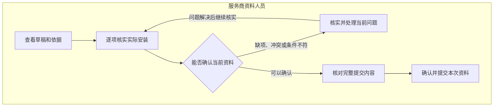
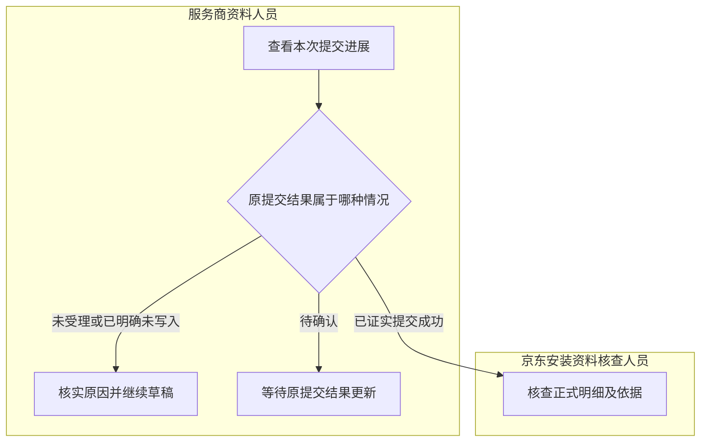

# 安装资料整理与提交

> 版本：V1.0｜日期：2026-09-20｜状态：图文与角色走查通过；真实实现待验证
> 图：[安装资料整理与提交](flow-installation-submission.html)
> 上游（我引用）：[业务主流程](flow-business-main.md) §1—2、§5—7、[术语表](../03-01-glossary/glossary.md) §1—3、§5、[安装资料关系](../03-03-er/er-installation.md) §1—5、[处理事项关系](../03-03-er/er-work-item.md) §2—5、[工单上下文读取](../03-02-external-apis/installation-work-order-context.md) §2—5、[正式安装明细提交](../03-02-external-apis/installation-detail-submit.md) §2—5、[AI 推理与材料解析](../03-02-external-apis/ai-inference-material-parsing.md) §2—3、[原型交互说明](../../02-prototype/interaction-spec.md) §1—3
> 下游（引用我）：[安装核查与补充](flow-installation-review.md) §1—7、[业务流程覆盖与一致性总核对](coverage-review.md) §2—8、[处理事项域表结构](../03-05-schema/work-item-schema.md) §1—9、[安装资料域表结构](../03-05-schema/installation-schema.md) §1—7、[安装资料与核查接口](../03-06-provided-apis/installation-apis.md) §1—4、[04-subprd-installation-materials.md](../../05-prd/04-subprd-installation-materials.md) §3

## 1. 范围与办理条件

**安装资料整理 Skill 提前形成草稿，服务商资料人员核实实际施工事实，并对完整内容作一次提交确认。** 资料提交成功后，京东安装资料核查人员处理正式明细及其依据。

本流程从资料整理事项进入，到正式资料提交结果明确并衔接京东核查为止。京东如何审核、退回与接受补充，由安装核查与补充流程展开；本流程不处理账单、费用批准或付款。

| 进入情况 | 当前工作 |
| --- | --- |
| 尚无正式明细，已有有效整理结果 | 展示草稿、原始依据与待核实问题，交给本工单有提交权限的服务商资料人员 |
| 整理结果只覆盖部分内容 | 已知信息保留，缺项和冲突明确展示；完整核实前不能正式提交 |
| 必要资料读取或分析失败 | 展示失败位置与已有资料；恢复读取和整理，不把失败当成“没有问题” |
| 原系统已存在正式明细 | 按当前原记录进入相应核查，不要求服务商为了新工作台重新提交一次 |
| 需要修订已提交明细 | 只有原系统当前业务状态允许修订，且前一笔未决提交已明确结果时，才进入修订；保留旧明细与决定 |
| 原工单、当前有效方案或正式明细状态无法确认 | 保留可用内容，暂停正式提交；不能把“没读到明细”视为“首次提交” |
| 当前人员不是责任人、无提交权限或服务商归属不符 | 不能办理；按已有职责核实责任与权限，不另设全员审批或新账号流程 |

资料整理事项、草稿、工单和服务商须属于同一办理范围。当前责任人暂未明确时保持待分配；角色名称和姓名相同不能替代具体责任确认。

## 2. 核实与确认流程

| 步骤 | 服务商资料人员的工作 | 工作台提供的支持 |
| --- | --- | --- |
| 查看草稿和依据 | 阅读整理结果、待核实问题，查看关联原文 | 将已有信息填入草稿；展示材料位置、原记录与当前工单，不要求先选择 Skill 或写指令 |
| 逐项核实实际安装 | 核实各项目实际数量、单位、供料方、服务范围及完整性 | 明确区分方案、实际施工、计费、权益和库存数量；同一项目的不同记录并列核实 |
| 补齐或更正 | 只处理缺项、冲突和错误提取；无法确认时保留待核实 | 保留已核实内容和未提交意见，记录人工改正，原 AI 输出仍可追溯 |
| 核对完整提交内容 | 查看本次全部项目及所用依据，确认没有遗漏或错误含义 | 确认的是完整草稿；只修改某一项也须展示并保存本次完整内容 |
| 确认提交 | 当前有权责任人确认本次安装事实并提交 | 固定确认内容与当时依据；同一内容的重复点击和恢复沿用本次提交 |

确认展示和最终提交属于一次业务决定。无需先“批准 AI 结果”，再由另一名人员重复批准相同资料。核实草稿期间的保存只保留编辑内容，不表示正式提交。

## 3. 核实内容、缺项与人工更正

| 内容 | 核实要求 | 不允许的替代 |
| --- | --- | --- |
| 安装项目与完整项目列表 | 依据实际施工确定项目及范围；同名记录须核实是否属于同一项目 | 只提交本次改动的几行，再假定其他行由系统随意补齐 |
| 实际安装数量 | 是实际完成量，值有效且非负；零仅在业务允许并已确认未发生该项施工时填写 | 未知填零；计费数量、权益上限或领退料差额直接当施工量 |
| 单位 | 与原资料和数量含义一致 | 只比较数字，忽略米、段或其他单位的区别 |
| 供料方 | 按每个项目核实实际供料主体 | 因为安装由服务商负责，就默认所有材料均由服务商提供 |
| 服务范围 | 与该项目实际承担的工作一致 | 将“仅安装”写成“供料及安装”，或因某一项物业供料而改写全部项目范围 |
| 原材料与人工更正 | 保留确切材料及版本；更正后的值标为人工核实内容，必要时说明更正依据 | 伪造材料引用、把人工改正显示成原文摘录，或覆盖原 AI 输出 |
| 当前业务条件 | 原工单、有效方案、明细状态及本次依据仍适用；当前人员有权提交 | 用历史版本、失效确认或此前权限批准新的内容 |

**缺项与冲突允许存在于草稿中，不能靠默认值变成“已核实”。** 数值一致也不足以证明项目、单位、供料方和范围均一致。

有效整理结果有待核实字段时，人员可按已取得事实补齐或纠正；必要缺项已解决且提交条件成立后，不要求为每次人工编辑再运行一遍 AI。若问题来自必要材料未取得、版本未知或关联错误，仍须先解决该问题，不能仅填满表单绕过。

没有文件依据时，可以保留可核实的业务记录及实际人工确认；不为满足表单而上传无关文件或伪造附件。所用材料必须真实可定位。已有材料未读全、无权读取，与明确没有文件依据分别处理。

补充了材料或重新整理得到新结果时，展示变化部分，保留人员正在编辑的内容。新结果不静默覆盖人工更正；旧确认也不能自动授权更改后的提交内容。

## 4. 提交后如何继续

| 页面进展含义 | 判断依据 | 人员接下来做什么 | 业务接续 |
| --- | --- | --- | --- |
| 尚未受理 | 内容或权限校验未通过；或明确尚未发出任何写入 | 看具体原因；修正内容或核实权限。若仅服务暂不可用且内容未变，恢复原提交即可 | 保留草稿；不生成核查事项，不因重试增加一次确认 |
| 原系统明确拒绝 | 有可靠结果证明该次没有写入 | 按拒绝原因核实；具备允许提交的条件后，再确认需要更正的新内容 | 原拒绝记录保留；不能改写成新提交成功。明确拒绝后的重新确认按新提交办理 |
| 正在处理 | 已确认原系统还在处理本次提交 | 查看进展，离开后可回原事项 | 工作台继续核实原结果；不能并行发起另一笔明细提交 |
| 结果暂时无法确定 | 请求可能已执行，但尚无可靠成功或拒绝结果 | 保留原确认，不重新填写或再次提交同一动作 | 回到本次提交的进展查看更新。超时、刷新或页面关闭都不代表写入失败 |
| 已证实提交成功 | 取得可关联本次确认内容的正式明细及其版本 | 服务商本环节完成，可查看提交内容和结果 | 京东核查人员接续该正式明细，不等同核查通过 |
| 已提交，核查衔接中 | 正式明细已成功，但核查事项准备或分析暂未完成 | 服务商无需重交；京东看到实际准备状态 | 恢复核查衔接，不重复提交正式明细，不创建重复核查事项 |

表中的进展含义用于业务交互，不新增一套数据库状态枚举。接口中的“正在处理”和“结果未知”均为待确认结果，须保留其区别；页面不能仅凭请求返回正常就显示资料已提交。

等待期间，原确认内容保持固定。人员不能通过修改草稿或重新生成提交编号绕过未决动作。若需要变更事实，先核实原提交结果，再按原系统允许的修订路径办理。

“已经点击确认”“查询暂时没有记录”“看到内容相似的旧明细”均不足以判断本次成功或失败。工作台负责取得可靠结果；当前人员不承担反复到原系统查找并搬运回执的日常步骤。

## 5. 版本变化、返回与核查交接

| 场景 | 保留什么 | 返回与交接规则 |
| --- | --- | --- |
| 确认前工单、方案、明细或必要材料变化 | 原草稿、已填意见及变化前依据 | 暂停旧确认，显示受影响内容；人员只核实变化部分，但新确认仍覆盖整份提交内容 |
| 已确认后发现条件变化，且能证明尚未写入 | 已确认内容和停止原因 | 不用旧确认提交新版。取得当前条件，核实后形成新的有效确认；该次旧确认不被覆盖 |
| 提交可能已经发出后发生变化 | 原提交内容、当前变化和待核实结果 | 先核实原动作终态，不把版本冲突直接当成未写入，不另起并行提交 |
| 人员确认后离开页面或会话结束 | 原确认和当前进展 | 重新进入按当前权限查看原结果；单纯重新登录不要求重复确认相同内容 |
| 重新分析与人工编辑同时发生 | 原分析、人员编辑及新分析差异 | 原事项展示变化，人工已改内容不被静默覆盖；保留可追溯版本 |
| 原系统成功，核查事项衔接暂时失败 | 成功明细、版本及人员确认 | 仅恢复衔接；相同提交或明细版本进入已有核查工作，不重复通知人员办理相同决定 |
| 原系统直接完成或修订资料 | 真实原记录及其来源，已有工作台草稿历史 | 核实当前资料和办理条件，进入相应核查；不补造本地草稿提交或本地人工确认 |
| 已审核明细需要改正 | 原审核结论及其依据 | 按原系统允许的修订条件办理；没有允许依据时保持待核实，不能直接覆盖已审核内容 |

交给京东核查的业务内容包括：关联工单及服务商、当前正式安装明细与版本、方案及相关材料、已准备的核查分析和仍待核实的问题。分析尚未完成时显示准备状态，不把资料提交人改成“已审核人”。

服务商完成资料提交，京东保留独立核查责任。资料整理事项与核查事项属于不同阶段；进入核查后的退回和补充在原核查事项接续，不重新创建一次首次资料提交。

## 6. 按角色走完路径

| 路径 | 服务商资料人员 | 京东安装资料核查人员 | 是否增加重复操作 |
| --- | --- | --- | --- |
| 内容已准确完整 | 打开草稿 → 核实原文和字段 → 核对完整内容 → 确认提交 → 查看结果 | 成功后进入对应核查事项，直接处理核查结果 | 一次业务提交确认；不增加 AI 审批 |
| 有提取错误或待核实字段 | 查看具体问题 → 按事实更正 → 核对完整内容 → 确认提交 | 接收修正后的正式明细，原依据仍可查 | 只改必要内容，不重填整单，不逐项重新启动 Skill |
| 必要材料失败或来源状态未知 | 查看失败与已有内容；只补真实缺项，等待恢复 | 尚无有效正式提交时不收到“可审核”的假事项 | 后台恢复不要求重做已完成的人工核实 |
| 结果未知 | 查看原提交进展，可离开后再查看 | 不根据暂时缺少成功回执认定未提交或让服务商重交 | 同一内容保留一次确认，不重复提交 |
| 明确拒绝后修改 | 核实拒绝原因并处理，按当前条件重新确认 | 新提交成功后继续核查 | 新内容产生一次新的确认，属于新的业务决定 |
| 本地交接失败 | 原提交成功结果保留，无需操作 | 核查准备恢复后处理同一正式版本 | 不增加资料重交或重复审核 |

一次成功路径的业务决定数为一次资料提交；确认弹窗与最终按钮属于同一决定。旧流程由人员阅读、整理和填写分散材料，新流程把已整理内容及依据放到当前事项。实际点击数、时间与往返沟通的改善须以同类完整路径验证，不能用这一次决定数替代实测结果。

必要性走查：每个图中动作由资料人员或核查人员承担；材料读取、自动整理、版本检查和提交结果核实不增加人员审批。事实核实发生在正式提交前，后续核查仍由京东承担，原有责任没有转给 AI。

## 7. 与当前原型的对应及待实现部分

| 能力 | 当前原型 | 本流程对正式实现的要求 |
| --- | --- | --- |
| 查看草稿、原文、修改实际量与范围 | 固定场景可操作 | 覆盖完整项目及真实输入，区分人工更正和原 AI 结果 |
| 表单校验和一次确认提交 | 固定字段校验、确认弹窗可操作 | 按各项目事实及当前业务条件核实；不把固定场景的选项限制当作全业务规则 |
| 提交成功后进入京东核查 | 前端模拟生成核查事项 | 必须取得本次原系统成功证据，再完成唯一交接 |
| 缺项、读取失败及重新整理 | 原型只覆盖部分固定场景 | 资料整理本身须覆盖完整缺项、材料问题、变化提示及人员编辑保留 |
| 结果未知、明确拒绝、版本冲突、并发及恢复 | 未实现生产行为 | 按本流程及既有提交契约设计完整状态反馈，并做后续运行验证 |

本流程是业务设计依据。前端模拟通过不能证明真实提交成功、版本保护或恢复行为已经实现。原系统修订条件、人员身份映射、条件写入、重复处理和可关联回查能力仍须核实。

## 8. 后续范围

安装核查与补充已由独立流程展开，覆盖依据核实、通过、提出补充要求、服务商回复、更新分析和继续原事项的完整路径。业务对账、配置确认、履约协同与共用异常已形成独立流程，全范围覆盖核对已完成；对应表结构、本系统接口与系统流程已形成。资料提交字段、存储与系统执行见表结构、本系统接口和系统流程；实现验收在 PRD 中接续。
