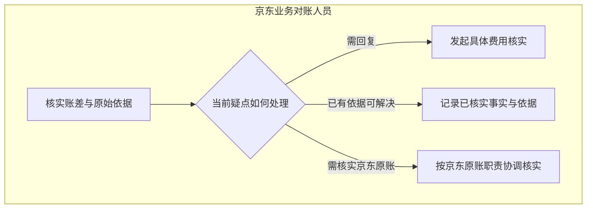
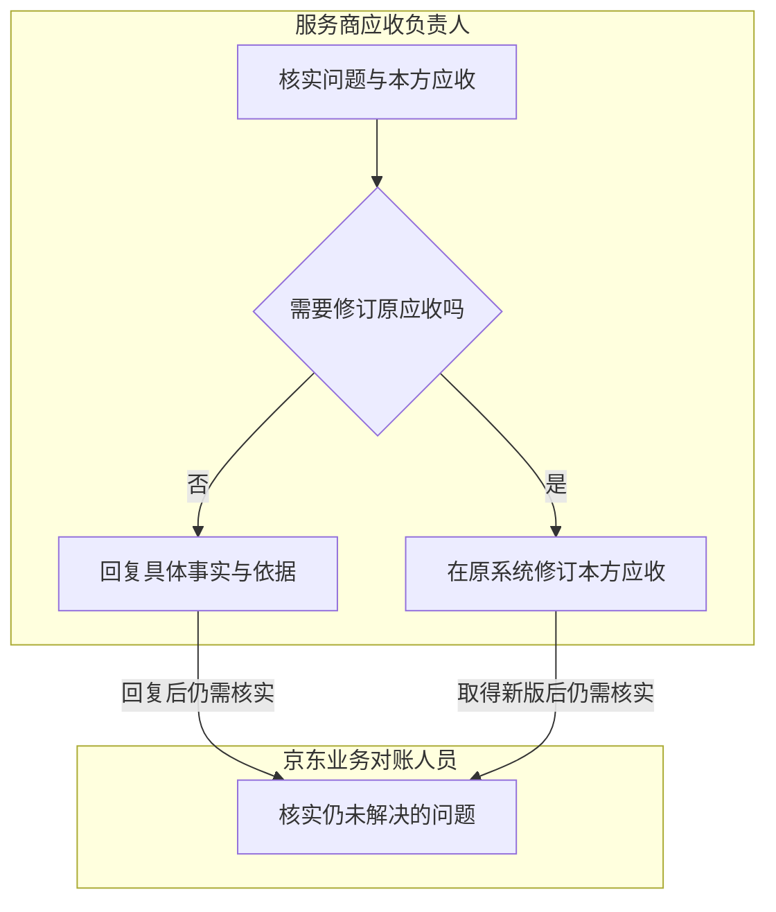

# 业务对账

> 版本：V1.0｜日期：2026-09-20｜状态：图文与角色走查通过；真实实现待验证
> 图：[业务对账](flow-reconciliation.html)
> 上游（我引用）：[业务主流程](flow-business-main.md) §1、§3、§5—7、[双方账单与对账依据关系](../03-03-er/er-reconciliation.md) §1—5、[京东账单读取](../03-02-external-apis/jd-bill-read.md) §1—5、[服务商应收读取](../03-02-external-apis/provider-receivable-read.md) §1—5、[计费条款与批准记录读取](../03-02-external-apis/billing-terms-approval-records-read.md) §1—3、[AI 推理与材料解析](../03-02-external-apis/ai-inference-material-parsing.md) §2—3、[原型交互说明](../../02-prototype/interaction-spec.md) §1—3
> 下游（引用我）：[履约协同与共用异常](flow-coordination-exceptions.md) §1—7、[业务流程覆盖与一致性总核对](coverage-review.md) §2—8、[双方账单与对账依据域表结构](../03-05-schema/reconciliation-schema.md) §1—7、[业务对账接口](../03-06-provided-apis/reconciliation-apis.md) §1—3、[06-subprd-reconciliation.md](../../05-prd/06-subprd-reconciliation.md) §3

## 1. 范围与入口

**系统提前组织双方原账、分项比较和差异解释；京东业务对账人员核实疑点，服务商应收负责人按职责回复依据或修订本方原应收。**

本流程覆盖一个安装工单及一家服务商的业务核对。双方记录独立维护，本工作台不代改原账，不新增费用审批、结算或付款流程。

| 当前情况 | 工作台呈现与办理方式 |
| --- | --- |
| 双方有效记录齐备，适用关系明确 | 自动比较当前范围，展示分项对应、计算结果及必要依据；有疑点才进入人工处理 |
| 初次比较已满足全部一致条件 | 保存核对结果，无需人员先发起一个问题或再批准一次无差异结果 |
| 只取得单方、部分分项或不明口径 | 展示已取得内容和具体缺项，暂停依赖缺项的结论；没有读到应收不按零金额处理 |
| 存在多张账单、替换或作废记录 | 先核实本次有效账单集合与范围；不默认取最新创建的一张，不累加新旧版本 |
| 整单覆盖多个工单 | 保留完整授权范围和明确归属；无分配依据的共同费用保持待核实，不按工单数平均分摊 |
| 当前办理人未确定、权限不足或关联变化 | 按既有职责落实具体人员和访问范围；不能凭角色名或同名小区直接办理 |
| 原事项已有费用问题待回复 | 展示当前问题、双方记录及进展；更新继续原事项，避免重复发起同一问题 |

当前需要人员处理的事项直接提供比较结果与相关依据。日常操作不要求先选 Skill、上传一份已有账单副本或重新制作对账表。读取和计算失败明确展示，旧结果只供历史回看。

## 2. 核实账差与分配处理责任

| 京东业务对账人员核实什么 | 系统提供的信息 | 处理边界 |
| --- | --- | --- |
| 是否比较同一业务范围 | 工单、服务商、双方有效账单集合、分项归属及当前版本 | 账单与工单的关联须可靠；整单总额不能代替多工单中的本工单金额 |
| 项目是否正确对应 | 双方原项目名称、计费范围、单位及已确认对应关系 | 一对多或多对多按完整范围比较；同名不自动认定相同项目 |
| 差额实际出现在哪 | 本次各组金额、差额、双方原总额与总分检查 | 不让 AI 重算金额，不把计费数量当作实际安装数量 |
| 差异解释是否成立 | 对账差异解释 Skill 提供的疑点、原条款、费用决定及原文位置 | 解释有依据不等于费用已获批准，也不代表账差已经消失 |
| 谁需要继续处理 | 当前问题及其对应原账归属 | 服务商问题交应收负责人；京东原账疑点按京东原有维护职责协调 |

| 处理路径 | 人员动作 | 成功后如何接续 |
| --- | --- | --- |
| 需要服务商核实 | 明确具体分项、疑点和需要回应的问题，确认发起费用核实 | 问题保存成功后，交本服务商当前有权应收负责人；京东看到等待回复 |
| 需要京东侧核实 | 核实本方记录或协调有权原账维护人处理，记录实际结果 | 工作台取得可靠依据或本方新版后重比；不在工作台直接代改原账 |
| 现有依据已能解决疑点 | 针对原问题记录已核实事实与依据，不重抄整张账单 | 重新检查受影响条件；全满足则结束，仍有差异继续保留问题 |
| 存在争议或本环节无法处理 | 写明未解决费用、原因及后续责任，按原职责协调 | 可进入异常处置；实际结果与原问题关联，不能关闭为核对一致 |

“记录核实结果”只针对需要人员判断的疑点。初次自动比较已经一致、或新版可靠记录已足以证明原问题解决时，不增加一轮人工确认。图中三条主要路径不代表所有问题必须交给服务商；异常处置按本节末行办理，详细闭环在共用异常流程继续展开。

## 3. 比较口径与结束条件

| 比较步骤 | 本次处理要求 |
| --- | --- |
| 固定双方记录 | 保存各自来源、原编号、版本和取数时点；不声称两方来自同一时刻的事务快照 |
| 核实可比性 | 币种、含税口径、工单范围、当前有效性、分项完整性和适用关系均可核实，才计算可用于结论的差额 |
| 按已确认关系分组 | 保留原项目，将对应分项放入同一比较组；一个原分项在同一次比较最多计入一组，避免重复累计 |
| 保留未匹配项 | 单边项目、范围不明或缺少对应关系单独展示；未知金额保留未知，不填零、不强行配对 |
| 检查总分 | 在完整且范围一致的前提下，比对原总额与原分项合计；有共同费用或未分配范围时，不能把可见行合计称为工单应付 |
| 解释疑点 | 以同一份固定比较及相关条款形成解释，原始金额由程序保留；AI 只解释，人员核实必要的业务事实 |

对已经确认范围的每个比较组，差额方向统一为：

`组差额 = 该组服务商原分项金额合计 − 该组京东原分项金额合计`

仅在双方目标工单金额可核实且比较范围一致时，展示：

`工单差额 = 服务商目标工单金额 − 京东目标工单金额`

使用原十进制精度及正负方向；正值表示服务商该范围金额更高，负值表示更低。缺失不能参与求和。当前没有已确认的容差或汇率、税额换算规则，不擅自舍入后判相等，不自动换算不同口径，也不无条件用数量乘单价覆盖原分项金额。

**核对一致须同时满足以下条件：**

- 双方记录有效且当前版本、完整范围和分项可核实。
- 比较对象、币种和含税口径一致，目标工单归属清楚。
- 必要项目对应及条款适用关系已明确，分项没有遗漏或重复计入。
- 同范围总分检查成立，比较组及工单的可比金额无未解决差额。
- 原核实问题已经由可靠记录或有权人员核实事实解决，无未决缺项、冲突或争议。

程序可以据可靠新版自动确认已经消除的金额差异；不能因总额变成相同就关闭“计费范围是否重叠”等尚未解决的业务问题。若需人员判断其是否解决，在原问题中记录核实结果即可，不再设一次“同意系统结束”的审批。

差异有合理解释但双方金额仍不同，不标为核对一致。按原职责继续核实或记录实际业务处置；不得为了消除差额强制任何一方改账。核对一致仅表示本次业务核对完成，不表示结算批准、费用全部获批或付款完成。

## 4. 服务商回复与原应收修订

| 服务商应收负责人所做的工作 | 记录和交接规则 |
| --- | --- |
| 查看当前核实问题 | 原问题与当时比较保留；同时展示当前已取得记录，明确期间是否发生变化 |
| 核实本方应收及计费依据 | 判断是否确需修订，不根据 AI 建议直接删减费用；暂不能确定时继续核实并保留进展 |
| 本方记录无需修订 | 针对具体问题回复事实和适用依据；必要时附材料，不能只回复“正确”来替代核实 |
| 本方记录确需修订 | 在服务商原系统由有权人员维护，原应收历史保留；工作台等待按权威关联取得新版 |
| 修订已被可靠取得 | 工作台准备新的比较与必要解释；无需再让应收负责人重复上传相同账单或回复一次“已修改” |
| 仍有问题需要补充解释 | 在原费用问题下继续回复或由京东提出下一轮具体问题，不另建重复对账事项 |

回复与其原问题必须属于同一事项和服务商；保留实际回复人、其看到的比较版本及引用依据。一次问题可以保留多次实际回复，但重复提交同一次回复不能多记一条。已关闭问题不能接收新的业务回复；下一轮使用新问题，历史问答不被覆盖。

人员打开旧问题时若已有新比较，工作台提示变化，保留草稿；不得把旧问题改挂新版或把旧回复自动解释成已回应新问题。仍有效的问题可以继续回答，记录各自实际依据；问题已经关闭时，人员需核实后回应当前有效问题。

**点击原系统保存、回复“已修改”、工作台取得可靠新版是三个不同事实。** 只有真实新版及其业务关联得到核实后，才能显示修订后的比较；版本字符串只用于判等，不能按数字或字母排序推断新旧。新编号替换旧应收时须有来源提供的替换依据。

服务商修订不改变京东账单。京东侧需要修订时按京东原职责处理，再独立读取其新版。工作台的核实问答不复用安装审核的退回与补充动作，也不伪装成原费用批准。

## 5. 依据、失败与变化后的接续

| 情况 | 原事项的处理方式 | 人员无需重复的工作 |
| --- | --- | --- |
| 条款、批准记录尚未查全或无权限取得 | 展示查询范围与缺项，暂停依赖这些记录的结论；不把“未查到”写成“未批准” | 不上传无关文件、不补造批准记录 |
| 找到相关批准或验收签字 | 核实费用项目、发生时间、范围、金额或数量限制及真实决定状态；施工签字只证明其覆盖的施工事实 | 不为全部工单强制补费用批准；仅核实当前问题所需依据 |
| 条款当前失效，但可能在费用发生时适用 | 核实当时适用依据；冲突或替代关系不明时继续待核实 | 不按查询当天状态自动推翻历史费用 |
| 账单读取失败、分页不全或版本混合 | 已取得有效内容可回看，显示失败或缺项；恢复同版本完整读取后重比 | 不重抄账单、不把失败当作零金额 |
| 有程序比较结果，AI 解释失败 | 保留可靠计算与缺项，恢复解释；依赖失败分析的结论暂不采用 | 不重交已保存的核实问题或回复；事实充分的人工核实仍可按职责记录 |
| 问题或回复保存结果未知 | 保留原确认内容，核实同一次提交结果；确认保存后才推进对应交接 | 不换编号盲目重发、不要求重新填写相同内容 |
| 回复保存成功，通知或新分析失败 | 保留成功回复与原问题，只恢复提醒或分析；必要时明确待分配 | 不让应收负责人再次确认同一回复 |
| 原系统修订结果未知，或工作台还未取得新版 | 显示等待取得修订记录，保留旧账供回看；由原系统既有恢复机制确定原写入结果 | 工作台只负责读取和核实，不因读取失败再次代写原应收 |
| 旧响应或旧分析晚到 | 保留其历史归属，只发布与当前比较输入一致的结果 | 不把新一轮问题退回成旧差额 |
| 责任转交、撤权或服务商关联失效 | 当前有权的具体责任人办理；历史操作者及原账归属保持，受限内容按当前授权控制 | 不因角色名称相同把所有人都当责任人，不把旧记录搬给另一服务商 |

尚未结束的事项遇原账、适用关系或依据变化，更新本事项的比较并保留旧版；同版重复通知不增加待办。人员仅核实受影响内容，仍可用的历史事实不用全部重做。

已完成对账后，若真实变化影响原核对结论，保留当时完成原因、双方版本和比较记录，并关联后续对账工作；后续工作尚未结束时继续在其中更新。新输入不自动改写旧结论，重复通知不新增工作。重新取得的当前输入满足全部一致条件时可记录新的结果；仍有问题才交相应人员处理。

仅有显示文案调整或重复读取不触发重办。工单取消、原账作废、服务商重新分配时，先核实当前业务安排；记录不可取得不等于核对完成。后续唯一关联、重复处理保护及恢复机制在表结构和系统流程落实。

## 6. 角色操作与必要性走查

以下按实际业务决定计数，读取、比较、分析及查看进度均不计作人工决定。旧系统同类完整路径的点击数与耗时尚未实测。

| 路径 | 京东业务对账人员 | 服务商应收负责人 | 准备工作与重复操作检查 |
| --- | --- | --- | --- |
| 首次比较已一致 | 无新增批准 | 无新增回复 | 自动记录结果，不制造核实往返 |
| 一次费用问答即可解决 | 提出问题一次；仅有需人工判断的疑点时记录核实结果一次 | 回复一次 | 直接查看比较、问题与依据，无需重制对账表 |
| 本方原应收需修订 | 提出问题一次；新版仍有疑点才继续处理 | 原系统确认修订一次 | 原系统表单步骤待实际验证；工作台不再强制一次重复回复或上传 |
| 京东原账需核实 | 按原账职责核实或协调，记录实际结果 | 无需替京东解释其内部账目 | 不把所有问题推回服务商；有权原账维护人保持原职责 |
| 只取得旧版、解释失败或通知失败 | 查看实际进展，未解决问题保留 | 成功回复或修订不重复提交 | 技术恢复不增加业务决定 |
| 金额相同但范围或依据未明 | 核实具体问题，必要时提出补充 | 按当前问题提供事实 | 不提前结束，也不要求双方重走全套流程 |
| 费用争议未解决 | 按原职责协调并记录结果 | 按问题协作 | 关闭异常不记为核对一致，不用改账制造相等 |

旧流程由人员整理项目对应、算差额和寻找计费依据；新流程提前完成适用的对应与计算，集中呈现疑点和原文。人员保留费用事实核实与原账维护职责。这里列明的是设计步骤，实际提效幅度须后续用相同业务范围验证。

必要性结论：图中每个动作有明确业务角色；AI 解释、原金额与费用决定分别保留。疑点在对账当次核实，不把所有分项重新交人工批准；原系统修订成功后的读取与比较由工作台接续。

## 7. 原型对应与后续范围

| 能力 | 当前原型 | 正式实现要求 |
| --- | --- | --- |
| 看双方账单、账差与条款，提出核实问题 | 固定场景可操作 | 真实范围、完整原记录、已确认关系及必要证据 |
| 服务商回复或进入原应收修订 | 前端模拟跨系统交接 | 保持原账归属，核实有权维护入口及新版取得能力 |
| 新版核对一致后结束 | 固定金额及状态演示 | 必须逐项满足本文件 §3，不能仅比较总额 |
| 不完整、未知版本、并发、撤权、重办与失败恢复 | 部分场景未覆盖 | 后续状态设计、开发与真实端到端验证 |

当前开发接口示例保留了未知的税口径、有效状态和计费范围，即使示例金额相同，也不能据此生成生产可用的核对一致结论。本流程不将前端固定场景升级为完整业务证据。

原系统维护权限、可靠版本与替换关系、合同及批准来源、问答保存和协作交接机制仍须验证。本轮不实现真实算账、改账、模型或接口，也不修改 BRD 或原型业务行为。

配置确认、履约协同与共用异常已形成独立流程，全范围覆盖核对已完成；对应表结构、本系统接口与系统流程已形成。
