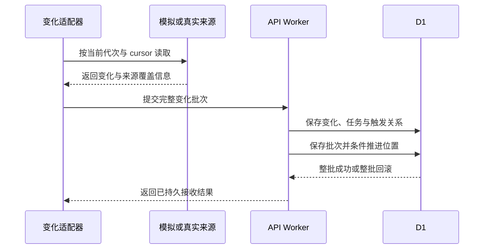
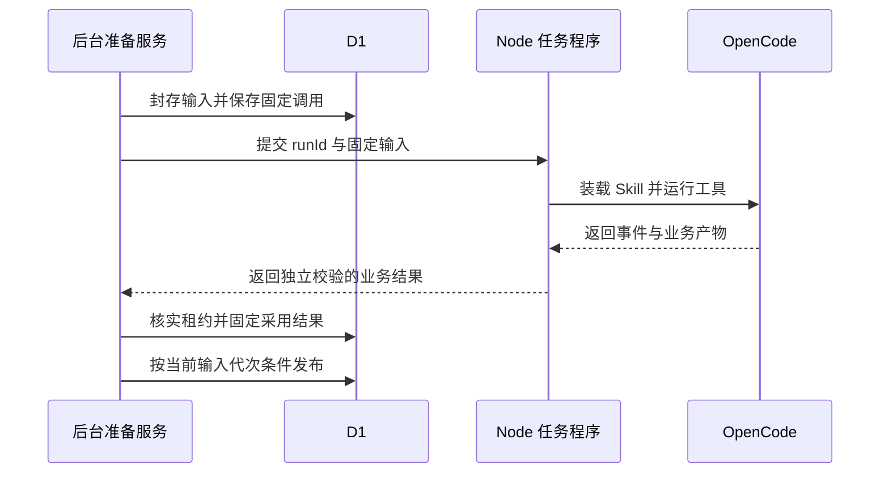

# 来源变化、自动准备与 Skill 分析

> 状态：foundation 系统设计；任务与 OpenCode 尚未实现
> 图：[变化与分析时序图](sys-analysis-preparation.html)
> 上游（我引用）：[后台接口](../03-06-provided-apis/execution-apis.md) §1—5、[对账接口](../03-06-provided-apis/reconciliation-apis.md) §1—3、[执行表结构](../03-05-schema/execution-schema.md) §2—5、[AI 契约](../03-02-external-apis/ai-inference-material-parsing.md) §2—5、[evidence-schema](../03-05-schema/evidence-schema.md) §8
> 下游（引用我）：[foundation 总核对](../coverage-review.md) §2—4

## 1. 变化接收

变化适配器用已授权 SERVICE 按 feed 当前代次与 cursor 读取外部真实或模拟接口。调用 change-batches 后，API 在同一事务中完成：固定 source_change、创建或核对 background_job、保存 job_change_trigger、完整 change_batch、按旧 cursor 和 row_version 推进 change_feed_generation。条件零行通过事务断言使整批失败。

非空批必须保留原顺序与逐条内容；重复变化同号同内容复用，内容冲突暂停。空批不推进；coverageThrough、sourceCheckedAt 和本地 retrievedAt 分别保存。关联未知先保存 DISCOVER_RELATIONS 任务；共享资料须覆盖全部已授权关联，不能只处理第一个工单。旧来源无版本历史时只承诺当前状态扫描。

## 2. 输入准备与运行

调度服务按条件领取任务并记录执行尝试，重新核实程序动作和范围后调用工单、订单权益、服务商格式、材料或账单依据接口。按业务类型选择所需来源，不因有 mock 开关而跳过真实转换和计算。

材料先取得确切完整字节，核对版本及摘要后保存 VERIFIED；解析能力调用固定 source_material_version。解析不足保留失败单元与缺项，不能只选成功页面。准备服务根据四类业务规则选择实际输入项与适用配置，先写 analysis_input_item，最后封存 analysis_input_snapshot，并同事务登记 capability_call 及后台工作。

API 经受控 HTTP 向 Node 任务程序提交 agent-run。Node 固定工作目录、Skill 包、输入、允许工具与模型配置，启动 OpenCode，采集进程状态与产物。运行真实读取/解析/工具调用；JSON 事件流不能直接当作业务结果。超时和失败遵循 AI 契约的预算，原 runId 重试可能再次计费。

## 3. 采用与发布

结果接收先检查实际 SERVICE、当前 leaseToken/epoch/时效，再校验 runId、固定输入、结构版本、完整性、证据定位与输出。校验失败记录尝试及原因；合法缺项保留 NEEDS_INFORMATION。采用结果与执行状态同事务固定，一个 runId 只采用一份。

发布时重新取得事项：当前输入代次、实际来源和配置指纹必须匹配，事项未完成、任务仍有发布权。普通进展引起的 row_version 变化只需重读并重新条件更新；实际输入变化则保留旧结果但不发布。发生输入变化时增加 analysis_generation 并同次清空旧指针、安排新输入任务。

已采用结果的发布失败仅安排 CONTINUE_LOCAL，不重跑模型。资料整理发布真实草稿；核查发布证据与问题；对账先由程序保存比较结果再发布解释；配置发布候选并自动安排试转换。任何结果均不自动记成人员确认。

## 4. 兜底与验收

| 情况 | 保存与恢复 |
| --- | --- |
| 收批后中断 | 已提交则从任务恢复；未提交按原 cursor 重读 |
| 租约失效 | 旧执行者停止发布，接管者按任务种类恢复；不把失联当作调用未发生 |
| 原文/权限不足 | 保持缺项或阻断；不以模拟文件、摘要或旧授权补齐 |
| 两代输入逆序返回 | 仅当前代次可发布，旧结果留历史 |
| 补充已成功但分析失败 | 回复事实不变，恢复分析，不要求重复提交 |
| 模型返回错误 | 标记实际失败，不切换固定答案；记录非敏感执行信息 |

后续运行验收须观察服务商材料变化后无须人员点运行按钮即可生成新结果，并核对证据和版本。设计与本地 SQL 约束不证明模型或真实后台任务已经执行。

## 图示结构

## 5. 成功回复触发的新输入

源端成功后的 CONTINUE_LOCAL 原子保存回复成功标记、责任交接、原事项输入代次递增及 PREPARE_INPUT 任务。准备服务按 AI 契约 §2.3.1 与证据表结构 §8，将原退回问题、成功回复 RECORD、附件确切解析以及重新核实的方案/正式明细一起封存。没有附件的文字回复也必须进入 records；回复不能覆盖原问题或正式明细。写入未决、拒绝或仅HTTP202的回复不得作为成功补充加入输入。重复接续复用成功事实和任务，不再增加代次。

以角色走查：服务商回复一次即可；准备或模型失败仅后台恢复，核查人看到新结果后继续同一事项，任何角色都不被要求重新提交已经成功的回复。
