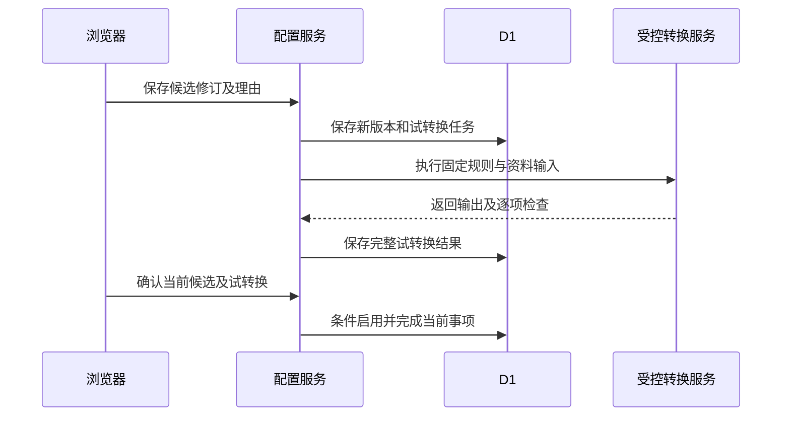
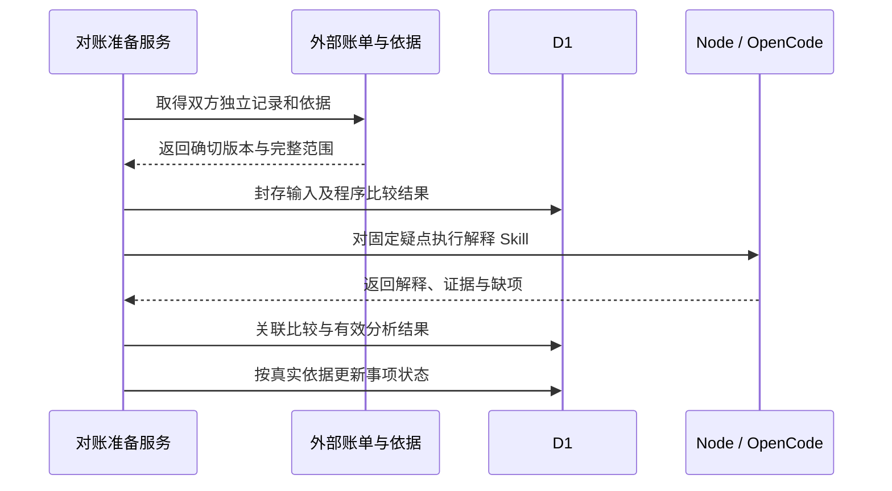

# 配置试转换与业务对账计算

> 状态：foundation 系统设计；转换与计算服务待实现
> 图：[配置与对账时序图](sys-configuration-reconciliation.html)
> 上游（我引用）：[配置接口](../03-06-provided-apis/configuration-apis.md) §1—3、[对账接口](../03-06-provided-apis/reconciliation-apis.md) §1—3、[配置表结构](../03-05-schema/integration-config-schema.md) §2—7、[对账表结构](../03-05-schema/reconciliation-schema.md) §2—7
> 下游（引用我）：[foundation 总核对](../coverage-review.md) §2—4

## 1. 配置试转换

配置 Skill 产生带依据的候选；配置服务保存 integration_config_version 与事项候选指针，并创建 TRIAL_CONFIG 任务。人工修订也保存固定新版本并自动安排任务，浏览器无需另行启动。生效版本仍由 integration_config.current_version_id 指向。

转换服务仅执行已登记 rule_catalog_version 下允许的声明式规则，读取确定资料快照，保存 configuration_trial 的输出、逐规则结果、缺项和检查详情。字段含义未明确、单位或范围未知、输入覆盖不足时不能写 PASSED。只做前端预览或预填通过标记不成立。

启用接口依据当前候选和试转换保存确认、启用及结果，条件切换配置指针，并完成当前配置事项。所有条件同事务检查；失败保留旧生效配置和候选。启用后后台只对实际受影响范围安排准备任务，固定旧历史继续保留。

## 2. 双方费用比较

变化或核实回复触发 RECONCILE 任务。服务读取独立京东账单、服务商应收、适用计费条款和批准记录；核实记录范围、币种、版本及已确认的项目对应关系，封存实际输入。

程序用十进制计算分项和分组，再保存 reconciliation_record 及其 groups_json；原分项保持独立，不以相同名称强行匹配。计算状态、输入完整性和“是否所有问题已核实”分别保存。无费用差异且范围、对应和依据均完整时按业务条件保存 RECONCILED 完成事实，无须额外人工批准。

存在疑点时由 billing-diff-explainer 对固定输入查找并解释依据，结果保存后更新事项。费用核实问答保存原问题与具体回复；取得真实应收新版后重新比较。程序不因对方曾报某数而自动改京东账单。

## 3. 失败与必要性

| 情况 | 接续 |
| --- | --- |
| 候选被修订，旧试转换晚到 | 保存旧试转换历史，不准其启用新候选 |
| 试转换完成但启用条件已变化 | 409，整批回滚；不要求无变化时重复审批 |
| 费用总额相同但分项未覆盖 | 保留未解决项目，不自动完成 |
| 依据适用未知或原记录缺失 | 保留缺项，不能把未查到批准记成已拒绝 |
| 对账计算完成而 AI 失败 | 保留程序比较事实，只恢复解释任务 |
| 应收已修订但通知未到 | 按来源变化与补查能力取得新版，不凭回复文字造账 |

配置对接人员只处理映射含义和试转换结果；对账角色只核实实际疑点。后续验收以不同服务商格式、正常与差异账单、并发候选和版本变化验证，不增加上传重复资料或手动选择 Skill 的日常步骤。

## 图示结构

