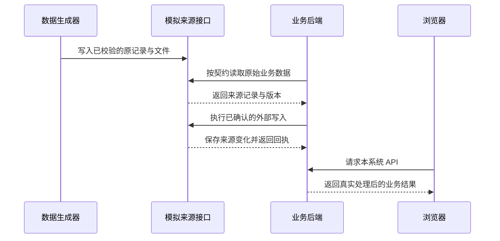
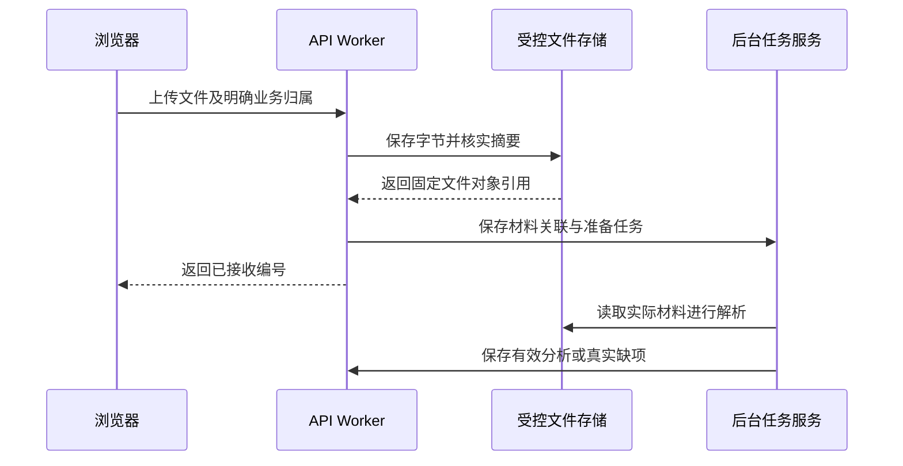

# 模拟来源与实际文件验证链路

> 状态：foundation 系统设计；模拟服务、生成器与上传实现待建设
> 图：[模拟来源与上传时序图](sys-mock-upload.html)
> 上游（我引用）：[运行数据规则](../../../rules/runtime-mock-data.md) §1—4、[mock 数据 PRD](../../05-prd/00-subprd-mock-data.md) §1—7、[材料接口](../03-06-provided-apis/material-apis.md) §1—3、[后台接口](../03-06-provided-apis/execution-apis.md) §1—5
> 下游（引用我）：[foundation 总核对](../coverage-review.md) §2—4、[00-subprd-mock-data.md](../../05-prd/00-subprd-mock-data.md) §2.3、§6；[mock T3.1子计划](../../07-delivery-plans/sub-delivery-plan-jd-charging-mock-T3.1-faults-environments.md) PRD双链·读

## 1. 模拟业务来源

开发数据生成器按版本、固定种子与参数生成多服务商原记录和实际材料文件，校验关联、金额、时间与版本后写入独立模拟来源存储。EXTERNAL_MODE=mock 时依赖适配器调用 code/mocks 对应模拟接口，真实模式使用相同业务契约的实际提供方适配。

本系统后台真实读取、转换、计算、安排分析与保存业务状态；前端只请求本系统 API。模拟源的写接口更新来源记录和版本，变化接口随后返回实际变化。前端不能导入种子 JSON、生成随机事项、预填 AI 结论或拦截响应代替后端流程。

常规联调的初始规模和数据闭环由独立 mock PRD 约束。快速检查集与常规集分开；不能拿少数服务商的固定记录证明分页、权限和批量处理已成立。

## 2. 上传实际服务商材料

浏览器通过 uploads 接口传文件；API 核实身份、当前责任、服务商和用途，验证实际格式及大小，保存字节后核对摘要。再把接收编号、固定文件版本、用途、归属、替换关联和任务同事务登记，返回已持久接收的编号。

上传不改变原系统账单，也不自动完成补充提交。资料准备从受控存储读取真实字节，经解析和本地 OpenCode 业务 Skill 产生结果。已有京东账单或合同不足时保持缺项，不给上传文件自动编造配套凭证。

AI_MODE=real 使用真实运行；AI_MODE=mock 只供流程检查且标明结果来源。每个验证环境绑定一份数据集及配对的模拟来源、本系统测试库、文件和任务空间。恢复初始数据时另建完整环境，后台经外部接口重新导入，检查通过后切换；旧任务和迟到结果不能写入新环境。含实际上传资料的环境不清空，完整保留其文件、关联及处理记录。文件保存成功但数据库失败时，未引用对象由受控清理任务处理。

## 3. 验收与不增加的操作

对同一服务商实际文件修改后重新上传，核对新版本、输入代次、真实解析、判断依据、人工处理和重新读取。多人访问、共享材料、权限撤销与大文件失败也须有实际记录。

业务人员使用现有资料入口上传并处理结果；生成、重置和切换验证模式由开发工具完成，不要求业务人员为联调去配置假数据。当前文档只约定功能链路，尚无运行验收结论。

## 图示结构

