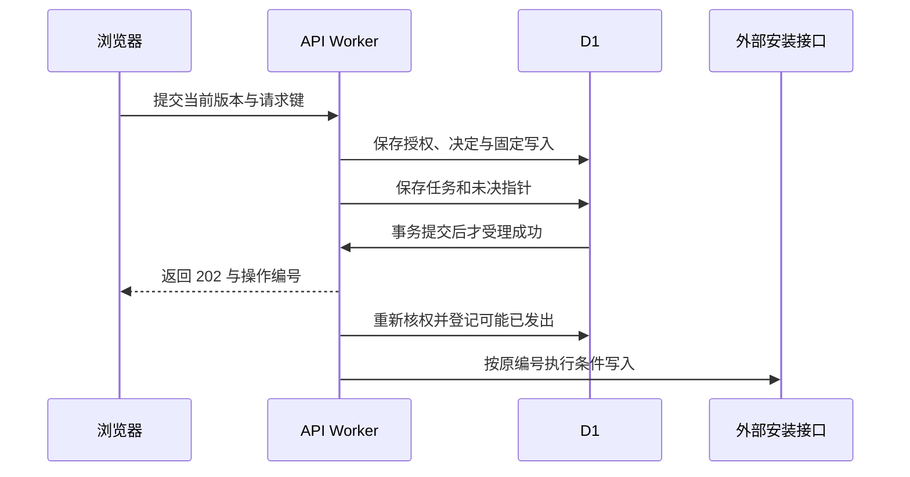
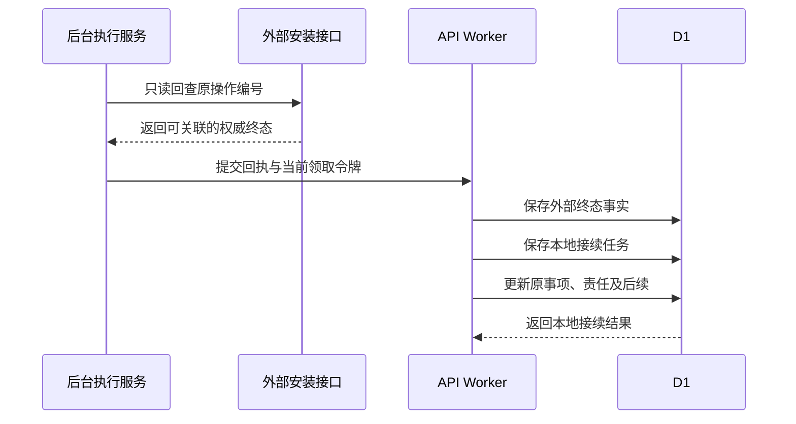

# 人员确认、事务与外部写入恢复

> 状态：foundation 系统设计；业务服务与 D1 运行待验证
> 图：[确认与恢复时序图](sys-transactions-recovery.html)
> 上游（我引用）：[安装接口](../03-06-provided-apis/installation-apis.md) §1—4、[协同异常接口](../03-06-provided-apis/coordination-apis.md) §1—4、[后台接口](../03-06-provided-apis/execution-apis.md) §1—5、[表结构总核对](../03-05-schema/coverage-review.md) §2—4
> 下游（引用我）：[foundation 总核对](../coverage-review.md) §2—4

## 1. 确认事务

API 验证当前身份与完整授权，重读确切事项、责任、候选、输入和来源状态；比对客户端预期版本，后端组装确认内容。先查询主体/目标/请求键的幂等记录，同内容返回原受理结果，冲突拒绝。

在同一受控事务内：保存本次授权项与上下文 → human_decision → external_write_operation（REGISTERED）→ 明细扩展（仅适用分支，同 operation id）→ WRITE_EXTERNAL 任务 → activity_record → 按旧事项/责任版本和允许状态设置 pending_write_id、PROCESSING 及 row_version → 紧随事务断言。任何语句失败全部回滚，202 只在持久提交后返回。

同一工单不同事项、明细/审核/补充入口共享未决唯一保护。应用不得只先查“没有未决”再无条件插入；数据库索引处理最终竞争。业务确认不自动补造当前责任或新审批。

## 2. 写出与终态

后台领取后核实 SERVICE 身份，按已保存决定受控重新核实原 HUMAN 当前权限和原账号，确认源端条件版本。保存尝试的授权依据与 MAY_HAVE_BEEN_SENT 后再调用外部接口。源端应按原稳定编号和固定正文执行条件写入。

权威回执匹配后，将 external_write_operation 置 SUCCEEDED 或 REJECTED 并固定完整回执。超时、响应丢失、部分结果保持 RESULT_UNKNOWN 与未决保护。REJECTED 须证明未生效，不能由网络错误推定。

成功事实先可靠保存，后续由 CONTINUE_LOCAL 接续业务：更新补充成功标记、清理未决指针、责任交接、输入代次或完成原因，保存后续事项及关系。只有本地接续成功后页面才显示对应本环节完成；外部成功与本地处理中可同时成立。

## 3. 未知结果与恢复

| 当前事实 | 后台行为 | 禁止动作 |
| --- | --- | --- |
| 明确尚未发出 | 按原编号、固定正文和当前权限恢复 | 换编号忽略旧确认 |
| 可能已发出、无终态 | QUERY_EXTERNAL 按原编号回查 | 重发新写入、删除未决保护 |
| 人员撤权但旧结果未知 | 有权程序仅回查旧操作 | 用 SERVICE 权限新增业务写入 |
| 原系统已成功，本地失败 | CONTINUE_LOCAL 恢复本地 | 再次提交原系统 |
| 旧执行者晚到 | 保留诊断，由有权当前尝试核实终态 | 旧 token 更新当前任务或业务状态 |

回查不到不必然证明未发生。来源没有可靠回查能力时保持阻断并登记该接入限制；不得用一般工单查询的“未出现”将结果未知改为失败。

## 4. 本地事务与停止

配置启用、费用问答、记录进展和协调完成无需伪装成外部安装写入，使用本地事务保存对应决定或记录。配置启用同时检查当前候选/试转换、责任、事项状态和配置旧版本，任何变化整批回滚。

异常关闭将确切后续事项/关联与关闭原因同时保存；复用已存在正确事项，不复制一份所有角色都得处理的新待办。停止须取得确切来源依据且无未决写入；不得因解析失败、暂时无权或缺失记录直接停止业务。

## 5. 运行验收点

必须执行：并发重复确认；同工单不同入口；同键改正文；责任交接后的旧页面；已完成事项旧确认启用；候选变化；批次中间语句失败；条件更新零行；响应丢失；租约失效；权限撤销；成功后本地接续失败。逐一回查决定、任务、来源记录和当前事项，不能只检查 HTTP 码。

事务断言设计与本地 SQLite 反例已纳入 schema 检查；完整 API、D1 batch 与外部模拟服务的联合运行在实现阶段验证。

## 图示结构

## 6. 安装核查的接续状态

安装审核和补充的状态投影、待分配与拒绝恢复以 [安装接口 §5](../03-06-provided-apis/installation-apis.md) 为准。202 后 PROCESSING，外部成功到本地接续完成前继续保持未决保护；退回接续完成才 WAITING_SUPPLEMENT，成功回复接续完成才增加输入代次并 PREPARING。服务商不因202多做一次提交，核查人不在补充同步中收到可审批按钮。
