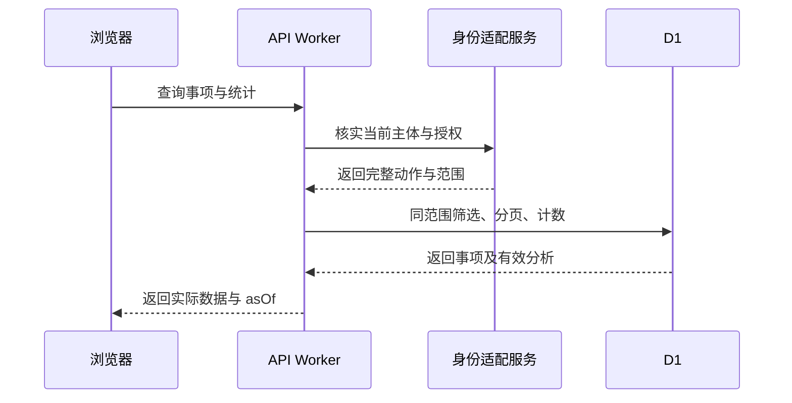
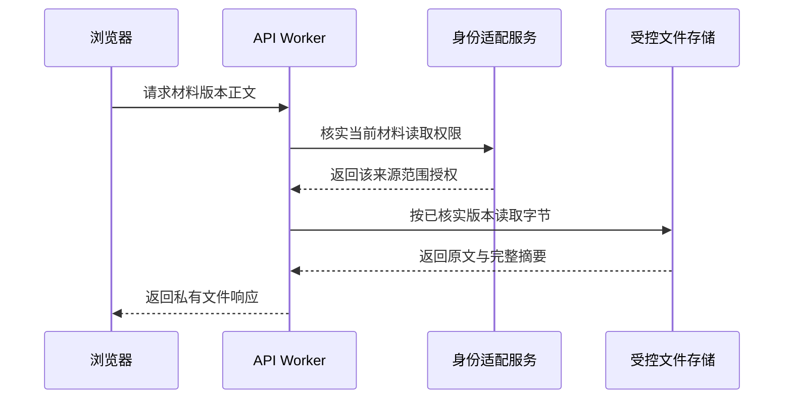

# 工作台查询与证据读取

> 状态：foundation 系统设计；运行实现待验证
> 图：[查询与读取时序图](sys-workbench-read.html)
> 上游（我引用）：[工作台接口](../03-06-provided-apis/workbench-apis.md) §1—5、[材料接口](../03-06-provided-apis/material-apis.md) §1
> 下游（引用我）：[foundation 总核对](../coverage-review.md) §2—4

## 1. 链路与组件

浏览器调用 session、providers、work-items/summary、work-items 和详情接口。API Worker 通过身份适配取得当前可信授权，将具体主体、允许动作和范围传入查询服务；服务先过滤可见范围，再在 D1 对 work_item、service_provider、analysis_result、activity_record 等作分页和聚合。

事项详情只关联当前有效结果。无材料/账单权限时不返回相应分析正文或隐藏字段，只返回明确的受限说明；不得先完整返回再用前端隐藏。文件请求经 API 再查当前 READ_SOURCE_MATERIAL，按 source_material_version 的固定对象引用读取受控存储，校验实际版本和摘要后响应。

## 2. 一致性与兜底

| 环节 | 判断与失败行为 |
| --- | --- |
| 身份核实 | 失败返回 401/503，不返回假空列表；历史授权不能继续放行 |
| 范围解析 | 无法完整解释返回待核实；分页与统计使用同一范围条件 |
| 当前分析 | 指针为空显示 PREPARING 或阻断原因；不读取别的事项结果填空 |
| 统计/列表 | asOf 表示各次读取时间；跨请求变化可重新查询，禁止前端从当前页推算总量 |
| 材料正文 | 每次检查实际权限与固定版本；缺失、受限、摘要不符分别报告，不能换成最新版静默展示 |
| 查看历史 | 固定历史保留原主体与依据，但访问仍按当前授权；不提供公开文件地址 |

查询路径无业务写入与 Skill 触发。后台已准备好的结果使人员打开工作台后直接处理；主动刷新只重查状态，不重复创建任务。

## 3. 验收走查

核查人员查看核查事项及证据，服务商资料人员只看本方授权工单；业务对账人员及应收负责人按整张账单范围读取，对接人员查看配置候选，履约人员不被要求读取无关安装分析。测试直接访问他人 id、共享材料单独权限、空列表、准备中及来源失败，核对页面、API 和数据库。当前仅完成设计。

## 图示结构

## 4. 工单聚合与列表摘要

工单列表/详情使用工作台接口 §6 的 work-orders 路径，先核实 READ_WORK_ORDER，再读取工单当前上下文及同工单可见事项集合。详情的购买权益由后台经受控只读适配调用取得并校验工单关联及版本；失败与权限不足明确返回部分不可用，不伪造本地已存权益。所有查询均不触发Skill或业务写入。

RECONCILIATION 列表在服务端按同页有权记录批量关联 current_reconciliation_id 和问题关闭依据，返回工作台接口 §7.2 的摘要，不由浏览器逐行查询详情。查看工单、材料及账单分别核权，当前页计数不能充当全范围汇总。
